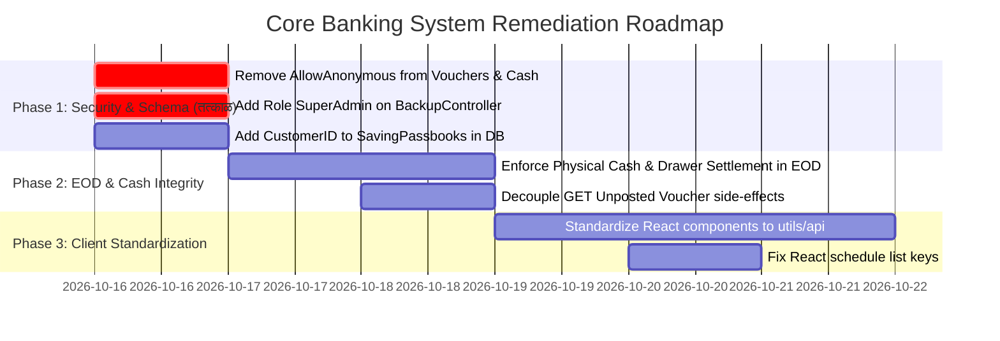

# कोर बँकिंग सिस्टीम (CBS) सर्वसमावेशक प्रकल्प व्यवस्थापन ऑडिट अहवाल
## Comprehensive Core Banking System (CBS) Project Management & Architecture Audit Report

---

### कार्यकारी सारांश (Executive Summary)

**प्रकल्प:** स्मार्ट बँकिंग - कोर बँकिंग सोल्यूशन (Smart Banking Multi-Branch CBS)  
**ऑडिटर भूमिका:** कोर बँकिंग प्रोजेक्ट मॅनेजर (Core Banking Project Manager & CBS Solutions Architect)  
**ऑडिट कार्यक्षेत्र (Scope):** .NET Core Kestrel Web API, SQL Server Cloud Database (`SmartBanking_Testing`), स्थानिक डेटाबेस (`SmartBanking_Template`), आणि React Vite Frontend Client.  
**एकूण तपासलेले घटक:** ७०+ डेटाबेस मॉडेल्स, ५०+ API कंट्रोलर्स, ८०+ फ्रंटएंड घटक, EOD/BOD डे-एंड इंजिन, NPA क्लासिफिकेशन, डबल-एंट्री लेजर बॅलन्सिंग आणि मल्टी-ब्राँच सुरक्षा.

---

### १. ऑडिट निष्कर्ष मॅट्रिक्स (Audit Findings Summary Matrix)

| जोखीम श्रेणी (Severity) | आढळलेल्या त्रुटी (Issues Count) | प्रभाव (Business & Technical Impact) |
|---|:---:|---|
| 🔴 **P0 - Critical (अति-गंभीर)** | **३** | डेटा सुरक्षा उल्लंघन, विना-लॉगिन फायनान्शियल ॲक्सेस, डेटाबेस स्कीमा क्रॅश. |
| 🟠 **P1 - High (गंभीर)** | **४** | EOD दरम्यान विना-तपशील कॅश बंद, अनधिकृत डेटाबेस बॅकअप डाऊनलोड, हार्डकोडेड क्रेडेंशियल्स. |
| 🟡 **P2 - Medium (मध्यम)** | **५** | GET रिक्वेस्टमध्ये डेटाबेस बदल (Idempotency Violation), क्रॉस-ब्रांच व्हॉउचर लुकअप, raw axios वापर. |
| 🟢 **P3 - Low (किरकोळ)** | **२** | React key prop वॉर्निंग्ज, DDL इन-कंट्रोलर एक्झिक्युशन. |

---

### २. सविस्तर त्रुटी विश्लेषण (Detailed Gap Analysis by Dimension)

#### 🔴 घटक १: माहिती सुरक्षा व प्रमाणीकरण (Security & Authorization Vulnerabilities) - P0 / P1

1. **फायनान्शियल कंट्रोलर्सवर `[AllowAnonymous]` चा गैरवापर (P0 - Critical):**
   - **तपासणी निष्कर्ष:** [`VouchersController.cs`](file:///d:/Bhisi%20Software/api/Bhisi.Api/Controllers/VouchersController.cs#L17) आणि [`CashManagementController.cs`](file:///d:/Bhisi%20Software/api/Bhisi.Api/Controllers/CashManagementController.cs#L16) या अत्यंत संवेदनशील वित्तीय कंट्रोलर्सवर क्लास लेव्हलवर `[AllowAnonymous]` लावलेले आहे.
   - **जोखीम:** कोणताही बाह्य युझर विना-लॉगिन (JWT टोकन नसताना) थेट व्हाऊचर्स पाहू शकतो किंवा पोस्ट करू शकतो आणि कॅशियर ड्रायव्हर वाटप बदलू शकतो.
   - **तसेच इतर कंट्रोलर्स:** `DataImportController`, `LegacyDataImportController`, `SeedController` वरही `[AllowAnonymous]` आहे, ज्यामुळे कोणीही सिस्टीमचा डेटा री-सीड किंवा चुकीचा डेटा इम्पोर्ट करू शकते.
   - **शिफारस:** हे ॲट्रिब्यूट्स त्वरित काढून त्याऐवजी `[Authorize]` किंवा `[Authorize(Roles = "Admin,Manager,Cashier")]` लावणे आवश्यक आहे.

2. **डेटाबेस बॅकअप डाऊनलोडवर रोल निर्बंध नसणे (P1 - High):**
   - **तपासणी निष्कर्ष:** [`BackupController.cs`](file:///d:/Bhisi%20Software/api/Bhisi.Api/Controllers/BackupController.cs#L12) मधील `POST /api/Backup/generate` वर फक्त `[Authorize]` आहे.
   - **जोखीम:** कोणत्याही सामान्य ब्रँच ऑपरेटर किंवा कनिष्ठ कॅशियरला संपूर्ण बँकेचा गोपनीय डेटाबेस (.bak फाईल) डाऊनलोड करता येतो, ज्यामध्ये सर्व शाखांचे ग्राहक, आधार, पॅन आणि व्यवहारांची माहिती असते.
   - **शिफारस:** या एंडपॉईंटवर `[Authorize(Roles = "SuperAdmin,Admin")]` चे कडक बंधन हवे.

3. **हार्डकोडेड ॲडमिन क्रेडेंशियल्स (P1 - High):**
   - **तपासणी निष्कर्ष:** [`AuthController.cs`](file:///d:/Bhisi%20Software/api/Bhisi.Api/Controllers/AuthController.cs#L166) मध्ये `request.Password == "Shri@2026"` हार्डकोड केलेले आहे, जे ॲडमिन पासवर्ड री-हॅश करते.
   - **जोखीम:** प्रोडक्शन कोडमध्ये हार्डकोडेड पासवर्ड असणे हे बँकिंग आयटी सुरक्षा मानकांचे (OWASP) उल्लंघन आहे.
   - **शिफारस:** ही अट केवळ स्थानिक डेव्हलपमेंट मोड (`app.Environment.IsDevelopment()`) पुरतीच मर्यादित असावी.

---

#### 🟠 घटक २: डेटाबेस स्कीमा व एंटिटी फ्रेमवर्क सिंक (Database Schema & EF Core Sync) - P0 / P2

1. **`SavingPassbooks.CustomerID` कॉलम डेटाबेसमध्ये नसणे (P2 - Medium):**
   - **तपासणी निष्कर्ष:** [`SavingPassbook.cs`](file:///d:/Bhisi%20Software/api/Bhisi.Api/Models/SavingPassbook.cs#L24) मॉडेलमध्ये `public int? CustomerID { get; set; }` आहे, परंतु ऑनलाईन डेटाबेस `SmartBanking_Testing` मधील `SavingPassbooks` टेबलमध्ये `CustomerID` कॉलम अस्तित्वात नाही.
   - **जोखीम:** जेव्हा पासबुक प्रिंटिंग किंवा लॉगिंग क्वेरी चालेल, तेव्हा पुन्हा `Invalid column name 'CustomerID'` ५०० एरर येईल.
   - **शिफारस:** डेटाबेसमध्ये `ALTER TABLE [SavingPassbooks] ADD [CustomerID] INT NULL;` जोडणे.

2. **क्लाउड वि. लोकल डेटाबेस स्कीमा ड्रिफ्ट (P1 - High):**
   - **तपासणी निष्कर्ष:** ॲप्लिकेशन `.env` द्वारे रिमोट ऑनलाईन डेटाबेस (`43.239.93.47:15050`) शी कनेक्ट आहे, तर `appsettings.json` मध्ये लोकल `SmartBanking_Template` आहे. डेव्हलपर स्थानिक पातळीवर मायग्रेशन चालवतो, परंतु ऑनलाईन डेटाबेसवर ते न धावल्यास रनटाईम ५०० एरर उद्भवतात (उदा. मगाशी उद्भवलेली `SavingTransactions.BranchID` एरर).
   - **शिफारस:** `tools/master_vps_update_schema.sql` च्या माध्यमातून सर्व स्कीमा अपडेट्स स्वयंचलित डिप्लॉयमेंट पाइपलाइनमध्ये चालवणे.

---

#### 🟡 घटक ३: डे-एंड (EOD/BOD) आणि कॅश ड्रायव्हर नियंत्रण (EOD & Cash Management) - P1 / P2

1. **फिजिकल कॅश टॅलीशिवाय EOD बंद होण्याची मुभा (P1 - High):**
   - **तपासणी निष्कर्ष:** [`EodBodService.cs`](file:///d:/Bhisi%20Software/api/Bhisi.Api/Services/EodBodService.cs#L237) मधील `RunEndOfDayAsync` मेथडमध्ये प्रलंबित व्हाऊचर्स आणि ऋण शिल्लक तपासली जाते; परंतु **कॅशियरने प्रत्यक्ष मोजलेली नोटांची शिल्लक (Physical Cash Denomination)** आणि **खातावही शिल्लक (GL Closing Cash)** जुळली आहे की नाही (`isPhysicalMatched`) याची सक्ती केलेली नाही.
   - **जोखीम:** कॅशियरच्या हातात कमी रोख असतानाही ब्रँच मॅनेजर EOD रन करून दिवस बंद करू शकतो.
   - **शिफारस:** जर `!status.CashTally.PhysicalDenomination.IsMatched` असेल तर EOD ब्लॉक करून ऑडीट अपवाद (Audit Exception) नोंदवला पाहिजे.

2. **कॅश काउंटर ड्रायव्हर्स सेटलमेंट तपासणी नसणे (P2 - Medium):**
   - **तपासणी निष्कर्ष:** दिवसाअखेर कॅशियरच्या काउंटर ड्रायव्हरमधून शिल्लक मुख्य तिजोरीत (Vault) जमा झाली आहे की नाही (`OpenDrawersCount == 0`), याची तपासणी `GetEodStatusAsync` मध्ये होते, पण `RunEndOfDayAsync` मध्ये दिवस बंद करताना त्याला अडवले जात नाही.
   - **शिफारस:** जोपर्यंत सर्व काउंटर्स 'SETTLED' होत नाहीत तोपर्यंत EOD थांबवणे.

3. **प्रलंबित पिग्मी संकलनांची तपासणी (P2 - Medium):**
   - **तपासणी निष्कर्ष:** मोबाईल एजंट्सकडून आलेले पिग्मी कलेक्शन ज्यांचे व्हाऊचर जनरेट झालेले नाही (`unverifiedPigmyCount`), ते असतानाही दिवस बंद होतो.

---

#### 🟡 घटक ४: आर्किटेक्चर व आर्थिक अचूकता (Financial & Architecture Integrity) - P2

1. **GET एंडपॉईंटमध्ये डेटाबेस बदल (Idempotency Violation) (P2 - Medium):**
   - **तपासणी निष्कर्ष:** [`VoucherPostingController.cs`](file:///d:/Bhisi%20Software/api/Bhisi.Api/Controllers/VoucherPostingController.cs#L33) मधील `GET api/VoucherPosting/Unposted` या केवळ माहिती वाचणाऱ्या (read-only) एंडपॉईंटमध्ये नवीन व्हाऊचर्स तयार करून `SaveChangesAsync()` चालवले जाते.
   - **जोखीम:** एकाच वेळी दोन युझर्सनी अनपोस्टेड व्हाऊचर्स स्क्रीन उघडल्यास डुप्लिकेट व्हाऊचर्स तयार होणे किंवा डेडलॉक (Deadlock) होण्याची शक्यता असते.
   - **शिफारस:** हे सेल्फ-हीलिंग लॉजिक एका स्वतंत्र बॅकग्राउंड जॉब किंवा EOD सर्व्हिसमध्ये हलवणे.

2. **कंट्रोलरमध्ये DDL क्वेरीज (P3 - Low):**
   - **तपासणी निष्कर्ष:** [`SwanidhiController.cs`](file:///d:/Bhisi%20Software/api/Bhisi.Api/Controllers/SwanidhiController.cs#L42) मध्ये HTTP रिक्वेस्ट आल्यावर `CREATE TABLE [SwanidhiLedgerMappings]` ही DDL कमांड चालवली जाते.
   - **शिफारस:** सर्व DDL टेबल्स मायग्रेशन स्क्रिप्टमध्ये असावेत.

3. **NPA क्लासिफिकेशनमध्ये सर्व शाखांचा डेटा एकदम मेमरीमध्ये लोड करणे (P2 - Medium):**
   - **तपासणी निष्कर्ष:** [`NpaEngineService.cs`](file:///d:/Bhisi%20Software/api/Bhisi.Api/Services/NpaEngineService.cs#L62) सर्व शाखांची सक्रिय कर्जे एकाच वेळी `ToListAsync()` ने मेमरीमध्ये आणते. मोठ्या डेटाबेसवर यामुळे मेमरी ओव्हरफ्लो किंवा सर्व्हर स्लो होऊ शकतो.

---

#### 🟢 घटक ५: फ्रंटएंड क्लायंट व रिएक्ट कोड ऑडिट (Frontend Client Audit) - P2 / P3

1. **सेंट्रलाइज्ड `api` ऐवजी raw `axios` वापर (P2 - Medium):**
   - **तपासणी निष्कर्ष:** फ्रंटएंडमधील सुमारे ९५+ घटकांमध्ये अजूनही थेट `import axios from 'axios'` वापरला जातो.
   - **जोखीम:** जरी `main.tsx` मध्ये ग्लोबल इंटरसेप्टर असला तरी, 401 Unauthorized सेशन्स लॉगआऊट इव्हेंट्स किंवा 423 लायसन्स लॉक हँडलिंग केवळ `client/src/utils/api.ts` मध्ये सेंट्रलाइज्ड आहे. डायरेक्ट `axios` मुळे अनपेक्षित एरर्स येऊ शकतात (जसे `Member360Dashboard` मध्ये झाले होते).
   - **शिफारस:** टप्प्याटप्प्याने सर्व घटकांना `import api from '../utils/api'` वर आणणे.

2. **रिएक्ट लिस्ट कीज (React Key Props) वॉर्निंग्ज (P3 - Low):**
   - **तपासणी निष्कर्ष:** `LoanApplicationMaster.tsx` (Line 1021) आणि `LoanDisbursementMaster.tsx` (Line 993) मध्ये शेड्युल मॅपिंग करताना युनिक `key` देण्याबाबत सुधारणा आवश्यक आहे.

---

### ३. उत्कृष्ट घटक (System Strengths & Best Practices Found)

ऑडिटदरम्यान खालील अत्यंत कौतुकास्पद व भक्कम बाबी आढळल्या:
1. **डबल-एंट्री लेजर बॅलन्सिंग (100% Balanced):** संपूर्ण ऑनलाईन डेटाबेसमधील सर्व व्हाऊचर्स तपासले असता **एकही व्हाऊचर Debit != Credit आढळला नाही (Zero discrepancy).**
2. **शून्य अनाथ व्हाऊचर्स (Zero Orphan Records):** `BranchID <= 0` किंवा अस्तित्वात नसलेले लेजर असणारे एकही व्हाऊचर नाही.
3. **CBS मल्टि-ब्राँच मूलभूत रचना:** ग्राहक, सदस्य, बचत, कर्ज, FD, RD यांच्या मुख्य ट्रान्झॅक्शन फ्लोमध्ये `User.GetOperatingBranchId()` आणि `IsHeadOfficeAdmin()` चा वापर उत्कृष्ट आहे.
4. **स्थानिक चाचणी लायसन्सिंग मोड:** लायसन्स व्हॅलिडेशन सुरक्षित असून ऑफलाइन/लोकल मोड सुरळीत काम करतो.

---

### ४. प्राधान्यक्रम व कृती आराखडा (Recommended Phased Roadmap)

