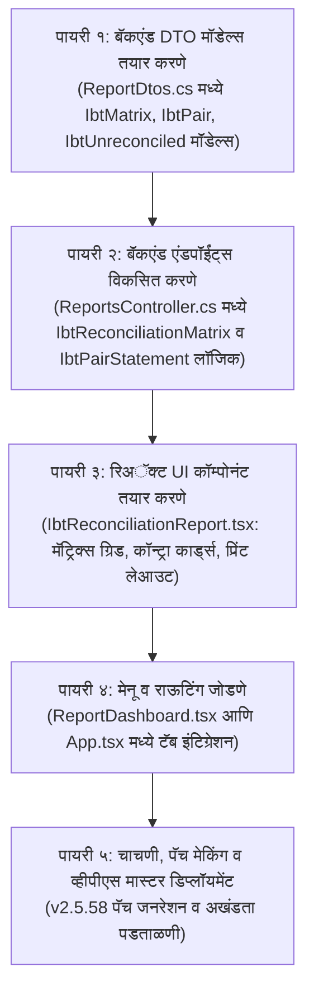

# 🏛️ कोअर बँकिंग सिस्टीम (CBS) — घटक क्र. ९ अंमलबजावणी आराखडा (Implementation Plan)
## आंतर-शाखा ताळमेळ व क्लिअरिंग मॅट्रिक्स अहवाल (Inter-Branch Transfer Clearing & Reconciliation Matrix Report)

---

### 📌 १. पार्श्वभूमी व बँकिंग आवश्यकता (Context & Banking Rationale)

#### अ. सद्यस्थिती व प्रगती (Current State):
* सिस्टीममध्ये **v2.5.56** व **v2.5.57** द्वारे कर्ज वसुली, बचत ठेव/उचल, पिग्मी विड्रॉल/क्लोजर, आरडी हप्ता/क्लोजर आणि मुदत ठेव (FD) या सर्व प्रमुख व्यवहारांमध्ये **आंतर-शाखा IBT ड्युअल-व्हाउचर इंजिन (Dual-Voucher Engine)** पूर्ण क्षमतेने सुरू करण्यात आले आहे.
* काऊंटर शाखेत पेमेंट किंवा रिसिप्ट व्हाउचर पडताना मूळ शाखेत संलग्न जर्नल व्हाउचर आपोआप तयार होते आणि दोन्हींना `RelatedVoucherID`, `IsIbtVoucher = true` व `TargetBranchID` ने जोडले जाते.
* जनरल लेजर (GL) मध्ये IBT च्या सर्व नोंदी तंतोतंत पडत आहेत आणि एकत्रित ताळेबंदावर (Consolidated Balance Sheet) डेबिट व क्रेडिट परस्पर संतुलित होऊन फरक शून्य (₹०.००) राहतो.

#### ब. सद्य त्रुटी व आवश्यकता (The Critical Missing Piece - 20% to 100%):
* **१-स्क्रीन मॅट्रिक्सचा अभाव:** व्यवस्थापक, मुख्य कार्यकारी अधिकारी (CEO) किंवा वैधानिक लेखापरीक्षक (Auditor) यांना जर हे पाहायचे असेल की:
  > *"आज अखेर मुख्य शाखेचे (शाखा १) पडवळवाडी उप-शाखेकडून (शाखा २) किती रुपये येणे (Receivable) किंवा देणे (Payable) आहे?"*  
  > *"दोन्ही शाखांच्या पुस्तकातील IBT रकमा समोरासमोर (Contra) पैशा-पैशाने जुळतात का?"*  
  > *"मध्यंतरी एखादा व्हाउचर एका बाजूला मंजूर राहून दुसऱ्या बाजूला प्रलंबित (Pending / In-Transit) राहिला आहे का?"*
* **सध्याची गैरसोय:** यासाठी सध्या स्वतंत्र अहवाल नसल्याने ऑपरेटरला दोन्ही शाखांचे जनरल लेजर (GL) स्वतंत्रपणे काढून एक्सेलमध्ये समोरासमोर तपासावे लागते, ज्यामध्ये बराच वेळ वाया जातो आणि मानवी चुकीची शक्यता असते.
* **वैधानिक ऑडिट नियम (Statutory Banking Rule):** नागरी बँका व पतसंस्थांमध्ये सहकार खात्याचे ऑडिटर **"Inter-Branch Adjustment / Clearing Reconciliation Schedule"** ची अनिवार्य मागणी करतात. यामध्ये १ रुपयाचाही विसंगत फरक आढळल्यास ऑडिट रिपोर्टमध्ये गंभीर ताशेरे ओढले जातात.

---

### 🎯 २. प्रस्तावित १-स्क्रीन IBT मॅट्रिक्स अहवाल डिझाइन (UI & UX Architecture)

अहवाल मेनूमध्ये (`Reports -> अकाउंटिंग`) **"🔄 आंतर-शाखा ताळमेळ व क्लिअरिंग अहवाल (IBT Clearing & Reconciliation Matrix)"** या शीर्षकाखाली एक अत्याधुनिक, उच्च दर्जाचा व प्रतिसादात्मक (Responsive) १-स्क्रीन डॅशबोर्ड तयार केला जाईल.

```
┌────────────────────────────────────────────────────────────────────────────────────────────────────────────────────────┐
│ 🏛️ कोर बँकिंग सिस्टीम — आंतर-शाखा ताळमेळ व क्लिअरिंग मॅट्रिक्स (Inter-Branch Clearing & Reconciliation Report)       │
├────────────────────────────────────────────────────────────────────────────────────────────────────────────────────────┤
│ [तारीख: ०१/०४/२०२६ ते १५/१०/२०२६]   [शाखा: सर्व शाखा (Consolidated) ▼]   [स्थिती: सर्व / केवळ तफावत असणारे ▼]  [शोधा] [🖨️ प्रिंट] [📥 एक्सेल] │
├────────────────────────────────────────────────────────────────────────────────────────────────────────────────────────┤
│ 📊 आंतर-शाखा त्वरित स्थिती कार्ड्स (Executive KPIs):                                                                    │
│ ┌───────────────────────┐ ┌───────────────────────┐ ┌───────────────────────┐ ┌───────────────────────────────────────┐ │
│ │ एकूण आंतर-शाखा व्यवहार│ │ एकूण क्लिअरिंग उलाढाल │ │ समोरासमोर जुळलेली शिल्लक│ │ आंतर-शाखा तफावत (Discrepancy)         │ │
│ │         ३४२           │ │    ₹ ४२,८०,५००.००     │ │  🟢 ₹ ०.०० (तंतोतंत)  │ │  🟢 कोणतीही तफावत नाही (₹ ०.००)       │ │
│ └───────────────────────┘ └───────────────────────┘ └───────────────────────┘ └───────────────────────────────────────┘ │
├────────────────────────────────────────────────────────────────────────────────────────────────────────────────────────┤
│ 📑 टॅब १: शाखा-ते-शाखा १-स्क्रीन मॅट्रिक्स ग्रिड (N x N Clearing Matrix)                                              │
│ ┌───────────────────┬────────────────────┬────────────────────┬────────────────────┬─────────────────────────────────┐ │
│ │ शाखा (Branch)     │ १. मुख्य कार्यालय   │ २. पडवळवाडी उप-शाखा│ ३. बांबवडे उप-शाखा │ निव्वळ स्थिती (Net Position)     │ │
│ ├───────────────────┼────────────────────┼────────────────────┼────────────────────┼─────────────────────────────────┤ │
│ │ १. मुख्य कार्यालय │       ---          │   🟢 + ₹ १,५०,०००   │   🟢 - ₹ ८५,०००    │  🟢 ₹ ६५,००० येणे (Dr)           │ │
│ │ २. पडवळवाडी शाखा  │   🟢 - ₹ १,५०,०००   │        ---         │   🟢 + ₹ २५,०००    │  🔴 ₹ १,२५,००० देणे (Cr)         │ │
│ │ ३. बांबवडे शाखा   │   🟢 + ₹ ८५,०००    │   🟢 - ₹ २५,०००    │        ---         │  🟢 ₹ ६०,००० येणे (Dr)           │ │
│ ├───────────────────┼────────────────────┼────────────────────┼────────────────────┼─────────────────────────────────┤ │
│ │ एकूण ताळमेळ बेरीज │   🟢 ₹ ०.००        │   🟢 ₹ ०.००        │   🟢 ₹ ०.००        │  ⭐ संस्था पातळीवर शून्य (₹ ०.००)│ │
│ └───────────────────┴────────────────────┴────────────────────┴────────────────────┴─────────────────────────────────┘ │
├────────────────────────────────────────────────────────────────────────────────────────────────────────────────────────┤
│ 📑 टॅब २: शाखा जोडी समोरासमोर कॉन्ट्रा ताळमेळ (Pair-Wise Contra Drill-Down: उदा. मुख्य कार्यालय ⟷ पडवळवाडी शाखा)       │
│ • मुख्य कार्यालयाच्या पुस्तकात पडवळवाडी IBT शिल्लक: Dr ₹ १,५०,०००.०० (येणे)                                             │
│ • पडवळवाडी शाखेच्या पुस्तकात मुख्य कार्यालय IBT शिल्लक: Cr ₹ १,५०,०००.०० (देणे)                                         │
│ • समोरासमोर कॉन्ट्रा पडताळणी: ₹ १,५०,००० (Dr) + (- ₹ १,५०,००० Cr) = 🟢 ₹ ०.०० (तंतोतंत जुळले)                          │
│ [🔄 आंतर-शाखा सेटलमेंट व्हाउचर बनवा (Settle via Bank/HO)]                                                               │
├────────────────────────────────────────────────────────────────────────────────────────────────────────────────────────┤
│ 📑 टॅब ३: प्रलंबित / विसंगत व्हाउचर्स रडार (Unreconciled & In-Transit Radar)                                            │
│ (दोन्ही बाजू जुळत नसलेले, एका बाजूला Pending असलेले किंवा रक्कम विसंगत असणारे व्हाउचर्स येथे थेट लाल रंगात दिसतील)      │
│ • जर सर्व व्हाउचर्स जुळले असतील तर: "सर्व आंतर-शाखा व्हाउचर्स यशस्वीरित्या जुळले आहेत (Zero Unreconciled Entries) 🟢"    │
└────────────────────────────────────────────────────────────────────────────────────────────────────────────────────────┘
```

---

### 🧮 ३. लेखांकन ताळमेळ सूत्रे व नियम (Mathematical & Accounting Logic)

#### अ. शाखा जोडी समोरासमोर ताळमेळ सूत्र (Contra Reconciliation Equation):
दोन कोणत्याही शाखा $A$ आणि $B$ साठी:
$$\text{Net Position}_A(B) = \text{Opening Bal} + \sum \text{Dr Amounts} - \sum \text{Cr Amounts}$$
$$\text{Net Position}_B(A) = \text{Opening Bal} + \sum \text{Dr Amounts} - \sum \text{Cr Amounts}$$

**अखंडता नियम (Invariable Rule):**
$$\text{Net Position}_A(B) + \text{Net Position}_B(A) = 0$$

* जर $\text{Sum} == 0$: **🟢 तंतोतंत जुळले (Matched & Reconciled)**
* जर $\text{Sum} \neq 0$: **🔴 आंतर-शाखा तफावत (Discrepancy / In-Transit Out of Balance)**
  * उदा. $\text{Difference} = \text{Net Position}_A(B) + \text{Net Position}_B(A)$ हा फरक नेमका कोणत्या व्हाउचरमुळे आला हे टॅब ३ मध्ये हायलाइट होईल.

#### ब. संस्था पातळीवर कन्सॉलिडेटेड शून्य हमी (Consolidated Zero Net Sum):
सर्व शाखांच्या IBT लेजर्सची एकत्रित बेरीज नेहमी **शून्य (₹०.००)** असणे आवश्यक आहे:
$$\sum_{i=1}^{N} \sum_{j \neq i}^{N} \text{IBT}_{i \to j} = 0.00$$

---

### 🛠️ ४. तांत्रिक अंमलबजावणी घटक (Technical Implementation Components)

#### घटक १: बॅकएंड डेटा मॉडेल्स व DTOs ([ReportDtos.cs](file:///d:/Bhisi%20Software/api/Bhisi.Api/Models/ReportDtos.cs))
नवीन DTO वर्ग तयार करणे:
1. `IbtMatrixResponseDto`:
   - `Branches`: सर्व सक्रिय शाखांची यादी (`BranchID`, `BranchName`, `BranchCode`).
   - `MatrixCells`: प्रत्येक जोडीसाठी (`SourceBranchID`, `TargetBranchID`, `DebitAmount`, `CreditAmount`, `NetAmount`, `IsTallied`).
   - `Summary`: एकूण व्यवहार, एकूण टर्नओव्हर, एकूण तफावत, ताळमेळ स्थिती.
2. `IbtBranchPairStatementDto`:
   - दोन शाखांमधील निवडलेल्या कालावधीतील सर्व व्हाउचर्सची तारीखवार यादी (`VoucherDate`, `CounterVoucherNo`, `HomeVoucherNo`, `Module`, `Amount`, `DrCr`, `CustomerName`, `AccountNo`, `Narration`, `Status`).
3. `IbtUnreconciledVoucherDto`:
   - ज्या व्हाउचरला `RelatedVoucherID` नाही किंवा स्टेटस जुळत नाही असे विसंगत व्हाउचर्स (`VoucherID`, `BranchID`, `VoucherNo`, `TargetBranchID`, `Reason`).
4. `IbtSettlementRequestDto`:
   - दोन शाखांमधील IBT बाकी रोख किंवा बँकेद्वारे सेटल करण्यासाठी इनपुट मॉडेल (`FromBranchID`, `ToBranchID`, `SettlementAmount`, `PaymentMode`, `BankLedgerID`, `Narration`).

#### घटक २: बॅकएंड एंडपॉईंट्स ([ReportsController.cs](file:///d:/Bhisi%20Software/api/Bhisi.Api/Controllers/ReportsController.cs))
1. **`GET /api/Reports/IbtReconciliationMatrix`**
   - **पॅरामीटर्स:** `fromDate` (DateTime), `toDate` (DateTime), `financialYearId` (int?)
   - **तर्क:**
     - सर्व शाखांची माहिती मिळवणे.
     - [IbtLedgerHelper.cs](file:///d:/Bhisi%20Software/api/Bhisi.Api/Helpers/IbtLedgerHelper.cs) द्वारे प्रत्येक शाखेचे IBT लेजर ओळखणे.
     - `BranchLedgerOpeningBalances` मधून सुरुवातीची शिल्लक घेणे.
     - `Vouchers` व `VoucherDetails` मधून `IsIbtVoucher == true` असणाऱ्या सर्व मंजूर व्हाउचर्सचे शाखानिहाय वर्गीकरण करणे.
     - $N \times N$ मॅट्रिक्स तयार करून Contra Difference कॅल्क्युलेट करणे.
2. **`GET /api/Reports/IbtPairStatement`**
   - **पॅरामीटर्स:** `branchAId` (int), `branchBId` (int), `fromDate`, `toDate`
   - **तर्क:**
     - शाखा A आणि शाखा B मधील सर्व थेट देवाणघेवाण व्हाउचर्सची समोरासमोर (Dual View) यादी देणे.
3. **`GET /api/Reports/IbtUnreconciledVouchers`**
   - **तर्क:**
     - विसंगत, अपूर्ण किंवा केवळ एकाच बाजूला तयार झालेले व्हाउचर्स शोधून काढणे.
4. **`POST /api/Reports/CreateIbtSettlement`**
   - **तर्क:**
     - मुख्य कार्यालयाला किंवा शाखा व्यवस्थापकाला दोन शाखांमधील थकीत IBT शिल्लक बँक किंवा रोख खात्याद्वारे १-क्लिकमध्ये सेटल करण्याचे व्हाउचर बनवण्याची सुविधा.

#### घटक ३: फ्रंटएंड कॉम्पोनंट ([IbtReconciliationReport.tsx](file:///d:/Bhisi%20Software/client/src/components/IbtReconciliationReport.tsx))
* आधुनिक UI, व्हिब्रंट कलर्स, डार्क-मोड सपोर्ट आणि मराठी/इंग्रजी द्विभाषिक लेबल्स.
* **कंट्रोल्स:**
  - तारीख निवडक (From Date, To Date).
  - शाखा जोडी सिलेक्टर्स.
  - झटपट स्टेटस फिल्टर: "सर्व", "केवळ तफावत असणारे", "केवळ सेटलमेंट बाकी असणारे".
* **दृश्य विभाग:**
  - ३ मुख्य टॅब: (१) $N \times N$ मॅट्रिक्स, (२) जोडीवार खतावणी व कॉन्ट्रा, (३) विसंगत व्हाउचर रडार.
  - कलर-कोडेड बॅजेस: 🟢 तंतोतंत जुळले, 🟡 प्रलंबित, 🔴 तफावत.
  - A4 लँडस्केप प्रिंट व CSV/एक्सेल एक्सपोर्ट पर्याय.

#### घटक ४: सिस्टीम मेनू इंटिग्रेशन
1. [ReportDashboard.tsx](file:///d:/Bhisi%20Software/client/src/components/ReportDashboard.tsx):
   - 'अकाउंटिंग (Accounting)' विभागात नवीन टाईल जोडणे:
     `{ id: 'ibt-reconciliation-report', name: '🔄 आंतर-शाखा ताळमेळ व क्लिअरिंग अहवाल (IBT Clearing & Reconciliation)' }`
2. [App.tsx](file:///d:/Bhisi%20Software/client/src/App.tsx):
   - रूट आणि टॅब मॅपिंग जोडणे:
     `{activeTab === 'ibt-reconciliation-report' && <IbtReconciliationReport />}`

---

### 🧪 ५. पडताळणी व चाचणी परिदृश्ये (Comprehensive Test Scenarios)

| चाचणी क्र. | परिदृश्य (Test Scenario) | अपेक्षित निकाल (Expected Outcome) |
| :---: | :--- | :--- |
| **१** | शाखा १ च्या काऊंटरवर शाखा २ च्या कर्जदाराने ₹५,००० भरले. | मॅट्रिक्समध्ये: शाखा १ Cr ₹५,००० / शाखा २ Dr ₹५,०००. समोरासमोर बेरीज = ₹०.०० (🟢 तंतोतंत जुळले). |
| **२** | शाखा १ च्या काऊंटरवर शाखा २ ची ₹२५,००० ची FD मोडली. | मॅट्रिक्समध्ये: शाखा १ Dr ₹२५,००० / शाखा २ Cr ₹२५,०००. कॉन्ट्रा तफावत = ₹०.०० (🟢). |
| **३** | एका शाखेचा व्हाउचर मंजूर (Approved) आहे पण काउंटरपार्ट Pending आहे. | विसंगत रडार (टॅब ३) मध्ये तातडीने लाल इशारा: "१ व्हाउचर प्रलंबित आहे, तातडीने मंजूर करा." |
| **४** | सर्व शाखांची कन्सॉलिडेटेड बेरीज पाहणे. | सर्व शाखांचे नेट रिझल्ट मिळून संपूर्ण संस्थेची IBT बेरीज ₹०.०० राहते. |
| **५** | तारीख बदलून मागील महिन्याचा ताळमेळ पाहणे. | निवडलेल्या तारखेनुसार अचूक Opening, Movement आणि Closing शिल्लक दिसेल. |
| **६** | शाखा ऑपरेटर लॉगिन असताना पाहणे. | [EnforceBranchScopeAttribute](file:///d:/Bhisi%20Software/api/Bhisi.Api/Helpers/EnforceBranchScopeAttribute.cs) मुळे ऑपरेटरला केवळ त्याच्या शाखेशी संबंधित शाखांचेच ताळमेळ दिसतील. ॲडमिनला सर्व शाखा दिसतील. |

---

### 📋 ६. अंमलबजावणीचा टप्प्याटप्प्याचा क्रम (Step-by-Step Implementation Roadmap)



---

### 💡 अंतिम शेरा व सज्जता:
हा अंमलबजावणी आराखडा पूर्ण झाल्यानंतर **कोअर बँकिंग सिस्टीम (CBS) मल्टी-ब्राँच क्षमता ९०% वरून १००% पूर्णत्वास जाईल**. यामुळे वैधानिक ऑडिटमधील आंतर-शाखा तपासणीचा मुद्दा कायमस्वरूपी निकाली निघेल.

*(सूचना: वापरकर्त्याच्या निर्देशानुसार सध्या कोणताही कोड करण्यात आलेला नाही; मंजुरी मिळाल्यावर वरील आराखड्यानुसार काम सुरू करता येईल.)*
