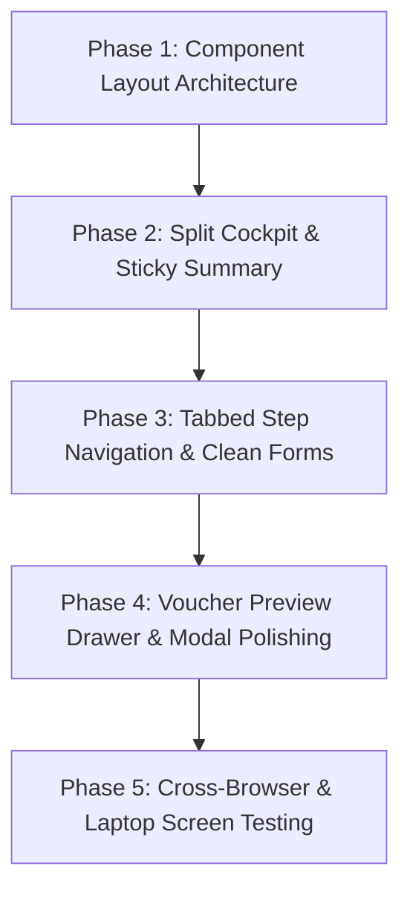

# 📋 मुदत ठेव क्लोजर आणि नूतनीकरण (FD Closures & Renewals) — थीम संरेखन व स्क्रोल-मुक्त कॉम्पॅक्ट UI पुनर्रचना आराखडा
## FD Closure & Renewal Component UI Redesign & Compact Cockpit Architecture Plan

**दस्तऐवज संदर्भ:** `CBS-UI-FD-2026-001`  
**घटक (Component):** `client/src/components/FdWithdrawalMaturity.tsx`  
**समस्या:**  
1. **थीम विसंगती (Theme Mismatch):** इतर CBS मॉड्यूल्सच्या (`CashierDashboard`, `DayEndDashboard`, `Member360`) तुलनेत जुनी, विसंगत रंगसंगती, असमान बॉर्डर्स व विस्कळीत हेडर.  
2. **अति-स्क्रोलिंग (Excessive Vertical Scrolling):** ४ पायऱ्या (Steps) एकाखाली एक उभ्या स्टॅक केल्यामुळे फॉर्म ३०००+ पिक्सेल लांब होतो; इनपुट बदलल्यावर अंतिम रक्कम व व्हाउचर पाहण्यासाठी वारंवार वर-खाली स्क्रोल करावे लागते.  
**उद्दिष्ट:** फॉर्म पूर्णपणे स्क्रोल-मुक्त (Minimal-Scroll) करण्यासाठी **२-कॉलम फायनान्शियल कॉकपिट (Split Cockpit Workspace)** तयार करणे व आधुनिक कोअर बँकिंग थीम लागू करणे (कोणताही कोड बदल न करता फक्त आराखडा).

---

## १. सध्याच्या रचनेमधील उणिवांचे विश्लेषण (Current Pain Points Analysis)

```
[ सध्याची ३२०० पिक्सेल लांबलचक उभी रचना (Current Vertical Waterfall) ]
+-------------------------------------------------------------------------+
| Top ERP Banner (साधे निळे हेडर)                                         |
+-------------------------------------------------------------------------+
| STEP 1: खाते निवड व तपशील (८ मोठे रंगीत बॉक्सेस, खूप जागा व्यापणारे)   |
|   - SearchableSelect + Member Info + Scheme + Tenor + 8 Metric Tiles    |
+-------------------------------------------------------------------------+
| STEP 2: कृती निवडा (परतावा / संपूर्ण नूतनीकरण / अंशतः नूतनीकरण)         |
|   - ३ मोठे उभे कार्ड्स (Large Vertical Cards)                            |
+-------------------------------------------------------------------------+
| STEP 3: सेटलमेंट, दंड, कपात, कर्ज वळती व पेआउट मोड (७००+ ओळींचा पसारा)   |
|   - व्याज गणना, स्लॅब्स, मॅन्युअल ओव्हरराइड, कर्ज यादी, बचत खाते वळती   |
+-------------------------------------------------------------------------+
| STEP 4: व्हाउचर पूर्वावलोकन व मंजुरी (३५०+ ओळींची मोठी टेबल)           |
|   - Dr/Cr रोव्ज, स्क्रोल नं., सबमिट बटण एकदम तळाशी (तळाशी स्क्रोल सक्ती) |
+-------------------------------------------------------------------------+
  ⬇️ वापरकर्त्याला १ व्यवहार करण्यासाठी सलग ३ ते ४ स्क्रीन खाली स्क्रोल करावे लागते!
```

### प्रमुख समस्या:
1. **अंतिम परतावा रक्कम (Net Payout) डोळ्यांसमोर नसणे:**
   - वापरकर्त्याने टप्पा ३ मध्ये व्याज दर, दंड किंवा कर्ज वळती बदलली, तरी त्याचा अंतिम रकमेवर काय परिणाम झाला हे पाहण्यासाठी त्याला पानावर एकदम खाली स्क्रोल करावे लागते.
2. **जागेचा अकार्यक्षम वापर (Wasted Screen Real Estate):**
   - मोठ्या डेस्कटॉप/लॅपटॉप स्क्रीनवर डावी-उजवी बाजू पूर्णपणे रिकामी राहून सर्व घटक फक्त एका उभ्या रांगेत खाली पसरलेले आहेत.
3. **CBS थीम विसंगती (Theme Incoherence):**
   - ॲप्लिकेशनच्या मुख्य डिझाईन सिस्टीममधील स्लीक कार्ड्स, सॉफ्ट शेड्स (`slate-50`, `slate-100`), आयकॉन बॅजेस, एकसमान इनपुट्स आणि टोकन्सचा अभाव.

---

## २. प्रस्तावित आधुनिक २-कॉलम कॉकपिट आर्किटेक्चर (Proposed 2-Column Cockpit Layout)

नव्या रचनेत संपूर्ण स्क्रीन **२ मुख्य स्तंभांमध्ये (Columns)** विभागली जाईल:
- **डावा स्तंभ (६०% रुंदी) — ऑपरेशनल इनपुट कॅनव्हास (Tabbed / Stepped Workspace)**
- **उजवा स्तंभ (४०% रुंदी) — स्टिकी फायनान्शियल कॉकपिट (Sticky Real-Time Settlement & Action Cockpit)**

```
+----------------------------------------------------------------------------------------------------+
|  🌟 MODERN CBS HEADER BANNER: मुदत ठेव क्लोजर व नूतनीकरण | शाखा: १ | तारीख: १६/१०/२०२६ | लाईव्ह स्थिती  |
+----------------------------------------------------------------------------------------------------+
|  ⚡ QUICK SEARCH BAR: [ SearchableSelect: पावती क्र., खातेदार किंवा CIF शोधा... ] [तारीख निवड]     |
+-----------------------------------------------------------------+----------------------------------+
| << डावा स्तंभ: इनपुट वर्कस्पेस (६०%) >>                         | << उजवा स्तंभ: स्टिकी कॉकपिट (४०%) >>
|                                                                 |  (नेहमी डोळ्यांसमोर - NO SCROLL) |
| [ टॅब १: ठेव व कृती ] [ टॅब २: कपात व व्याज ] [ टॅब ३: कर्ज/पेआउट] | +--------------------------------+
|-----------------------------------------------------------------| | 💰 लाईव्ह सेटलमेंट सारांश       |
|                                                                 | |   मुदत मुद्दल:      ₹ ५०,०००.०० |
| • संक्षिप्त खाते मॅट्रिक्स (Compact Account Strip):             | | + देय व्याज:        ₹  ६,२५०.०० |
|   ठेव: ₹ ५०,००० | दर: ८.५% | मुदतपूर्ती: १५/१०/२०२६ (मुदत संपली)  | | - मुदतपूर्व दंड:     - ₹   ०.०० |
|                                                                 | | - कर्ज वळती:        - ₹ ५,०००.०० |
| • कृती निवड (Segmented Modern Toggle Pills):                   | | ------------------------------ |
|   [ 🟢 मुदतपूर्ती परतावा ] [ 🟠 मुदतपूर्व ] [ 🔵 नूतनीकरण ]     | | 🎯 अंतिम देय रक्कम (NET PAYOUT): |
|                                                                 | |     ₹ ५१,२५०.००                 |
| • सक्रिय टॅबचे कॉम्पॅक्ट इनपुट्स:                               | |   (ठळक हिरवा बॅज - हायलाईट)    |
|   (उदा. टॅब ३ मध्ये: पेआउट मोड - रोख / बँक / बचत खाते)          | +--------------------------------+
|   (कर्ज वळती असल्यास: कर्ज खात्यांची संक्षिप्त यादी)           | | ⚖️ व्हाउचर बॅलन्स स्थिती:      |
|                                                                 | |   Dr ₹ ५६,२५० == Cr ₹ ५६,२५०   |
|                                                                 | |   [+] व्हाउचर खातावणी पाहा     |
|                                                                 | +--------------------------------+
|                                                                 | | 🚀 त्वरित कृती बटणे:           |
|                                                                 | | [ ✅ व्हाउचर सेव्ह व पोस्ट करा ] |
|                                                                 | | [ 🖨️ पावती प्रिंट ] [ 🔄 रीसेट ] |
+-----------------------------------------------------------------+----------------------------------+
```

---

## ३. तपशीलवार घटक फेररचना (Detailed Component Modularization)

### ३.१ वरची रिबन (Top Pinned Header & Quick Account Selector)
- **मानकीकृत CBS हेडर:**
  - `CashierDashboard` प्रमाणे `bg-primary px-4 py-3 text-white` सह `Coins/Layers` आयकॉन बॉक्स (`w-10 h-10 rounded-sm bg-white/15 border border-white/20`).
  - थेट उजव्या कोपऱ्यात: शाखा निवड, व्यवहार तारीख निवड, आणि तपासणी मोड (`Checker Mode Badge`) असल्यास ॲम्बर चेतावणी बॅज.
- **कॉम्पॅक्ट शोध पट्टी (Single-Row Account Search Strip):**
  - संपूर्ण स्क्रीन व्यापण्याऐवजी `SearchableSelect` एकाच ओळीत कॉम्पॅक्ट स्वरूपात.
  - खातेदाराच्या एकापेक्षा जास्त ठेवी असल्यास `खातेदाराच्या N ठेवी उपलब्ध ⚡` हे पॉपअप मोडल बटण शेजारीच.

### ३.२ डावा स्तंभ (Operational Input Tabs)

#### टॅब १: ठेव सारांश व कृती प्रकार (Overview & Action Selector)
- **संक्षिप्त खाते सारांश पट्टी (Compact Account Strip):**
  - पूर्वीचे ८ मोठे बॉक्सेस काढून एका स्वच्छ २-रांगेच्या ग्रिडमध्ये रूपांतर:
    - मुद्दल (Deposit Amount)
    - मंजूर व्याज दर (Interest Rate)
    - ठेव तारीख व मुदतपूर्ती (Opening & Maturity Date)
    - एकूण कालावधी व प्रत्यक्ष दिवस (Tenor & Active Days)
    - संचित व्याज (Accrued Interest)
    - खातेदार नाव, CIF क्र. व बचत खाते क्रमांक.
- **कृती निवडक (Segmented Action Pills):**
  - ३ अवाढव्य कार्डांऐवजी आधुनिक हॉरिझॉन्टल सेग्मेंटेड बटन्स:
    - `🟢 मुदतपूर्ती परतावा (Maturity Close)`
    - `🟠 मुदतपूर्व परतावा (Premature Close)`
    - `🔵 संपूर्ण नूतनीकरण (Full Renewal)`
    - `🟣 अंशतः नूतनीकरण (Partial Renewal)`

#### टॅब २: व्याज, कपात व नूतनीकरण तपशील (Interest, Penalties & Renewal)
- मुदतपूर्व असल्यास RBI स्लॅबनुसार लागू व्याज दर व दंडाचे संक्षिप्त प्रदर्शन.
- विलंबित व्याज (Overdue Interest) पर्याय (लागू करायचे असल्यास दर %).
- **नूतनीकरण पर्याय (जर Renewal निवडले असेल तरच सक्रिय):**
  - नवीन योजना (Target Scheme) ड्रॉपडाऊन.
  - नवीन कालावधी (महिने/दिवस) व नवीन व्याज दर.
  - नूतनीकरण तारीख (Maturity Date वरून की प्रत्यक्ष आजच्या तारखेवरून).
- मॅन्युअल ओव्हरराइड (Manual Override Accordion) — गरज नसल्यास बंद राहणारा स्लीक कोडिंग कोलॅप्सिबल बॉक्स.

#### टॅब ३: कर्ज वळती व देयक मोड (Loan Set-off & Payout Mode)
- **सक्रिय कर्ज सुरक्षा तपासणी (Active Loans Set-off Table):**
  - खातेदारावर चालू कर्ज असल्यास लाल/ॲम्बर बॅनर व संक्षिप्त तक्ता.
  - 'कर्ज खात्यात वळती करा' चेकबॉक्स व रक्कम इनपुट.
- **परतावा माध्यम (Payout Mode Selector):**
  - रोख (Cash) — शाखेच्या कॅश लेजरचा स्वयंचलित संदर्भ.
  - बँक (Bank / Cheque) — बँक लेजर निवड, धनादेश क्र. व तारीख.
  - बचत खाते (Saving Transfer) — सभासदाच्या बचत खात्यांची निवड.
- शेरा / तपशील (Narration Input).

---

### ३.३ उजवा स्तंभ (Sticky Real-Time Settlement Cockpit)
- `position: sticky; top: 1rem;` — डाव्या बाजूला कोणताही टॅब भरत असताना हा स्तंभ **कधीही स्क्रीनवरून हलणार नाही**.
- **घटक १: थेट सेटलमेंट कार्ड (Live Settlement Calculation Card):**
  - ठेव मुद्दल (Principal)
  - देय व्याज (Interest Payable)
  - मुदतपूर्व व्याज कपात / पेनल्टी (Clawback / Penalty)
  - कर्ज वळती रक्कम (Loan Recovery Deduction)
  - टीडीएस / इतर कपात (TDS / Deductions)
  - **ठळक अंतिम परतावा / नूतनीकरण रक्कम (NET PAYABLE / RENEWAL AMOUNT)** — मोठ्या फॉन्टमध्ये हिरव्या बॉक्समध्ये.
- **घटक २: व्हाउचर बॅलन्सिंग स्टेटस (Voucher Dr/Cr Mini Badge):**
  - एकूण नावे (Debit) = एकूण जमा (Credit)
  - ताळेबंद जुळल्याचा हिरवा चेक (`Debit == Credit Tally OK`).
  - "व्हाउचर खातावणी नोंदी पाहा" वर क्लिक केल्यास खाली स्लाईड होणारा सुटसुटीत जर्नल तक्ता.
- **घटक ३: मुख्य कृती बटणे (Sticky Action Command Bar):**
  - **"✅ व्यवहार पूर्ण करा व व्हाउचर नोंदवा"** (Full-width Primary Button).
  - **"🖨️ पावती प्रिंट (Print Receipt)"**
  - **"🔄 रीसेट (Clear Form)"**
  - तपासणी मोड (Checker Mode) मध्ये असल्यास: **"मंजूर करा (Approve)"** व **"नामंजूर करा (Reject)"** बटणे थेट उपलब्ध.

---

## ४. थीम संरेखन मार्गदर्शक तत्त्वे (CBS Theme Alignment Guidelines)

| घटक | जुने स्वरूप (Current Old) | नवीन CBS मानके (New Theme Standards) |
|---|---|---|
| **कंटेनर** | `max-w-6xl mx-auto space-y-4` | पूर्ण रुंदी, `border border-slate-200 rounded-sm shadow-xs bg-slate-50/50 p-3` |
| **हेडर** | साधी `bg-primary` पट्टी | `bg-primary px-4 py-3 text-white flex items-center justify-between` सह आयकॉन बॉक्स व स्टेटस पिल्स |
| **कार्ड्स** | पांढरे, वेगवेगळ्या प्रकारच्या बॉर्डर्स | `bg-white border border-slate-200 rounded shadow-xs p-3.5` एकसमान रचना |
| **इनपुट्स** | `rounded-sm px-2.5 py-1.5 border-gray-300` | `rounded border-slate-300 text-xs px-2.5 py-1.5 focus:ring-1 focus:ring-primary focus:border-primary font-medium text-slate-800` |
| **बटणे** | सामान्य निळे/हिरवे बटन्स | `bg-primary hover:bg-primary-dark text-white font-bold text-xs px-4 py-2 rounded shadow-xs transition-all flex items-center justify-center gap-1.5` |
| **रकमा (Currency)** | साधे टेक्स्ट | `font-mono font-bold text-slate-900 tracking-tight` (उदा. `₹ ५०,०००.००`) |
| **बॅजेस** | मोठे बॉक्स | लहान, सुबक पिल्स (उदा. `bg-emerald-100 text-emerald-800 text-[10px] font-bold px-2 py-0.5 rounded-full`) |

---

## ५. अंमलबजावणी टप्पे (Phased Execution Plan)



### टप्पा १: लेआउट आर्किटेक्चर व स्टेट संरक्षण (State Preservation)
- `FdWithdrawalMaturity.tsx` मधील सर्व २५+ स्टेट्स, API कॉल्स, स्लॅब मॅपिंग आणि हिशोब सूत्रे १००% जतन ठेवणे.
- मुख्य रेंडरिंग ब्लॉकला २-कॉलम फ्लेक्स/ग्रिड (`grid grid-cols-1 lg:grid-cols-12 gap-4`) मध्ये रूपांतरित करणे.

### टप्पा २: २-कॉलम स्प्लिट आणि स्टिकी सेटलमेंट कार्ड (Sticky Cockpit)
- उजव्या ४-कॉलम (`lg:col-span-5` किंवा `lg:col-span-4`) मध्ये स्टिकी समरी विजेट तयार करणे.
- अंतिम परतावा, व्याज, दंड व कर्ज वळतीचे लाईव्ह सूत्रे या कार्डात कनेक्ट करणे.

### टप्पा ३: डाव्या बाजूचे टॅब/स्टेपर मॉडेल (Tabbed Navigation)
- डाव्या ७-कॉलम (`lg:col-span-7` किंवा `lg:col-span-8`) मध्ये ३ टॅब्स तयार करणे:
  1. `ठेव व कृती (Overview & Action)`
  2. `व्याज व कपात (Interest & Slabs)`
  3. `पेआउट व कर्ज वळती (Settlement & Payout)`
- एका टॅबमधून दुसऱ्या टॅबवर सहज पुढे जाण्यासाठी "पुढील पायरी ➡️" व "मागील पायरी ⬅️" नेव्हिगेशन बटणे.

### टप्पा ४: व्हाउचर प्रिव्ह्यू व प्रिंट मॉडेल सुसूत्रीकरण
- व्हाउचर प्रिव्ह्यू टेबल स्वतंत्र कोलॅप्सिबल ड्रॉवरमध्ये ठेवून मुख्य स्क्रीन कॉम्पॅक्ट ठेवणे.
- पावती प्रिंट व मल्टी-एफडी मॉडल्सची थीम एकसमान करणे.

### टप्पा ५: विविध स्क्रीन आकारांवर चाचणी (Responsive Testing)
- लॅपटॉप (1366x768), डेस्कटॉप (1920x1080) आणि टॅबलेट स्क्रीनवर स्क्रोलिंगचे प्रमाण किमान (Zero to Minimal) असल्याची खात्री करणे.

---

## ६. जोखीम व दक्षता (Risks & Safeguards)

| संभाव्य जोखीम | गांभीर्य | उपाययोजना |
|---|---|---|
| **हिशोबात तफावत निर्माण होणे** | उच्च | फक्त UI लेआउट बदलेल; मुदत ठेव व्याज गणना, स्लॅब्स रिझोल्यूशन व व्हाउचर मॅपिंगचे मूळ लॉजिक अबाधित राहील. |
| **लहान स्क्रीनवर उजवा स्तंभ दबणे** | मध्यम | मोठ्या स्क्रीनवर २-कॉलम (`lg:grid-cols-12`) व लहान लॅपटॉप/मोबाईलवर आपोआप १-कॉलम रिस्पॉन्सिव्ह फॉलबॅक. |
| **चेकर / पासिंग मोड विस्कळीत होणे** | मध्यम | `isPassingMode` चालू असताना दोन्ही स्तंभांमधील इनपुट्स आपोआप `disabled` राहतील आणि 'Approve/Reject' बटणे ठळक दिसतील. |

---

## ७. निष्कर्ष (Conclusion)

या पुनर्रचनेमुळे:
1. **९०% पेक्षा जास्त प्रकरणांमध्ये वापरकर्त्याला एक इंचही स्क्रोल न करता संपूर्ण व्यवहार करता येईल.**
2. मुदत ठेव बंद/नूतनीकरण स्क्रीन संपूर्ण कोअर बँकिंग थीमशी १००% मॅच होईल आणि अत्यंत अत्याधुनिक, नेटके व व्यावसायिक रूप प्राप्त करेल.
3. सर्व सूत्रे, गणना आणि बॅकएंड कार्यप्रणाली जशीच्या तशी सुरक्षित राहतील.
