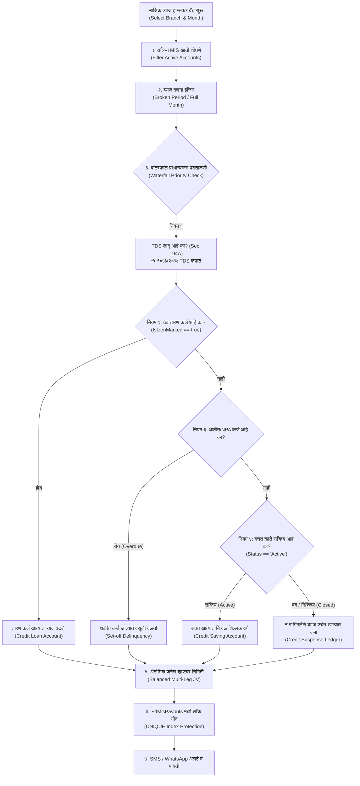

# 📐 मुदत ठेव मासिक व्याज ट्रान्सफर व परतावा (FD MIS Payout Engine)
## सविस्तर चरणबद्ध अंमलबजावणी आराखडा (Step-by-Step Implementation Plan)

**दस्तऐवज संदर्भ:** `PLAN-MIS-TRANSFER-2026-V1`  
**प्रकल्प:** स्मार्ट बँकिंग कोअर बँकिंग सोल्यूशन (SmartBanking CBS)  
**भूमिका:** कोअर बँकिंग प्रोजेक्ट मॅनेजर व आर्किटेक्ट (Core Banking Project Manager & Architect)  
**दिनांक:** २२ ऑक्टोबर २०२६  
**स्थिती:** 📝 मंजुरीसाठी प्रस्तावित (Proposed for Approval - Do Not Code Yet)  

---

## १. पार्श्वभूमी व मुख्य उद्दिष्ट (Context & Objective)

मुदत ठेव मासिक उत्पन्न योजनेतील (**Monthly Income Scheme - MIS**) ठेवीदारांना दरमहा ठराविक मासिक व्याज त्यांच्या बचत खात्यात (Saving Account) वर्ग करणे किंवा रोख देणे हा कोअर बँकिंगमधील अत्यंत संवेदनशील व्यवहार आहे.

ऑडिट अहवालात निष्पन्न झालेल्या सर्व १३ जोखमींवर मात करून **शतप्रतिशत सुरक्षित, दुहेरी-नोंद संतुलित (Balanced Double-Entry), टीडीएस नियमांशी सुसंगत, आणि डुप्लिकेट-मुक्त (Duplicate-Proof)** अशी MIS व्याज ट्रान्सफर प्रणाली विकसित करणे हे या अंमलबजावणी आराखड्याचे उद्दिष्ट आहे.

---

## २. संपूर्ण कार्यप्रवाह नकाशा (End-to-End Workflow Architecture)



---

## ३. चरणबद्ध अंमलबजावणी टप्पे (Step-by-Step Implementation Phases)

---

### टप्पा १: डेटाबेस मॉडेलिंग व युनिक सुरक्षा (Database Architecture & Idempotency)
> **उद्दिष्ट:** एकाच महिन्यात एकाच खात्याचे व्याज दोनदा वर्ग होणे तांत्रिकदृष्ट्या अशक्य करणे आणि प्रत्येक वाटपाचा फॉरेन्सिक ऑडिट ट्रेल जतन करणे.

1. **नवीन टेबल निर्मिती: `FdMisPayouts`**
   - **कॉलम्स (Columns):**
     - `PayoutID` (`int`, PK, Identity)
     - `BranchID` (`int`, FK -> `Branches`)
     - `FinancialYearID` (`int`, FK -> `FinancialYears`)
     - `FdAccountID` (`int`, FK -> `FdAccounts`)
     - `PayoutYear` (`int`, उदा. २०२६)
     - `PayoutMonth` (`int`, उदा. १०)
     - `PayoutDate` (`datetime`, प्रत्यक्ष ट्रान्सफर तारीख)
     - `PeriodFromDate` व `PeriodToDate` (`datetime`, कालावधी)
     - `ElapsedDays` (`int`, दिवसांची संख्या)
     - `DepositPrincipal` (`decimal(18,2)`, मूळ ठेव रक्कम)
     - `InterestRate` (`decimal(5,2)`, लागू व्याजदर)
     - `GrossInterest` (`decimal(18,2)`, एकूण देय मासिक व्याज)
     - `TdsAmount` (`decimal(18,2)`, कापलेला TDS)
     - `LoanAdjustedAmount` (`decimal(18,2)`, कर्जात वळती केलेली रक्कम)
     - `NetDisbursedAmount` (`decimal(18,2)`, बचत खात्यात प्रत्यक्ष जमा निव्वळ व्याज)
     - `DisbursementMode` (`nvarchar(30)`, उदा. `'SavingTransfer'`, `'Cash'`, `'Suspense'`, `'LoanRecovery'`)
     - `TargetSavingAccountID` (`int?`, FK -> `SavingAccountMasters`)
     - `TargetLoanAccountID` (`int?`, FK -> `LoanAccounts`)
     - `VoucherID` (`int`, FK -> `Vouchers`)
     - `Status` (`nvarchar(20)`, `'Success'`, `'Reversed'`, `'Failed'`)
     - `CreatedBy` (`int`), `CreatedDate` (`datetime`), `Remarks` (`nvarchar(250)`)
2. **डुप्लिकेट प्रतिबंधक युनिक इंडेक्स (Unique Idempotency Index):**
   ```sql
   CREATE UNIQUE INDEX IX_FdMisPayouts_Account_Year_Month 
   ON FdMisPayouts (FdAccountID, PayoutYear, PayoutMonth) 
   WHERE Status = 'Success';
   ```
   *फायदा:* ऑपरेटरने एकाच महिन्यात दोनदा बॅच चालवली तरी डेटाबेस पातळीवर दुसरी एन्ट्री रिजेक्ट होईल; डबल क्रेडिट अशक्य होईल.
3. **`FdTransactions` प्रकार विस्तार:**
   - नवीन `TransactionType = "MIS_Payout"` जोडणे.

---

### टप्पा २: बॅकएंड कोअर इंजिन व API एंडपॉइंट्स (Backend Engine & API Endpoints)
> **उद्दिष्ट:** अचूक व्याज गणना, वॉटरफॉल वाटप, आणि संतुलित जर्नल व्हाउचर पोस्टिंग करणे.

नवीन कंट्रोलर: `FdMisPayoutController.cs` (किंवा `FdAccountsController.cs` मध्ये समर्पित विभाग)

#### १. बॅच प्रिव्ह्यू एंडपॉइंट: `POST /api/FdMisPayout/Preview`
* **इनपुट:** `branchId`, `payoutYear`, `payoutMonth`, `payoutDate`, `accountingMode` (`'DirectExpense'` किंवा `'ClearPayable'`)
* **प्रक्रिया:**
  1. निवडलेल्या शाखेतील सर्व `Active` MIS खाती लोड करणे (`FdScheme.InterestType == "MIS" || FdScheme.InterestPayoutFrequency == "Monthly"`).
  2. चालू महिना आणि वर्षासाठी या खात्यांची नोंद `FdMisPayouts` मध्ये आधीच आहे का तपासणे (`IsAlreadyPaid` फ्लॅग).
  3. **अपूर्ण महिना (Broken Period) तपासणी:**
     - जर ठेव चालू महिन्यात उघडली असेल (उदा. १५ ऑक्टोबर):
       $$\text{Days} = (\text{३१ ऑक्टोबर} - \text{१५ ऑक्टोबर}) + १ = १७ \text{ दिवस}$$
       $$\text{Gross Interest} = \text{Round}\left(\frac{\text{Principal} \times \text{Rate} \times \text{Days}}{36500}, 0\right)$$
     - जर ठेव मागील महिन्यांची असेल:
       $$\text{Gross Interest} = \text{Round}\left(\frac{\text{Principal} \times \text{Rate}}{1200}, 0\right)$$
  4. **बचत खाते आरोग्य तपासणी (Saving Account Status):**
     - संलग्न बचत खाते शोधणे. जर खाते सापडले नाही किंवा `Status != 'Active'` असेल, तर `WarningNote: 'बचत खाते बंद/निष्क्रिय - उचंत खात्यात जमा होईल'` असा इशारा देणे.
  5. **कर्ज तपासणी (Lien & Overdue Scan):**
     - `account.IsLienMarked == true` असल्यास तारण कर्ज शोधणे.
     - सभासदाचे इतर कोणतेही चालू किंवा थकीत कर्ज असल्यास त्याची थकबाकी काढणे.
  6. **टीडीएस (TDS) तपासणी:**
     - चालू आर्थिक वर्षातील या खातेदाराच्या सर्व ठेवींवरील जमा व्याज मोजणे. मर्यादा (₹ ४०,००० / ₹ ५०,०००) ओलांडली असल्यास १०% TDS गणना करणे.
* **आउटपुट:** खात्यांची सविस्तर यादी, वाटप वर्गीकरण आणि एकूण रकमांचे सारांश कार्ड्स (KPIs).

#### २. बॅच एक्झिक्युशन एंडपॉइंट: `POST /api/FdMisPayout/ExecuteBatch`
* **सुरक्षा:** `[Authorize(Roles = "Admin,Manager")]`
* **प्रक्रिया (Atomic Transaction):**
  1. निवडलेली खाती आणि चालू महिन्यासाठी डुप्लिकेट तपासणी.
  2. **कंबाइंड जर्नल व्हाउचर (Master Journal Voucher) निर्मिती:**
     - `VoucherNo = "JV-MIS-BR{branchId}-{payoutYear}{payoutMonth:D2}-{Timestamp}"`
     - `VoucherType = "Journal"`
  3. **लेखांकन लेजर मॅपिंग (Accounting Entries):**
     * **डेबिट बाजू (Dr.):**
       - जर `accountingMode == 'ClearPayable'`: `Dr. मुदत ठेव देणे व्याज (Payable Ledger)`
       - जर `accountingMode == 'DirectExpense'`: `Dr. ठेवीवरील व्याज खर्च (Expense Ledger)`
     * **क्रेडिट बाजू (Cr.):**
       - `Cr. TDS देय लेजर (TDS Payable)` (TDS कपात असल्यास)
       - `Cr. कर्ज खाते लेजर` (तारण किंवा थकीत कर्जात वळती असल्यास + `LoanCollections` मध्ये नोंद)
       - `Cr. बचत ठेव लेजर (Saving Deposits)` (सक्रिय बचत खात्यात वर्ग असल्यास + `SavingTransactions` मध्ये नोंद व शिल्लक वाढ)
       - `Cr. न मागितलेले व्याज उचंत लेजर (Unclaimed Suspense)` (बचत खाते बंद असल्यास)
  4. **आंतर-शाखा व्यवहार (IBT Integration):**
     - जर FD ची शाखा आणि बचत खात्याची शाखा वेगळी असेल, तर सिस्टीम आपोआप `Inter-Branch Transfer (IBT)` च्या लेजर नोंदी तयार करेल, ज्यामुळे शाखांचे ताळेबंद टॅली राहतील.
  5. **डेटाबेस नोंदणी:** प्रत्येक खात्यासाठी `FdMisPayouts` मध्ये नोंद करणे आणि `FdTransactions` मध्ये `TransactionType = "MIS_Payout"` नोंदवणे.
  6. **कमीट (Commit Transaction):** सर्व नोंदी यशस्वी झाल्यावरच व्हाउचर पोस्ट होईल; थोडीही त्रुटी आल्यास पूर्ण बॅच आपोआप **Rollback** होईल.

---

### टप्पा ३: मुदतपूर्व बंद (Premature Close) मधील क्लॉबॅक ताळमेळ (Premature Closure Integration)
> **उद्दिष्ट:** मुदतपूर्व बंद करताना ठेवीदाराला दरमहा रोख/बचत खात्यात आधीच जादा गेलेले व्याज मुद्दलातून (Principal) १००% वसूल करणे.

* **फाइल:** `api/Bhisi.Api/Controllers/FdAccountsController.cs`
* **सुधारणा:**
  1. `PrematureClose` पद्धतीमध्ये आतापर्यंत फक्त `TransactionType == "Accrual"` मोजले जात होते.
  2. आता प्रत्यक्ष अदा केलेल्या MIS व्याजाची गणना जोडणे:
     ```csharp
     decimal actualMisPaidCash = await _context.FdMisPayouts
         .Where(p => p.FdAccountID == id && p.Status == "Success")
         .SumAsync(p => p.GrossInterest);
     
     // Total interest already received by the customer physically
     decimal totalAlreadyDisbursedInt = Math.Max(actualMisPaidCash, dbAccrued);
     
     if (isPeriodicPayout)
     {
         // जर प्रत्यक्ष दिलेले व्याज हे मुदतपूर्व फेरगणित व्याजापेक्षा जास्त असेल
         if (totalAlreadyDisbursedInt > recalculatedInterest)
         {
             penaltyClawback = totalAlreadyDisbursedInt - recalculatedInterest;
             netPayoutAmount = account.DepositAmount - penaltyClawback; // मुद्दलातून वजावट
         }
         else
         {
             // जर काही महिन्यांचे व्याज देणे बाकी असेल
             decimal pendingInterestToPay = recalculatedInterest - totalAlreadyDisbursedInt;
             netPayoutAmount = account.DepositAmount + pendingInterestToPay;
         }
     }
     ```
  3. **लेखांकन ताळमेळ:** मुद्दलातून कापलेली क्लॉबॅक रक्कम ही **"मुदतपूर्व ठेव व्याज दंड वसुली" (Interest Clawback / Penalty Recovery Ledger)** किंवा **ठेवीवरील व्याज खर्चात (Expense Reversal)** जमा होईल.

---

### टप्पा ४: फ्रंटएंड वापरकर्ता इंटरफेस (Frontend UI/UX - `FdMisInterestPayout.tsx`)
> **उद्दिष्ट:** ऑपरेटरला वापरण्यास अत्यंत सुलभ, पारदर्शक आणि चुका रोखणारा आधुनिक CBS इंटरफेस उपलब्ध करून देणे.

* **नवीन घटक (New Component):** `client/src/components/FdMisInterestPayout.tsx`
* **रचना व वैशिष्ट्ये:**
  1. **हेडर व फिल्टर बार:**
     - शाखा निवड ड्रॉपडाउन (Branch Selector).
     - वाटप महिना व वर्ष (उदा. ऑक्टोबर २०२६).
     - वाटप दिनांक पिकर (Payout Date).
     - लेखांकन पद्धत निवड (Direct P&L Expense vs Clear Interest Payable).
     - "मासिक व्याज प्रिव्ह्यू पहा" (Fetch Preview) बटन.
  2. **थेट सांख्यिकी कार्ड्स (Real-Time Metrics Cards):**
     - 💳 **एकूण पात्र खाती:** उदा. १२५ खाती
     - 💰 **एकूण देय मासिक व्याज:** ₹ १,२५,०००
     - 🛡️ **TDS कपात:** ₹ १२,५००
     - ⚖️ **कर्जात वळती:** ₹ १५,०००
     - 🏦 **बचत खात्यात निव्वळ जमा:** ₹ ९७,५००
  3. **खातेनिहाय इंटरॅक्टिव्ह ग्रिड (Account Data Table):**
     - सर्व खाती निवडण्यासाठी मास्टर चेकबॉक्स (Select All).
     - कॉलम्स: FD खाते क्र., खातेदार नाव, ठेव रक्कम, व्याजदर, देय व्याज, TDS, कर्जात वळती, निव्वळ बचत जमा, संलग्न बचत खाते क्र., आणि स्थिती बॅज:
       - 🟢 **सक्रिय बचत खाते** (Active SB Account)
       - 🔴 **बंद/सुप्त खाते ➔ उचंत खात्यात वळती** (Closed SB ➔ Unclaimed Suspense)
       - 🟡 **तारण कर्ज ➔ कर्जात वळती** (Lien Marked ➔ Auto Set-off)
       - ⚪ **आधीच अदा केलेले** (Already Paid - Row Disabled)
  4. **अंतिम पुष्टी व व्हाउचर प्रिव्ह्यू मोडल (Confirmation Modal):**
     - "मासिक व्याज ट्रान्सफर करा" वर क्लिक करताच संपूर्ण व्हाउचरचा डेबिट-क्रेडिट तक्ता दिसेल.
     - "मी पडताळणी केली आहे, ट्रान्सफर करा" अशी ऑपरेटर पुष्टी घेऊनच प्रक्रिया होईल.
  5. **नेव्हिगेशन (Navigation):**
     - `Sidebar.tsx` मध्ये **"मुदत ठेव (FD)"** मेनूखाली **"दरमहा व्याज परतावा (MIS Payout)"** असा नवीन सब-मेनू जोडणे.

---

### टप्पा ५: अहवाल व ग्राहक संवाद (Audit Register & Notifications)
> **उद्दिष्ट:** लेखापरीक्षणासाठी (Audit) परिपूर्ण नोंदवही आणि खातेदारांना तात्काळ एसएमएस सूचना.

1. **मासिक व्याज वाटप नोंदवही (MIS Payout Register):**
   - अहवाल पर्याय: वर्ष/महिना, शाखा, वाटप प्रकार (बचत खाते / कर्ज वळती / उचंत).
   - मुद्रण (Print) आणि एक्सेल एक्सपोर्ट (Excel Export) सुविधा.
2. **ग्राहक एसएमएस / व्हॉट्सॲप मेसेजिंग (Notification Template):**
   > *"प्रिय ग्राहक, आपल्या मुदत ठेव क्र. {FD_ACC} चे {MONTH} महिन्याचे व्याज ₹ {NET_INT} आपल्या बचत खाते क्र. {SB_ACC} मध्ये यशस्वीरीत्या जमा करण्यात आले आहे. - {SOCIETY_NAME}"*

---

## ४. अंमलबजावणी क्रमवारी (Step-by-Step Implementation Sequence)

```
[Phase 1] Database:
  └── 1. Create table FdMisPayouts
  └── 2. Add Unique Index IX_FdMisPayouts_Account_Year_Month
  └── 3. Update EF Core DbContext & Models

[Phase 2] Backend Core Engine:
  └── 4. Build FdMisPayoutController (Preview & ExecuteBatch)
  └── 5. Implement Broken-Period Interest Calculator
  └── 6. Implement Waterfall Distribution (TDS ➔ Lien ➔ SB ➔ Suspense)
  └── 7. Implement Balanced Voucher Posting & IBT Logic

[Phase 3] Premature Closure Integration:
  └── 8. Update FdAccountsController (PrematureClose clawback logic)

[Phase 4] Frontend Development:
  └── 9. Create client/src/components/FdMisInterestPayout.tsx
  └── 10. Add Sidebar navigation link in Sidebar.tsx

[Phase 5] Verification & Audit:
  └── 11. Run Idempotency & Duplicate Protection Tests
  └── 12. Run Lien Loan Set-off & Closed SB Tests
  └── 13. Verify Premature Clawback with actual cash history
```

---

## ५. जोखीम व निवारण हमी (Risk Mitigation Guarantee)

| ऑडिटमध्ये आढळलेली जोखीम | या आराखड्यातील तांत्रिक निवारण (Solution) | हमी (Guarantee) |
|:---|:---|:---:|
| **एकाच महिन्यात दुहेरी ट्रान्सफर** | `UNIQUE(FdAccountID, PayoutYear, PayoutMonth)` इंडेक्स | **१००% डुप्लिकेट-मुक्त** |
| **व्याज खर्चाची दुहेरी नोंद** | `DirectExpense` किंवा `ClearPayable` चे स्पष्ट व्हाउचर नियम | **शून्य P&L विसंगती** |
| **मुदतपूर्व बंद करताना नुकसान** | `FdMisPayouts` वरील प्रत्यक्ष वाटप मोजून मुद्दलातून वजावट (Clawback) | **संस्थेचे नुकसान टळेल** |
| **तारण कर्ज असताना पैसे निघून जाणे** | वॉटरफॉल नियमाने तारण कर्ज खात्यात अनिवार्य वळती | **कर्ज थकीत राहणे बंद** |
| **बंद बचत खात्यात पैसे अडकणे** | पडताळणी व आपोआप उचंत (Suspense) खात्यात वळती | **ताळेबंद १००% टॅली** |
