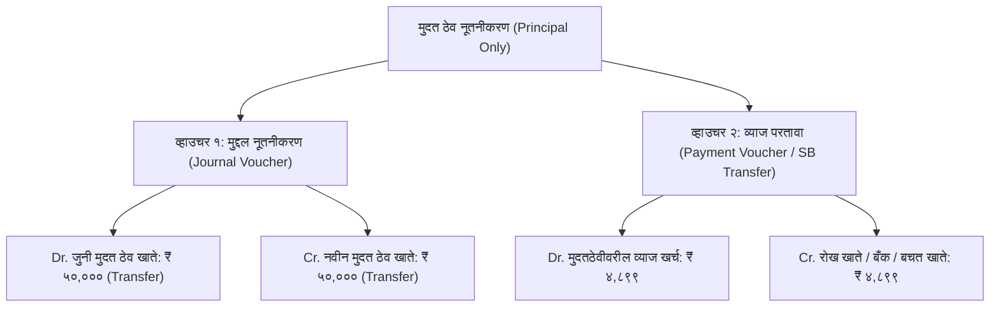

# मुदत ठेव नूतनीकरण (फक्त मुद्दल + रोख व्याज) - अचूक जमा-खर्च व व्हाउचर सुधारणा आराखडा
## Implementation Plan: FD Principal-Only Renewal Voucher Decoupling & Daybook Fix

---

### 📌 कार्यकारी सारांश (Executive Summary)

मुदत ठेव क्लोजर आणि नूतनीकरण (`FdWithdrawalMaturity`) मध्ये खातेदाराने **'फक्त मुद्दल नूतनीकरण (Principal Only)'** पर्याय निवडल्यास:
1. **मुद्दल (उदा. ₹५०,०००)** ही नवीन मुदत ठेवीत जमा होते (**१००% कीर्द / ट्रान्सफर व्यवहार**).
2. **व्याज (उदा. ₹४,८९९)** हे खातेदाराला रोखीने / बँकेने अदा केले जाते (**१००% रोख पेमेंट व्यवहार**).

सध्या सिस्टीम या दोन स्वतंत्र व्यवहारांचे **एकच एकत्रित जर्नल व्हाउचर (Compound JV of ₹५४,८९९)** बनवत आहे. जेव्हा हे व्हाउचर **रोजकीर्द (Daybook / जमा-खर्च)** अहवालात जाते, तेव्हा डे-बुकमधील प्रपोर्शन अल्गोरिदम रोख रक्कम (₹४,८९९) ही ५०,००० मुद्दल आणि ४,८९९ व्याज या दोन्ही खात्यांवर गुणोत्तराने (९१% आणि ९%) वाटतो! यामुळे:
- मुदत ठेवीतून रोख गेली: ₹४,४६१.८३ ❌ (प्रत्यक्षात मुदत ठेवीतून रोख शून्य गेली आहे)
- व्याजातून रोख गेली: फक्त ₹४३७.१७ ❌ (प्रत्यक्षात पूर्ण ₹४,८९९ रोख दिले आहे)
आणि रोखवही (Cash Book) व खतावणीचा ताळेबंद पूर्ण विस्कळीत होतो. तसेच फ्रंटएंडवर सेटलमेंट सारांशात नवीन मुद्दल **₹ ०.००** अशी चुकीची दिसत आहे.

हा आराखडा बँकिंग मानकांनुसार **दोन स्वतंत्र व्हाउचर्स (Dual Vouchers: १. मुद्दल नूतनीकरण JV आणि २. व्याज रोख पेमेंट Payment)** लागू करण्यासाठी तयार करण्यात आला आहे.

---

### 🔍 १. समस्येचे मूळ कारण व तांत्रिक विश्लेषण (Root Cause Analysis)

#### अ) बॅकएंडमधील कंपाऊंड व्हाउचर (Compound Voucher Issue)
* **फाइल:** `api/Bhisi.Api/Controllers/FdAccountsController.cs` (Lines 4323–4365)
* **सध्याची रचना:**
  `RenewalType == "PrincipalOnly"` असतानाही सिस्टीम एकच व्हाउचर तयार करते:
  ```text
  व्हाउचर प्रकार: Journal (JV) | एकूण रक्कम: ₹ ५४,८९९.००
  -------------------------------------------------------------
  Dr. मुदत ठेव देयता खाते (Old FD)         : ₹ ५०,०००.००
  Dr. मुदतठेवीवरील व्याज (Interest Expense)   : ₹  ४,८९९.००
  Cr. नवीन मुदत ठेव खाते (New FD)            : ₹ ५०,०००.००
  Cr. हातातील रोख शिल्लक (Cash Ledger)      : ₹  ४,८९९.००
  ```

#### ब) डे-बुक (Daybook) मधील प्रोपोर्शनल कॅश-स्प्लिटिंग फॉल्ट
* **फाइल:** `api/Bhisi.Api/Controllers/ReportsController.cs` (Lines 562–574)
* **लॉजिक:**
  ```csharp
  if (cashDrCr == "Cr" && vd.DrCr == "Dr") {
      decimal proportion = vd.Amount / totalNonCashDr; // ५०,००० / ५४,८९९ = ०.९१०८
      cashAmt = Math.Min(vd.Amount, cashAmountInVoucher * proportion);
      transferAmt = vd.Amount - cashAmt;
  }
  ```
* **परिणाम:**
  - **मुदत ठेव (₹५०,०००):** रोख = ₹४,४६१.८३ (९१%), ट्रान्सफर = ₹४५,५३८.१७
  - **व्याज (₹४,८९९):** रोख = ₹४३७.१७ (९%), ट्रान्सफर = ₹४,४६१.८३
  - कॅशियरने पूर्ण ₹४,८९९ रोख व्याज दिले असताना डे-बुकमध्ये व्याजापोटी फक्त ₹४३७.१७ रोख खर्च दिसतो!

#### क) फ्रंटएंड सारांशात नवीन ठेव मुद्दल "₹ ०.००" दिसणे (UI Zero Amount Bug)
* **फाइल:** `client/src/components/FdWithdrawalMaturity.tsx` (Lines 1920–1921 & 1222)
* **कोड:**
  ```ts
  const isFullRoll = actionType === 'Renewal' && renewalType === 'PrincipalPlusInterest';
  const finalAmount = isFullRoll ? (principal + interestPayable + effOverdue) : netPayout;
  ```
  `PrincipalOnly` वेळी `isFullRoll` false राहते, आणि `netPayout` हे `getTotalFdPayout()` मधून येते. पण `getTotalFdPayout()` नूतनीकरणासाठी `0` रिटर्न करतो!
  त्यामुळे उजव्या बाजूच्या सेटलमेंट सारांशात **नवीन ठेव मुद्दल ₹ ०.००** दिसते.

---

### 🏛️ २. कोअर बँकिंग अचूक समाधान (Proposed Accounting Solution)

`RenewalType == "PrincipalOnly"` असताना **दोन स्वतंत्र व्हाउचर्स (Two Decoupled Vouchers)** तयार करणे:



#### १. व्हाउचर १: मुदत ठेव मुद्दल नूतनीकरण (Pure Journal / Transfer Voucher - JV)
* **VoucherType:** `"Journal"`
* **VoucherNo:** `JV-FD-REN-{NewAccountNo}`
* **TotalAmount:** `₹ ५०,०००.००`
* **तपशील:**
  - **Dr.** जुनी मुदत ठेव खाते: **₹ ५०,०००.००** *(जुने खाते बंद)*
  - **Cr.** नवीन मुदत ठेव खाते: **₹ ५०,०००.००** *(नवीन खाते उघडले)*
* **डे-बुक प्रभाव:** रोजकीर्दीच्या **'ट्रान्सफर / कीर्द'** बाजूला पूर्ण ₹५०,००० दिसेल. रोखेशी शून्य संबंध.

#### २. व्हाउचर २: मुदत ठेव व्याज परतावा (Cash / Bank Payment Voucher)
* **VoucherType:** जर PaymentMode == "Cash" किंवा "Bank" असेल तर `"Payment"`, बचत खात्यात वर्ग असल्यास `"Journal"`
* **VoucherNo:** `PAY-FD-INT-{NewAccountNo}` (किंवा `JV-FD-INT-{NewAccountNo}`)
* **TotalAmount:** `₹ ४,८९९.००`
* **तपशील:**
  - **Dr.** मुदत ठेवीवरील व्याज खर्च खाते (आणि/किंवा देणे व्याज तरतूद): **₹ ४,८९९.००**
  - **Cr.** हातातील रोख शिल्लक (Cash Account) / बँक खाते / बचत खाते: **₹ ४,८९९.००**
* **डे-बुक प्रभाव:** रोजकीर्दीच्या **'रोख खर्च (Cash Payment)'** बाजूला तंतोतंत **₹ ४,८९९.००** खर्च नोंदवला जाईल. कॅशियरची रोख शिल्लक १००% टॅली होईल.

---

### 📋 ३. तपशीलवार बदल व अंमलबजावणी कृती आराखडा (Step-by-Step Execution Plan)

#### घटक १: बॅकएंड सुधारणा (`api/Bhisi.Api/Controllers/FdAccountsController.cs`)
1. `Renew(int id, [FromBody] FdRenewalRequest request)` मध्ये:
   - जर `request.RenewalType == "PrincipalPlusInterest"` असेल, तर विद्यमान सिंगल JV चालू राहील (कारण यात रोख पेमेंट नसते).
   - जर `request.RenewalType == "PrincipalOnly"` आणि `interestPayoutAmount > 0` असेल:
     - **पहिले व्हाउचर (Voucher 1):** मुद्दल ट्रान्सफरसाठी `Journal` व्हाउचर तयार करणे (`TotalAmount = oldAccount.DepositAmount`). यात फक्त जुनी मुदत ठेव Dr आणि नवीन मुदत ठेव Cr राहील.
     - **दुसरे व्हाउचर (Voucher 2):** व्याज परताव्यासाठी `PaymentMode == "Cash"` किंवा `"Bank"` असल्यास `Payment` व्हाउचर तयार करणे (`TotalAmount = interestPayoutAmount`). यात व्याज खर्च Dr आणि रोख/बँक/बचत Cr राहील.
     - दोन्ही व्हाउचर्सचे परस्पर संदर्भ (RelatedVoucherID किंवा नॅरेशनमध्ये स्पष्ट उल्लेख) सुरक्षित ठेवणे.
2. `FdTransactions` मध्ये या दोन्ही व्हाउचर्सचा योग्य संदर्भ नोंदवणे.

#### घटक २: फ्रंटएंड सुधारणा (`client/src/components/FdWithdrawalMaturity.tsx`)
1. **सेट्लमेंट सारांश (Settlement Summary - Line 1920–1921):**
   - `PrincipalOnly` नूतनीकरणाच्या वेळी:
     - `newPrincipalDeposit = principal;` (₹ ५०,०००.००)
     - `cashPayout = accruedInt + effOverdue;` (₹ ४,८९९.००)
   - उजव्या बाजूच्या बॉक्समध्ये:
     `नवीन ठेव मुद्दल: ₹ ५०,०००.००` (शून्यऐवजी खरी मुद्दल दिसेल).
     `व्याज रोख परतावा: ₹ ४,८९९.००` (स्पष्ट दिसेल).
2. **लेखा व्हाउचर पूर्वावलोकन (Accounting Voucher Preview - Lines 1600–1665):**
   - `PrincipalOnly` निवडलेले असताना व्हाउचर टेबलमध्ये दोन स्वतंत्र विभाग किंवा स्पष्ट गट दाखवणे:
     - **१. मुदत ठेव मुद्दल नूतनीकरण (कीर्द):** Dr. जुनी मुदत ठेव ₹५०,००० | Cr. नवीन मुदत ठेव ₹५०,०००
     - **२. मुदत ठेव व्याज परतावा (रोख पेमेंट):** Dr. मुदतठेवीवरील व्याज ₹४,८९९ | Cr. हातातील रोख शिल्लक ₹४,८९९
   - `targetLiabilityLedger` चे नाव अचूक ठेव योजनेनुसार मॅप करणे.

---

### 🛡️ ४. जोखीम व सुरक्षितता पडताळणी (Risk & Safeguards)

| जोखीम | निवारण उपाय |
| :--- | :--- |
| **१. मुदत + व्याज नूतनीकरण (Full Roll)** | `PrincipalPlusInterest` मध्ये कोणताही बदल नाही; पूर्वीप्रमाणेच एकच JV कायम राहील. |
| **२. चेकर पासिंग (Maker-Checker)** | व्हाउचर्स स्वतंत्र असले तरी ते एकाच ट्रान्झॅक्शनमध्ये जोडलेले राहतील आणि दोन्ही व्हाउचर्सची स्थिती (Pending/Approved) अखंड राहील. |
| **३. बचत खाते ट्रान्सफर (SB Transfer)** | जर खातेदाराने रोखऐवजी बचत खात्यात व्याज जमा निवडले, तर बचत खात्यात थेट ₹४,८९९ जमा होऊन योग्य पासबुक नोंद होईल. |
| **४. डे-बुक अखंडता** | रोख खर्च रकान्यात फक्त आणि फक्त रोखीने गेलेले व्याज दिसेल; मुद्दलाचा कोणताही रोख भाग डे-बुकमध्ये चुकीने पडणार नाही. |

---

### 🧪 ५. चाचणी व प्रमाणीकरण निकष (Testing & Verification Matrix)

1. **चाचणी १ (स्क्रीनशॉटमधील खात्यावर पडताळणी):**
   - मुदत ठेव: ₹५०,०००, व्याज: ₹४,८९९ (रोख).
   - सेटलमेंट सारांशात नवीन मुद्दल: **₹ ५०,०००.००** (₹ ०.०० नाही).
   - व्हाउचर १ (JV): Dr. मुदत ठेव ₹५०,००० | Cr. नवीन मुदत ठेव ₹५०,०००.
   - व्हाउचर २ (Payment): Dr. व्याज ₹४,८९९ | Cr. रोख खाते ₹४,८९९.
2. **चाचणी २ (डे-बुक ताळेबंद चाचणी):**
   - डे-बुक उघडणे -> रोख खर्च रकान्यात मुदत ठेव व्याज = **₹ ४,८९९.०० (Cash)**.
   - कीर्द / ट्रान्सफर रकान्यात = **₹ ५०,०००.०० (Transfer)**.
   - रोख शिल्लक तंतोतंत जुळली पाहिजे.
3. **चाचणी ३ (बिल्ड तपासणी):**
   - `dotnet build -c Release` -> 0 Errors.
   - `npm run build` -> 0 Errors.
