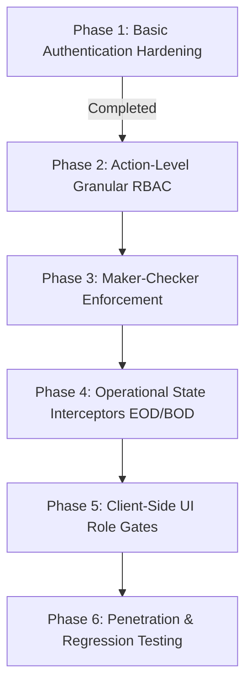

# 📋 कोर बँकिंग सिस्टीम (CBS) — फायनान्शियल ॲक्सेस कंट्रोल आणि ऑथोरायझेशन अंमलबजावणी आराखडा
## Financial Access Control & Enterprise Authorization Implementation Plan (Vouchers & Cash Management)

**दस्तऐवज संदर्भ:** `CBS-SEC-PLAN-2026-001`  
**प्रकल्प:** Smart Banking / Bhisi Core Banking System  
**प्रकार:** आर्किटेक्चरल व सुरक्षा अंमलबजावणी आराखडा (Architecture & Security Implementation Plan)  
**प्राधान्य:** 🔴 P0 - Critical (अति-गंभीर सुरक्षा घटक)  
**लक्ष्य कंट्रोलर्स:** `VouchersController.cs`, `CashManagementController.cs`  

---

## १. पार्श्वभूमी आणि सुरक्षा विश्लेषण (Background & Threat Modeling)

### १.१ समस्येचे स्वरूप (Vulnerability Context)
पूर्वी `VouchersController.cs` आणि `CashManagementController.cs` वर `[AllowAnonymous]` ॲट्रिब्यूट अस्तित्वात होते. 
यामुळे कोणताही बाहेरील अनधिकृत वापरकर्ता (Unauthenticated Actor) वैध लॉगिन किंवा JWT टोकन नसतानाही:
1. थेट HTTP API कॉल करून बनावट किंवा अवैध व्हाउचर (Cash Receipt, Payment, Journal, Contra) तयार करू शकत होता.
2. तिजोरी (Vault) आणि टेलर (Cashier Drawer) मधील कॅश ॲलोकेशन बदलू शकत होता.
3. टेलरची शिल्लक (Cash in Hand) व संस्थात्मक ताळेबंद (Balance Sheet) विस्कळीत करू शकत होता.

### १.२ तात्काळ उपाय वि. सर्वसमावेशक संस्थात्मक आराखडा (Immediate Fix vs Enterprise Plan)
- **झालेली तात्काळ दुरुस्ती (Immediate Fix Completed):**
  - दोन्ही कंट्रोलर्सवर `[AllowAnonymous]` काढून `[Authorize]` बंधनकारक केले.
  - अनधिकृत विनंत्या आता **HTTP 401 Unauthorized** सह तात्काळ ब्लॉक होत आहेत (पडताळणी यशस्वी).
- **प्रस्तुत आराखड्याचे उद्दिष्ट (Objective of this Plan):**
  - फक्त `[Authorize]` पुरेसे नसून, कोर बँकिंग सिस्टीम (CBS) मानकांनुसार **Granular Role-Based Access Control (RBAC)**, **Maker-Checker (दुहेरी मान्यता)**, **Multi-Branch Data Isolation**, **EOD/BOD Financial State Controls** आणि **Audit Trail** यांचे संपूर्ण सुरक्षा कवच उभारणे.

```
+---------------------------------------------------------------------------------------+
|                                6-LAYER SECURITY DEFENSE                               |
+---------------------------------------------------------------------------------------+
|  Layer 1: JWT Authentication & Expiry Validation (HTTP 401)                           |
+---------------------------------------------------------------------------------------+
|  Layer 2: Multi-Branch Isolation & Scope Enforcement (HTTP 403 / 400)                 |
+---------------------------------------------------------------------------------------+
|  Layer 3: Granular Role-Based Access Control - RBAC (HTTP 403 Forbidden)              |
+---------------------------------------------------------------------------------------+
|  Layer 4: Business Operational State Check (Day-End Closed / BOD Not Done)            |
+---------------------------------------------------------------------------------------+
|  Layer 5: Maker-Checker Segregation of Duties (Maker != Checker)                      |
+---------------------------------------------------------------------------------------+
|  Layer 6: Immutable Financial Audit Trail & Tamper Prevention                         |
+---------------------------------------------------------------------------------------+
```

---

## २. सुरक्षा आर्किटेक्चरचे ६ स्तर (The 6-Layer Security Architecture)

### स्तर १: प्रमाणीकरण आणि टोकन पडताळणी (Authentication & Token Integrity)
- सर्व फायनान्शियल एंडपॉइंट्ससाठी वैध स्वाक्षरीकृत (Digitally Signed) JWT Bearer टोकन अनिवार्य.
- टोकनमध्ये `UserID`, `Role`, `BranchID`, आणि `FinancialYearID` हे क्लेम्स (Claims) असणे बंधनकारक.
- टोकन एक्सपायर झाल्यास सिस्टीमने त्वरित **401 Unauthorized** देणे.

### स्तर २: मल्टी-ब्राँच आयसोलेशन (Multi-Branch Data Isolation)
- `[EnforceBranchScope]` ॲट्रिब्यूटद्वारे प्रत्येक विनंतीची तपासणी.
- सामान्य शाखा वापरकर्ता (Branch Cashier/Accountant/Manager) **केवळ स्वतःच्या शाखेचाच** डेटा पाहू आणि ट्रान्झॅक्ट करू शकेल.
- मुख्यालयातील प्रशासक (`IsHeadOfficeAdmin`) यांनाच इतर शाखांचा डेटा पाहण्याची अथवा निवडण्याची मुभा असेल.

### स्तर ३: ग्रॅन्युलर रोल-बेस्ड ॲक्सेस कंट्रोल (Granular RBAC)
- प्रत्येक फायनान्शियल ॲक्शनसाठी विशिष्ट परवानग्या (Permissions):
  - **कॅशियर (Cashier):** दैनंदिन रोख जमा (Receipt) आणि रोख नावे (Payment) मर्यादित रकमेपर्यंत. (JV किंवा Contra व्हाउचर तयार करण्याची परवानगी नाही).
  - **अकाउंटंट (Accountant):** सर्व प्रकारचे व्हाउचर तयार करणे, लेजर तपासणे, बँक रिकन्सिलिएशन. (स्वतः तयार केलेले व्हाउचर स्वतः मंजूर करू शकत नाही).
  - **मॅनेजर / ॲडमिन (Manager / Admin):** व्हाउचर मंजुरी (Approval), रद्द करणे (Cancel), टेलरला रोख वाटप (Vault to Drawer Allocation).
  - **ऑडिटर (Auditor):** फक्त वाचण्याची (Read-Only) परवानगी. कोणत्याही नोंदी तयार किंवा बदलता येणार नाहीत.

### स्तर ४: बँकिंग व्यवसाय नियम व स्थिती नियंत्रण (Operational State Control)
- **EOD (Day-End) लॉक:** ज्या शाखेचा 'दिवस बंद' (Day Closed) झाला आहे, त्या शाखेत नवीन व्हाउचर, कॅश ॲलोकेशन किंवा बदल पूर्णपणे प्रतिबंधित असतील (HTTP 400 Bad Request).
- **BOD (Day-Begin) पडताळणी:** 'दिवस सुरू' (Day Begin) झाल्याशिवाय कोणतीही कॅश देवाणघेवाण स्वीकारली जाणार नाही.
- **कॅशियर ड्रॉवर मर्यादा (Drawer Cash Limit):** कॅशियरकडे अधिकृत मर्यादेपेक्षा जास्त शिल्लक असल्यास नवीन कॅश पेमेंट व्हाउचर किंवा जादा वाटप थांबवणे.

### स्तर ५: मेकर-चेकर नियंत्रण (Maker-Checker / Dual Authorization)
- कोर बँकिंगचा मूलभूत नियम: **"ज्याने व्हाउचर तयार केले (Maker), तो स्वतः ते व्हाउचर मंजूर (Checker) करू शकत नाही."**
  $$\text{MakerID} \neq \text{CheckerID}$$
- ठरावीक मर्यादेवरील (उदा. ₹५०,०००+) व्यवहारांसाठी मॅनेजरची अंतिम स्वाक्षरी/मान्यता अनिवार्य.

### स्तर ६: छेडछाड-मुक्त ऑडिट ट्रेल (Immutable Audit Logging)
- प्रत्येक व्हाउचरची निर्मिती, बदल, मंजुरी आणि रद्दबातल प्रक्रिया `VoucherAuditLogs` मध्ये नोंदवली जाईल:
  - `ActionType` (Create, Update, Approve, Reject, Cancel)
  - `ChangedByUserId`, `BranchId`, `Timestamp`, `ClientIP`
  - `OldValuesJson` आणि `NewValuesJson`

---

## ३. एंडपॉइंट ऑथोरायझेशन मॅट्रिक्स (Endpoint Authorization Matrix)

### ३.१ VouchersController ऑथोरायझेशन मॅट्रिक्स

| HTTP पद्धत | एंडपॉइंट (Endpoint) | परवानगी असलेले रोल्स (Allowed Roles) | व्यवसाय अटी व निर्बंध (Business Rules) |
|---|---|---|---|
| `GET` | `/api/Vouchers` | `Cashier, Accountant, Manager, Admin, Auditor` | शाखा स्कोप फिल्टर (`ResolveOptionalBranchId`). शाखा वापरकर्त्याला फक्त स्वतःची शाखा दिसेल. |
| `GET` | `/api/Vouchers/{id}` | `Cashier, Accountant, Manager, Admin, Auditor` | जर व्हाउचर दुसऱ्या शाखेचे असेल आणि युझर HO Admin नसेल तर 403 Forbidden. |
| `GET` | `/api/Vouchers/next-number` | `Cashier, Accountant, Manager, Admin` | चालू आर्थिक वर्ष व शाखेनुसार पुढील नंबर जनरेशन. |
| `POST` | `/api/Vouchers` | `Cashier, Accountant, Manager, Admin` | 1. कॅशियर फक्त 'Cash Receipt' आणि 'Cash Payment' करू शकेल.<br>2. कॅशियर JV किंवा Contra करू शकत नाही.<br>3. Day-End झालेला नसावा. |
| `PUT` | `/api/Vouchers/{id}` | `Accountant, Manager, Admin` | फक्त `Pending` स्थितीतील व्हाउचर बदलता येईल. `Approved` व्हाउचर थेट बदलता येणार नाही. |
| `DELETE` | `/api/Vouchers/{id}` | `Manager, Admin` | फक्त `Pending` व्हाउचर डिलीट करता येईल. `Approved` व्हाउचर डिलीट करता येणार नाही (फक्त Cancel/Reversal करता येईल). |
| `GET` | `/api/Vouchers/batch` | `Accountant, Manager, Admin, Auditor` | बॅच व्हाउचर रिपोर्टिंग. |
| `POST` | `/api/Vouchers/{id}/Approve` | `Manager, Admin, HO_Manager` | **Maker-Checker सक्ती:** Maker ID != Approver ID. स्वतःचे व्हाउचर स्वतः मंजूर करता येणार नाही. |
| `POST` | `/api/Vouchers/{id}/Reject` | `Manager, Admin, HO_Manager` | रिजेक्शनचे कारण (`RejectionReason`) नोंदवणे बंधनकारक. |
| `POST` | `/api/Vouchers/{id}/Cancel` | `Manager, Admin` | रद्द करण्याचे कारण आणि उलट नोंद (Reversal Voucher) तयार केली जाईल. |

---

### ३.२ CashManagementController ऑथोरायझेशन मॅट्रिक्स

| HTTP पद्धत | एंडपॉइंट (Endpoint) | परवानगी असलेले रोल्स (Allowed Roles) | व्यवसाय अटी व निर्बंध (Business Rules) |
|---|---|---|---|
| `GET` | `/api/CashManagement/Settings` | `Manager, Admin, Accountant` | शाखेचे मुख्य वॉल्ट, कॅश शॉर्टेज आणि कॅश एक्सेस लेजर सेटिंग्स वाचन. |
| `POST` | `/api/CashManagement/Settings` | `SuperAdmin, Admin` | अत्यंत संवेदनशील लेजर मॅपिंग असल्याने केवळ उच्च व्यवस्थापनाला अधिकार. |
| `GET` | `/api/CashManagement/Cashiers` | `Cashier, Manager, Admin, Accountant` | शाखेतील सक्रिय कॅशियर्स आणि त्यांच्या ड्रॉवरची शिल्लक पाहणे. |
| `POST` | `/api/CashManagement/Cashiers` | `Manager, Admin` | नवीन टेलर/कॅशियर ड्रॉवर तयार करणे व मर्यादा ठरवणे. |
| `PUT` | `/api/CashManagement/Cashiers/{id}` | `Manager, Admin` | कॅशियर मर्यादा किंवा स्टेटस अपडेट करणे. |
| `DELETE` | `/api/CashManagement/Cashiers/{id}` | `SuperAdmin, Admin` | कॅशियर ड्रॉवर काढून टाकणे (शिल्लक ० असल्याशिवाय डिलीट करता येणार नाही). |
| `GET` | `/api/CashManagement/Allocations` | `Cashier, Manager, Admin, Accountant` | कॅशियरला फक्त स्वतःचे ॲलोकेशन दिसेल; मॅनेजरला शाखेतील सर्वांचे दिसेल. |
| `POST` | `/api/CashManagement/Allocations` | `Manager, Admin` | **तिजोरीतून कॅशियरला वाटप:** कॅशियर स्वतःला रोख वाटप करू शकत नाही. फक्त मॅनेजर करू शकेल. |
| `PUT` | `/api/CashManagement/Allocations/{id}/status` | `Cashier, Manager, Admin` | कॅशियर प्रत्यक्ष रोख मिळाल्यावर `Accepted` करेल, किंवा नाकारल्यास `Rejected`. |
| `GET` | `/api/CashManagement/Denominations` | `Cashier, Manager, Admin, Auditor` | चलनानुसार नोटांची मोजणी (Denominations) तपासणे. |
| `POST` | `/api/CashManagement/Denominations` | `Cashier, Manager, Admin` | दिवसअखेर किंवा रोख हस्तांतरण वेळी नोटांची नोंद करणे. |
| `GET` | `/api/CashManagement/DashboardSummary` | `Cashier, Manager, Admin, Accountant, Auditor` | शाखेची एकूण तिजोरी शिल्लक आणि टेलर शिल्लक डॅशबोर्ड सारांश. |
| `POST` | `/api/CashManagement/SeedDefaults` | `SuperAdmin, Admin` | डिफॉल्ट कॅश मॅनेजमेंट लेजर इनिशियलायझेशन. |

---

## ४. फ्रंटएन्ड (UI/UX) सुरक्षा आणि सुसंगतता (Frontend Security & Interceptors)

### ४.१ ऑटोमॅटिक Bearer Injection आणि 401/403 इंटरसेप्टर
- `client/src/services/api.ts` किंवा समतुल्य ॲक्सिओस कॉन्फिगरेशनमध्ये:
  - प्रत्येक विनंतीसोबत `Authorization: Bearer <token>` आपोआप जोडणे.
  - रिस्पॉन्स इंटरसेप्टरमध्ये **401 Unauthorized** आढळल्यास:
    - चालू इनव्हॅलिड सेशन क्लिअर करणे (`localStorage.removeItem('token')`).
    - वापरकर्त्याला "सत्र संपले आहे (Session Expired), कृपया पुन्हा लॉगिन करा" अशी सूचना दाखवून लॉगिन स्क्रीनवर रिडायरेक्ट करणे.
  - **403 Forbidden** आढळल्यास:
    - "आपल्याला या आर्थिक कृतीची परवानगी नाही (Access Denied)" असा स्पष्ट अलर्ट दाखवणे.

### ४.२ रोल-बेस्ड UI घटकांचे नियंत्रण (Dynamic UI Permissions)
- `CashierDashboard.tsx` आणि `CashAllocation.tsx`:
  - कॅशियर लॉगिन असेल तर "तिजोरीतून नवीन वाटप (New Vault Allocation)" हे बटण लपवणे.
  - ज्या व्हाउचरचे Maker स्वतः लॉगिन युझर आहेत, तिथे "Approve" बटण अक्षम (Disabled) ठेवणे.

---

## ५. अंमलबजावणीचे टप्पे (Phased Execution Roadmap)



### टप्पा १: मूळ प्रमाणीकरण संरक्षण (Basic Auth Hardening) — **[पूर्ण झाले]**
- सर्व फायनान्शियल कंट्रोलर्सवरून `[AllowAnonymous]` हटवून `[Authorize]` बंधनकारक करणे.
- 401 Unauthorized आणि 200 OK पडताळणी यशस्वी.

### टप्पा २: ॲक्शन-लेव्हल ग्रॅन्युलर RBAC ॲट्रिब्यूट्स (Action-Level Granular RBAC)
- `VouchersController` आणि `CashManagementController` मधील प्रत्येक ॲक्शनवर `[Authorize(Roles = "...")]` चे अचूक बंधन घालणे.
- उदा. `[HttpPost("Settings")]` वर `[Authorize(Roles = "SuperAdmin,Admin")]`.

### टप्पा ३: मेकर-चेकर पडताळणी तर्क (Maker-Checker Logic in Service/Controller)
- `VouchersController.ApproveVoucher`:
  - Approver चे ID आणि Creator चे ID एकच असल्यास 400 Bad Request सह रिजेक्ट करणे.

### टप्पा ४: ऑपरेशनल स्टेट इंटरसेप्टर्स (EOD / BOD Check)
- व्हाउचर किंवा कॅश ॲलोकेशन सेव्ह करण्यापूर्वी शाखेची `DayStatus` तपासणे. दिवस बंद असल्यास एरर देणे.

### टप्पा ५: क्लायंट-साइड UI रोल गेट्स आणि 401 हँडलर
- रिएक्ट फ्रंटएन्डमध्ये रोलनुसार परवानग्या तपासणारा हुक वापरून योग्य तेच ॲक्शन बटन्स दाखवणे.

### टप्पा ६: सुरक्षा व रिग्रेशन चाचणी (Penetration & Regression Testing)
- ऑटोमेटेड स्क्रिप्ट्सद्वारे खालील चाचण्या घेणे:
  1. विना-टोकन कॉल => ४०१ Unauthorized
  2. कॅशियरद्वारे मॅनेजर ॲक्शन कॉल => ४०३ Forbidden
  3. स्वतःचे व्हाउचर स्वतः मंजूर करण्याचा प्रयत्न => ४०० Bad Request
  4. दुसऱ्या शाखेचा डेटा ॲक्सेस करण्याचा प्रयत्न => ४०३ / ४००

---

## ६. जोखीम आणि सुरक्षितता नियंत्रण (Risk Assessment & Safeguards)

| संभाव्य धोका (Risk) | गांभीर्य | उपाययोजना (Mitigation) |
|---|---|---|
| **मोबाईल एजंट / पिग्मी सिंक खंडित होणे** | मध्यम | एजंट ॲप्स आधीच अधिकृत टोकन वापरत असल्याची खात्री करणे आणि एजंट ट्रान्झॅक्शनसाठी विशेष API स्कोप ठेवणे. |
| **मॅनेजर गैरहजर असताना मंजुरी अडकणे** | मध्यम | पर्यायी अधिकृत रोल्स (उदा. `Accountant-in-charge` किंवा `HO_Manager`) यांना तात्पुरती मंजुरी परवानगी देण्याची सोय. |
| **टोकन एक्सपायर झाल्यामुळे डेटा लॉस** | कमी | फॉर्म भरताना ड्राफ्ट सेव्ह करण्याची सोय आणि टोकन एक्सपायरीपूर्वी सायकल रिफ्रेश (`Silent Token Refresh`). |

---

## ७. निष्कर्ष व मंजुरी (Conclusion)

हा अंमलबजावणी आराखडा कोर बँकिंग प्रणालीला भारतीय बँकिंग मानकांनुसार (RBI Cyber Security Framework आणि सहकार बँकिंग ऑडिट मार्गदर्शक तत्त्वे) सुसंगत करतो. 
P0 टप्प्यातील तात्काळ धोके दूर झाले असून, या आराखड्यानुसार टप्प्याटप्प्याने पुढील RBAC व मेकर-चेकर नियंत्रणे लागू केल्यास संस्थात्मक डेटा व रोख व्यवहार १००% सुरक्षित होतील.
