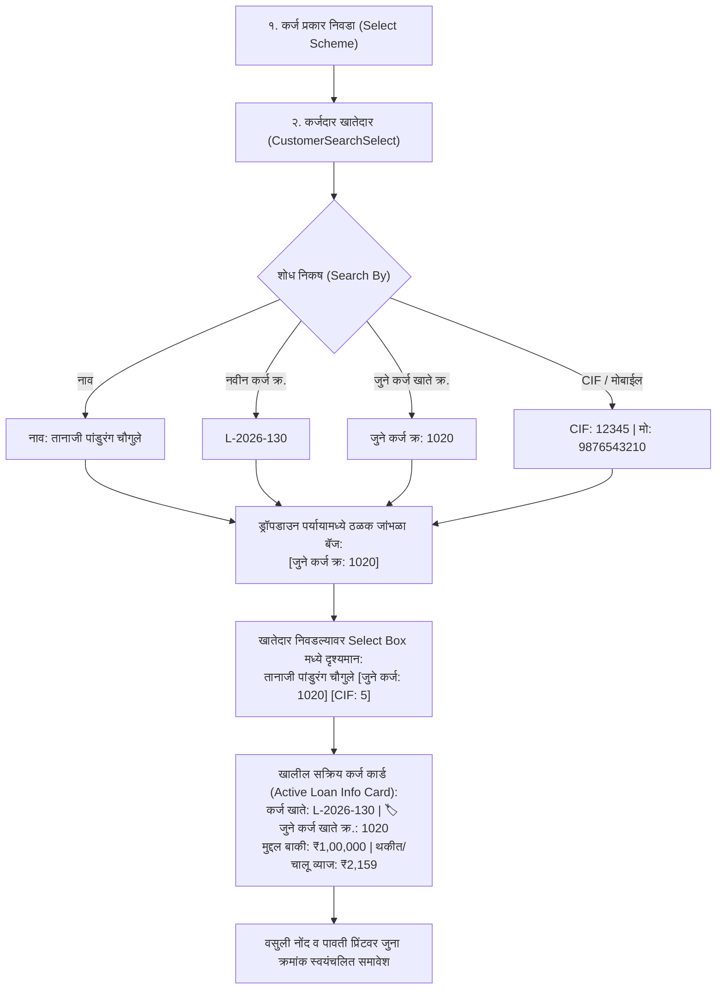

# कर्ज वसुली (Loan Collection) - कर्जदार खातेदार निवडीमध्ये "जुने कर्ज खाते नंबर" (Old Loan Account No) समावेश व शोध सुविधा
## सविस्तर अंमलबजावणी आराखडा (Comprehensive Implementation Plan)

---

### १. पार्श्वभूमी आणि सद्यस्थितीचे विश्लेषण (Background & Problem Analysis)

पतसंस्थेमध्ये (Co-operative Credit Societies / Banks) सीबीएस (CBS) मायग्रेशननंतर कर्ज वसुली करताना बहुतांश सभासद/कर्जदार हे आपले **जुने कर्ज पासबुक (Old Loan Passbook)** घेऊन येतात किंवा त्यांचा **जुना कर्ज खाते क्रमांक (Legacy Account Number)** सांगतात (उदा. `१०२०` किंवा `५५`).

#### 🔍 सद्यस्थितीतील कमतरता (Current Gap):
1. **`LoanCollectionMaster.tsx` मधील `borrowerCustomers` मॅपिंग**:
   - कर्ज प्रकार (Loan Scheme) निवडल्यानंतर त्या योजनेतील खात्यांवरून `borrowerCustomers` यादी तयार केली जाते.
   - परंतु त्यामध्ये फक्त `a.customer.legacyCustomerNo` (ग्राहकाचा जुना CIF नंबर) साठवला जातो; `a.legacyAccountNumber` (कर्ज खात्याचा जुना नंबर) साठवलाच जात नाही!
2. **`CustomerSearchSelect.tsx` मधील मर्यादा**:
   - शोध घटकामध्ये (Search Select) `legacyLoanAccountNo` हे फील्डच उपलब्ध नाही.
   - त्यामुळे कॅशियरने जुना कर्ज खाते क्रमांक टाईप केल्यास खातेदार शोधला जात नाही.
   - तसेच ड्रॉपडाउन पर्यायांमध्ये आणि खातेदार निवडल्यानंतर जुने कर्ज खाते क्रमांक कुठेही दिसत नाही.
3. **एकच कर्ज खाते असल्यास (Single Loan Account) दृश्यमानतेचा अभाव**:
   - ज्या खातेदाराचे १ पेक्षा जास्त कर्ज खाती आहेत, त्यांच्यासाठी खालील टेबलमध्ये जुना क्रमांक दिसतो; परंतु **ज्या खातेदाराचे १च कर्ज खाते आहे**, त्यांच्या बाबतीत स्क्रीनवर जुना कर्ज खाते क्रमांक स्पष्टपणे दर्शवणारे कोणतेही ठळक कार्ड/बॅज उपलब्ध नाही.
4. **पावती प्रिंट (Receipt Print)**:
   - कर्ज वसुली पावतीवर फक्त चालू संगणकीकृत खाते क्र. (`L-2026-130`) येतो, जुना कर्ज क्र. येत नाही.

---

### २. अपेक्षित कार्यप्रणाली (Required Workflow & Visual Experience)



---

### ३. तपशीलवार बदल आराखडा (Step-by-Step Technical Blueprint)

#### टप्पा १: `CustomerSearchSelect.tsx` मध्ये जुने कर्ज खाते क्रमांक मॉडेल व शोध एकात्मिकरण
**फाईल**: [`client/src/components/common/CustomerSearchSelect.tsx`](file:///d:/Bhisi%20Software/client/src/components/common/CustomerSearchSelect.tsx)

1. **`CustomerOption` इंटरफेस अपडेट**:
   ```typescript
   export interface CustomerOption {
     customerID: number;
     cifNo: string;
     firstName: string;
     middleName?: string;
     lastName: string;
     fullName?: string;
     legacyCustomerNo?: string;
     legacyLoanAccountNo?: string; // 👈 NEW: जुने कर्ज खाते क्रमांक (उदा. "1020" किंवा "55, 62")
     loanAccountNo?: string;       // 👈 NEW: चालू सीबीएस कर्ज खाते क्रमांक (उदा. "L-2026-130")
     mobileNo?: string;
     aadhaarNo?: string;
     status?: string;
     id?: number;
     customerId?: number;
     customerName?: string;
   }
   ```

2. **`options` जनरेटर आणि लेबल तयार करणे (`useMemo`)**:
   - जर `legacyLoanAccountNo` उपलब्ध असेल, तर तो `codeParts` मध्ये जोडणे:
     `codeParts.push('जुने कर्ज क्र: ' + legacyLoan);`
   - ग्राहकाच्या डेटा ऑब्जेक्टमध्ये `legacyLoanAccountNo` आणि `loanAccountNo` सुरक्षित करणे.

3. **`filterOption` मध्ये जुन्या कर्ज खाते क्रमांकाने शोध सक्षम करणे**:
   ```typescript
   const searchString = `
     ${label} 
     ${customer.firstName} 
     ${customer.middleName || ''} 
     ${customer.lastName} 
     ${customer.fullName} 
     ${customer.cifNo || ''} 
     ${customer.legacyCustomerNo || ''} 
     ${customer.legacyLoanAccountNo || ''} 
     ${customer.loanAccountNo || ''} 
     ${customer.mobileNo || ''} 
     ${customer.aadhaarNo || ''}
   `.toLowerCase();
   return searchString.includes(input);
   ```
   *परिणाम*: कॅशियरने सर्च बॉक्समध्ये थेट जुना खाते नंबर (उदा. `1020` किंवा `55`) टाईप केल्यास तो खातेदार तात्काळ सापडेल!

4. **`formatOptionLabel` मधील व्हिज्युअल बॅजेस**:
   - **ड्रॉपडाउन मेनू उघडल्यावर (`context !== 'value'`)**:
     खातेदाराच्या नावाशेजारी ठळक जांभळा बॅज (Purple Badge):
     ```tsx
     {cust.legacyLoanAccountNo && (
       <span className="text-[10px] font-mono font-bold px-1.5 py-0.5 rounded bg-purple-100 text-purple-900 border border-purple-300 shrink-0 whitespace-nowrap shadow-2xs">
         🏷️ जुने कर्ज क्र: {cust.legacyLoanAccountNo}
       </span>
     )}
     ```
   - **निवड झाल्यावर इनपुट बॉक्समध्ये (`context === 'value'`)**:
     कॅशियरला तात्काळ खात्री होण्यासाठी:
     ```tsx
     {cust.legacyLoanAccountNo && (
       <span className="text-[10px] font-mono font-bold shrink-0 px-1.5 py-0.5 rounded bg-purple-100 text-purple-900 border border-purple-300 leading-none">
         जुने कर्ज: {cust.legacyLoanAccountNo}
       </span>
     )}
     ```

---

#### टप्पा २: `LoanCollectionMaster.tsx` मध्ये `borrowerCustomers` डेटा एकत्रीकरण
**फाईल**: [`client/src/components/LoanCollectionMaster.tsx`](file:///d:/Bhisi%20Software/client/src/components/LoanCollectionMaster.tsx)

1. **`borrowerCustomers` (Lines 342-392) अद्ययावत करणे**:
   - जेव्हा `filteredAccountsForBorrowers` मधून खातेदारांची यादी तयार होते, तेव्हा प्रत्येक खातेदाराच्या सर्व सक्रिय खात्यांचे `legacyAccountNumber` आणि `loanAccountNo` गोळा करणे:
   ```typescript
   const borrowerCustomers = useMemo(() => {
       if (!selectedSchemeId) return [];
       const map = new Map<number, any>();
       
       filteredAccountsForBorrowers.forEach((a: any) => {
           const custId = Number(a.customerID || a.customer?.customerID || a.memberID || 0);
           if (custId <= 0) return;

           const fName = a.customer?.firstName || a.member?.firstName || (a.customer ? '' : 'खातेदार');
           const mName = a.customer?.middleName || a.member?.middleName || '';
           const lName = a.customer?.lastName || a.member?.lastName || (a.customer ? '' : `#${custId}`);
           const fullName = [fName, mName, lName].filter(Boolean).join(' ').trim() || `खातेदार #${custId}`;
           const cif = a.customer?.cifNo || a.member?.memberCode || a.loanAccountNo || '';
           const legacyCust = a.customer?.legacyCustomerNo || '';
           const mobile = a.customer?.mobileNo || '';

           const legacyAccNo = (a.legacyAccountNumber || '').trim();
           const currentAccNo = (a.loanAccountNo || '').trim();

           if (!map.has(custId)) {
               map.set(custId, {
                   customerID: custId,
                   cifNo: cif,
                   legacyCustomerNo: legacyCust,
                   legacyLoanAccountNos: legacyAccNo ? [legacyAccNo] : [],
                   loanAccountNos: currentAccNo ? [currentAccNo] : [],
                   firstName: fName,
                   middleName: mName,
                   lastName: lName,
                   fullName: fullName,
                   mobileNo: mobile
               });
           } else {
               const existing = map.get(custId);
               if (legacyAccNo && !existing.legacyLoanAccountNos.includes(legacyAccNo)) {
                   existing.legacyLoanAccountNos.push(legacyAccNo);
               }
               if (currentAccNo && !existing.loanAccountNos.includes(currentAccNo)) {
                   existing.loanAccountNos.push(currentAccNo);
               }
           }
       });

       const result = Array.from(map.values()).map(item => ({
           ...item,
           legacyLoanAccountNo: item.legacyLoanAccountNos.join(', '),
           loanAccountNo: item.loanAccountNos.join(', ')
       }));

       return result.sort((a, b) => (a.fullName || '').localeCompare(b.fullName || ''));
   }, [filteredAccountsForBorrowers, selectedSchemeId]);
   ```

2. **सक्रिय कर्ज खाते माहिती कार्ड (Active Loan Info Banner)**:
   - `२. कर्जदार खातेदार` इनपुटच्या अगदी खाली, जेव्हा `selectedAccount` निवडलेले असते:
   ```tsx
   {selectedAccount && (
       <div className="mt-1.5 px-2.5 py-1.5 bg-gradient-to-r from-blue-50/90 via-slate-50 to-indigo-50/90 border border-blue-200/80 rounded-sm shadow-2xs flex flex-wrap items-center justify-between gap-2 text-xs">
           <div className="flex flex-wrap items-center gap-2">
               <span className="text-slate-600 font-semibold">सक्रिय कर्ज खाते:</span>
               <span className="font-mono font-bold text-gray-900 bg-white px-2 py-0.5 rounded border border-blue-300">
                   {format14DigitDisplay(selectedAccount.loanAccountNo)}
               </span>
               {selectedAccount.legacyAccountNumber && (
                   <span className="font-mono font-bold text-purple-900 bg-purple-100 px-2 py-0.5 rounded border border-purple-300 text-[11px] flex items-center gap-1 shadow-2xs">
                       🏷️ जुने कर्ज खाते क्र.: <strong className="text-purple-950 font-black">{selectedAccount.legacyAccountNumber}</strong>
                   </span>
               )}
           </div>
           <div className="flex flex-wrap items-center gap-3 text-[11px]">
               <span>मंजूर: <strong className="text-slate-800">₹{(selectedAccount.sanctionedAmount || 0).toLocaleString('en-IN')}</strong></span>
               <span>मुद्दल बाकी: <strong className="text-rose-700 font-bold">₹{(selectedAccount.principalBalance || 0).toLocaleString('en-IN', { minimumFractionDigits: 2 })}</strong></span>
               <span>व्याज बाकी: <strong className="text-amber-800 font-bold">₹{(selectedAccount.interestBalance || 0).toLocaleString('en-IN', { minimumFractionDigits: 2 })}</strong></span>
           </div>
       </div>
   )}
   ```

3. **मल्टी-लोन मोडल (Multi-Loan Selection Modal)**:
   - खातेदाराकडे एकापेक्षा जास्त खाती असल्यास उघडणाऱ्या मोडलमधील प्रत्येक खात्याच्या कार्डवर `🏷️ जुने कर्ज क्र: {acc.legacyAccountNumber}` बॅज ठळकपणे दर्शवणे.

4. **अलिकडील वसुली नोंदी टेबल (Recent Receipts Table)**:
   - खात्याच्या स्तंभात `जुने खाते क्र: {c.loanAccount?.legacyAccountNumber}` समावेश करणे.

---

#### टप्पा ३: पावती प्रिंट (`LoanCollectionReceiptPrint.tsx`) मध्ये जुना क्रमांक
**फाईल**: [`client/src/components/LoanCollectionReceiptPrint.tsx`](file:///d:/Bhisi%20Software/client/src/components/LoanCollectionReceiptPrint.tsx)

1. **पावती प्रिंटिंग लेआउट (Physical Slip)**:
   ```tsx
   <p className="text-gray-600 mt-1">
       कर्ज खाते क्र. (Loan Account No): 
       <span className="font-bold text-slate-900 ml-1">
           {collection.loanAccount?.loanAccountNo}
       </span>
       {collection.loanAccount?.legacyAccountNumber && (
           <span className="ml-2 font-mono font-bold text-purple-900 bg-purple-50 px-1.5 py-0.5 rounded border border-purple-200 text-xs">
               (जुने कर्ज खाते क्र.: {collection.loanAccount.legacyAccountNumber})
           </span>
       )}
   </p>
   ```
2. **व्हॉट्सॲप / एसएमएस पावती मेसेज (WhatsApp / SMS Receipt Template)**:
   ```
   👤 *कर्ज खाते क्र.:* ${collection.loanAccount?.loanAccountNo}${collection.loanAccount?.legacyAccountNumber ? ` (जुना क्र.: ${collection.loanAccount.legacyAccountNumber})` : ''}
   ```

---

#### टप्पा ४: बॅकएंड व डेटाबेस पडताळणी (Backend & Database Verification)
- `Bhisi.Api/Models/LoanAccount.cs` मध्ये `public string? LegacyAccountNumber { get; set; }` आधीच अस्तित्वात आहे.
- `SmartBanking_Testing` डेटाबेसमध्ये `LoanAccounts.LegacyAccountNumber` कॉलम आधीच भरलेला आहे (उदा. खाते क्र. `L-2026-130` चा जुना नंबर `1020` आहे).
- `GET /api/LoanAccounts` आणि `GET /api/LoanCollections` हे आधीच `LegacyAccountNumber` रिटर्न करतात.
- **त्यामुळे डेटाबेस किंवा सी-शार्प बॅकएंडमध्ये कोणतेही नवीन स्थलांतर (Migration) किंवा स्कीमा बदलाची आवश्यकता नाही (Zero DB Risk)!**

---

### ४. चाचणी व गुणवत्ता पडताळणी (Verification & Test Cases)

| क्र. | चाचणी प्रकार (Test Case) | अपेक्षित निकाल (Expected Outcome) |
| :--- | :--- | :--- |
| १ | **कर्ज प्रकार निवड** | उपलब्ध कर्जदारांची यादी अचूक लोड होते व त्यामध्ये जुने कर्ज क्रमांक जोडलेले असतात. |
| २ | **जुने कर्ज नंबरने शोध (`1020` किंवा `55`)** | सर्च बॉक्समध्ये जुना नंबर टाकल्यास संबंधित कर्जदार तात्काळ फिल्टर होतो. |
| ३ | **ड्रॉपडाउनमधील व्हिज्युअल बॅज** | कर्जदाराच्या नावासमोर `[🏷️ जुने कर्ज क्र: 1020]` जांभळा बॅज दिसतो. |
| ४ | **निवड झाल्यानंतर इनपुट बॉक्स** | इनपुट बॉक्समध्ये `तानाजी पांडुरंग चौगुले [जुने कर्ज: 1020] [CIF: 5]` स्वच्छपणे दिसतो. |
| ५ | **सक्रिय कर्ज कार्ड (Single Loan)** | १च खाते असले तरी खाली `कर्ज खाते क्र: L-2026-130 | 🏷️ जुने कर्ज खाते क्र.: 1020` दिसते. |
| ६ | **अनेक खाती असलेला कर्जदार (Multiple Loans)** | मोडल व ग्रिडमध्ये प्रत्येक खात्याचा जुना नंबर वेगवेगळ्या कार्डवर अचूक दिसतो. |
| ७ | **पावती जतन व प्रिंट** | पावतीवर आणि व्हॉट्सॲप मेसेजवर जुने कर्ज खाते क्रमांक समाविष्ट होतो. |

---

### ५. अंमलबजावणीसाठी फाइल्सची यादी (Affected Files)

1. [`client/src/components/common/CustomerSearchSelect.tsx`](file:///d:/Bhisi%20Software/client/src/components/common/CustomerSearchSelect.tsx)
2. [`client/src/components/LoanCollectionMaster.tsx`](file:///d:/Bhisi%20Software/client/src/components/LoanCollectionMaster.tsx)
3. [`client/src/components/LoanCollectionReceiptPrint.tsx`](file:///d:/Bhisi%20Software/client/src/components/LoanCollectionReceiptPrint.tsx)
