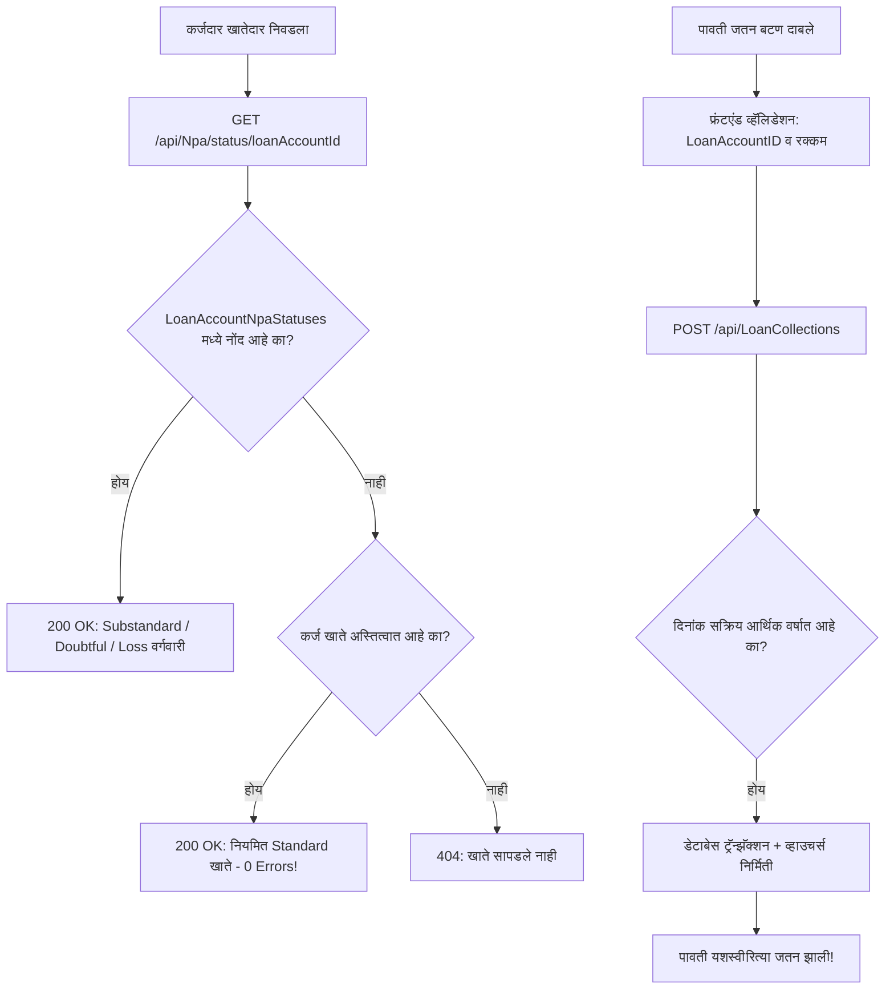

# 📋 कर्ज वसुली NPA ४०४ त्रुटी व पावती जतन (Save) बिघाड निवारण कृती आराखडा
## Implementation Plan: Loan Collection NPA 404 Resolution & Receipt Save Flow Fix

**आवृत्ती:** SmartBanking CBS v2.5.91  
**मॉड्यूल:** कर्ज वसुली (`/karjvibhag/vasuli` - `LoanCollectionMaster.tsx` & `LoanCollectionsController.cs` & `NpaController.cs`)  
**स्थिती:** मंजुरीसाठी सादर (Do Not Code Mode)

---

### 🎯 १. उद्दिष्ट व समस्येची व्याप्ती (Objectives & Scope)

1. **NPA ४०४ कन्सोल एररचे कायमस्वरूपी निवारण:**  
   कर्जदार निवडताच `GET /api/Npa/status/{id}` कडून मिळणारा ४०४ (Not Found) बंद करून नियमित खात्यांसाठी `200 OK` सह `Standard (नियमित)` स्थिती पाठवणे.
2. **कर्ज वसुली पावती जतन (Save Failure) प्रक्रियेचे सुलभीकरण:**  
   - तारीख पडताळणी (`DateTime.Today` vs Business Date) अधिक लवचिक व शास्त्रीय करणे.
   - पडवळवाडीसह सर्व संस्थांच्या डेटाबेसवर नवीन `LoanCollections` स्कीमाची १००% हमी देणे.
   - फ्रंटएंडवर खाते निवड व्हॅलिडेशन अधिक मजबूत करणे, जेणेकरून सेव्ह अयशस्वी झाल्यास युझरला नेमके कारण स्पष्ट दिसेल.
3. **सर्व संस्थांसाठी मल्टि-अ‍ॅप पॅच अपडेट:**  
   बदल पडवळवाडी, बामणवाडे, याद्राव, सह्याद्रीसह सर्व ९ संस्थांच्या व्हीपीएस पॅकेजमध्ये समाविष्ट करणे.

---

### 🏗️ २. प्रस्तावित तांत्रिक बदल (Detailed Technical Changes)



---

### 📝 ३. तपशीलवार अंमलबजावणी टप्पे (Step-by-Step Implementation Steps)

#### 🔹 टप्पा १: बॅकएंड - `NpaController.cs` मधील ४०४ त्रुटी सुधारणा
* **फाईल:** [NpaController.cs](file:///d:/Bhisi%20Software/api/Bhisi.Api/Controllers/NpaController.cs#L54-L74)
* **बदल:**  
  `GetAccountNpaStatus(int loanAccountId)` या एंडपॉईंटमध्ये:
  - जर खात्याची नोंद `LoanAccountNpaStatuses` मध्ये नसेल, तर लगेच `NotFound()` न देता `_context.LoanAccounts.AnyAsync(l => l.LoanAccountID == loanAccountId)` तपासावे.
  - खाते अस्तित्वात असल्यास **`200 OK`** सह खालील ऑब्जेक्ट द्यावा:
    ```csharp
    return Ok(new
    {
        Category = "Standard",
        OverdueDays = 0,
        CategoryMarathi = "नियमित (Standard)",
        IsNpa = false
    });
    ```
* **फायदा:** ब्राऊझर कन्सोलमधील लाल ४०४ एरर पूर्णपणे नाहीशी होईल आणि स्क्रीनवर हिरवा "नियमित" बॅज अचूक दिसेल.

---

#### 🔹 टप्पा २: बॅकएंड - `LoanCollectionsController.cs` तारीख व्हॅलिडेशन सुधारणा
* **फाईल:** [LoanCollectionsController.cs](file:///d:/Bhisi%20Software/api/Bhisi.Api/Controllers/LoanCollectionsController.cs#L204-L215)
* **बदल:**  
  - सध्याचा चेक: `if (collection.CollectionDate.Date > DateTime.Today)` हा सर्व्हरच्या प्रत्यक्ष कॅलेंडर घड्याळावर अवलंबून असल्यामुळे `३०/०६/२०२६` सारख्या व्यवसाय तारखेला सेव्ह रोखू शकतो.
  - सुधारणा: सक्रिय आर्थिक वर्ष (`Active Financial Year`) मधील तारखांना सुरक्षित मंजुरी देणे:
    ```csharp
    var activeFy = await _context.FinancialYears.FirstOrDefaultAsync(fy => fy.IsActive);
    if (activeFy != null && collection.CollectionDate.Date > activeFy.EndDate.Date)
    {
        return BadRequest($"पावतीची दिनांक चालू आर्थिक वर्षाच्या समाप्ती दिनांकापेक्षा ({activeFy.EndDate:dd/MM/yyyy}) पुढील असू शकत नाही.");
    }
    ```
* **फायदा:** चालू व्यवसाय तारखेवर (३०/०६/२०२६) पावती कोणत्याही तांत्रिक अडथळ्याविना सेव्ह होईल.

---

#### 🔹 टप्पा ३: फ्रंटएंड - `LoanCollectionMaster.tsx` डिफेन्सिव्ह सेव्ह गार्ड्स
* **फाईल:** [LoanCollectionMaster.tsx](file:///d:/Bhisi%20Software/client/src/components/LoanCollectionMaster.tsx#L1460-L1500)
* **बदल:**  
  - `handleSubmit` मध्ये `loanAccountID` सुरक्षितपणे जोडणे:
    ```typescript
    const targetAccountId = formData.loanAccountID || selectedAccount?.loanAccountID;
    if (!targetAccountId) {
        alert('कृपया आधी कर्जदार व सक्रिय कर्ज खाते निवडा.');
        return;
    }
    ```
  - सर्व्हरकडून काही अडचण आल्यास येणारा एरर मेसेज युझरला स्पष्ट व मराठीत दाखवणे.

---

#### 🔹 टप्पा ४: डेटाबेस थेट पडताळणी व SQL पॅच
* **फाईल:** [patch_loan_collections_padvalwadi.sql](file:///d:/Bhisi%20Software/sql_patches/patch_loan_collections_padvalwadi.sql)
* **कृती:**  
  पडवळवाडीच्या थेट SQL डेटाबेसवर (`SmartBanking_padvalwadi`) ही स्क्रिप्ट रन करून सर्व ११ नवीन कॉलम्स व `LoanCollectionFees` टेबल उपलब्ध असल्याची खात्री करणे.

---

#### 🔹 टप्पा ५: बिल्ड, चाचणी व पॅकेजिंग
1. `client` आणि `api` बिल्ड्सची चाचणी (`npm run build` व `dotnet build`).
2. व्हर्जन `v2.5.91` अपडेट करणे.
3. Git वर बदल कमिट व पुश करणे.
4. `tools/build_vps_multi_app_patch.ps1` द्वारे नवीन मास्टर पॅच (`SmartBanking_VPS_Multi_App_Master_Patch.zip`) तयार करणे.

---

### 🛡️ ४. जोखीम व पूर्वतयारी (Risks & Safeguards)

| जोखीम | परिणाम | पूर्वतयारी / उपाययोजना |
| :--- | :--- | :--- |
| **NPA कॅल्क्युलेशन बदलणे** | इतर अहवालांवर परिणाम होण्याची भीती | कोणतीही कॅल्क्युलेशन अल्गोरिदम बदलली जाणार नाही; फक्त `status` रीड क्वेरीचा फॉलबॅक सुरक्षित केला जाईल. |
| **तारीख सुरक्षा** | बंद झालेल्या वर्षात पावती पडणे | बंद झालेल्या आर्थिक वर्षाचा चेक (`fy.IsClosed`) कायम तसाच कडक राहील. |
| **डेटाबेस अखंडता** | डेटा लॉस | सर्व बदल फक्त नवीन कॉलम्स `ADD` करतात, कोणत्याही जुन्या डेटाला हात लावला जात नाही. |

---

### 💬 पुढील पाऊल:
हा कृती आराखडा मंजूर असल्यास कृपया **"Proceed"** आदेश द्यावा, जेणेकरून कोड अंमलबजावणी तात्काळ सुरू करता येईल.
