# कर्ज वसुली (Loan Collection) हाय-स्पीड कार्यक्षमता सुधारणा अंमलबजावणी आराखडा
## High-Performance Loan Collection Optimization & Instant Save Implementation Plan

---

### १. कार्यकारी प्रस्तावना (Executive Summary)

कर्ज वसुली (Loan Collection) हे पतसंस्थेचे दैनंदिन मुख्य कार्य आहे, जेथे प्रत्येक ऑपरेटर दिवसाला शेकडो पावत्या फाडतो.
सध्या या मॉड्यूलमध्ये २ प्रमुख अडथळे (Performance Bottlenecks) जाणवत आहेत:
1. **कर्ज प्रकार / योजना (Loan Scheme Dropdown) उशिरा लोड होणे:** स्क्रीन उघडल्यावर योजना दिसण्यासाठी ५ ते १५ सेकंद वाट पाहावी लागते.
2. **जतन (Save) बटनावर क्लिक केल्यावर पावती सेव्ह होण्यास खूप वेळ लागणे व स्क्रीन फ्रीझ होणे:** सेव्ह बटन दाबल्यावर ३ ते ६ सेकंद सिस्टीम अडकून राहते.

हा आराखडा वरील दोन्ही अडथळ्यांचे मूळ कारण नष्ट करून **स्क्रीन उघडताच १ सेकंदाच्या आत योजना दिसणे** आणि **पावती १ सेकंदात सेव्ह होऊन पुढील पावतीसाठी स्क्रीन तत्काळ तयार होणे** यासाठी तांत्रिक उपाययोजना सादर करतो.

---

### २. समस्येचे मूळ तांत्रिक विश्लेषण (Root Cause Analysis)

```mermaid
flowchart TD
    subgraph CURRENT_FLOW ["🔴 सध्याचा संथ प्रवाह (Slow Current Architecture)"]
        A1["स्क्रीन उघडणे"] --> B1["GET /api/LoanAccounts<br/>(हजारो खाती + ९ सब-टेबल्स डाऊनलोड)"]
        B1 --> C1["मेगाबाईट्सचा डेटा डाऊनलोड होण्याची प्रतीक्षा... (५-१५ से.)"]
        C1 --> D1["क्लायंट ब्राउझर लूपमधून योजना काढणे"]
        D1 --> E1["योजना ड्रॉपडाउनमध्ये दिसणे"]
        
        F1["'जतन' (Save) क्लिक"] --> G1["बॅकएंड: ४ वेळा स्वतंत्र SaveChangesAsync()<br/>+ मजकूर लेजर शोध"]
        G1 --> H1["सेव्ह झाल्यावर लगेच: पुन्हा एकदा GET /api/LoanAccounts<br/>(संपूर्ण डेटाबेस पुन्हा नव्याने डाऊनलोड!)"]
        H1 --> I1["स्क्रीन ३-६ सेकंद पूर्णपणे फ्रीझ"]
    end

    subgraph PROPOSED_FLOW ["🟢 प्रस्तावित हाय-स्पीड प्रवाह (Optimized High-Speed Architecture)"]
        A2["स्क्रीन उघडणे"] --> B2["GET /api/LoanRates<br/>(केवळ ५-१० मास्टर योजना: <५ KB)"]
        B2 --> C2["⚡ १ सेकंदाच्या आत योजना तत्काळ उपलब्ध! (<५० ms)"]
        
        F2["'जतन' (Save) क्लिक"] --> G2["बॅकएंड: १ सिंगल बॅच ट्रान्झॅक्शन SaveChangesAsync()<br/>+ कॅश लेजर मॅपिंग"]
        G2 --> H2["सेव्ह झाल्यावर: फक्त संबंधित १ खात्याची शिल्लक अपडेट<br/>(संपूर्ण डेटाबेस फेच पूर्णपणे बंद)"]
        H2 --> I2["⚡ १ सेकंदात पावती सेव्ह व नवीन पावतीसाठी फॉर्म रेडी!"]
    end
```



---

### ३. तपशीलवार तांत्रिक बदल (Component-by-Component Blueprint)

---

#### टप्पा १: 'कर्ज प्रकार / योजना' तात्काळ लोड करणे (Instant Scheme Dropdown)

##### १.१ सद्यस्थितीतील दोष:
* `availableLoanSchemes` हे `useMemo` मध्ये `accounts` स्टेटवर अवलंबून आहे.
* `accounts` हे `GET /api/LoanAccounts` पूर्ण होईपर्यंत रिकामे राहते.
* `LoanAccountsController.cs` मध्ये ९ मोठे `Include(...)` असल्याने SQL Server वर प्रचंड कार्टेशियन जॉइन (Cartesian Join) होतो.

##### १.२ प्रस्तावित बदल:
1. **थेट मास्टर API कॉल (`GET /api/LoanRates`):**
   * स्क्रीन माउंट होताच `fetchSanstha()` प्रमाणेच `fetchLoanSchemes()` द्वारे थेट `GET /api/LoanRates` फेच करणे.
   * `availableLoanSchemes` हे थेट मास्टर यादीवरून तयार करणे.
   * **फायदा:** ५ ते १० योजनांचा डेटा केवळ **१० ते २० मिलीसेकंदांत** लोड होईल, ऑपरेटरला एक क्षणही थांबावे लागणार नाही.
2. **योजना निवडल्यावरच खाती फेच करणे (Lazy-Load by Scheme):**
   * स्क्रीन उघडताच संपूर्ण बँकेची सर्व खाती फेच न करता, ऑपरेटरने वर योजना निवडल्यावर (उदा. 'जमीनकी कर्ज' किंवा 'सोनेतारण कर्ज') फक्त त्या एकाच योजनेची चालू खाती फेच करणे:
     `GET /api/LoanAccounts?loanRateId=${selectedSchemeId}&status=Active`
   * **फायदा:** नेटवर्क ट्रॅफिक ९०% ने कमी होईल आणि ब्राउझरची मेमरी हलकी राहील.

---

#### टप्पा २: 'जतन (Save)' प्रक्रिया ऑप्टिमायझेशन (Instant Save & No Freeze)

##### २.१ बॅकएंड `LoanCollectionsController.cs` सुधारणा:
1. **सिंगल बॅच सेव्ह (Consolidate SaveChangesAsync):**
   * सध्याच्या कोडमध्ये एकाच ट्रान्झॅक्शनमध्ये ४ वेळा स्वतंत्र `_context.SaveChangesAsync()` कॉल्स होतात.
   * **बदल:** कलेक्शन तयार करणे, वेळापत्रक (Schedules) मॉडिफाय करणे आणि व्हाउचर्स तयार करणे या सर्व एंटिटीजचा स्टेट चेंज एकाच वेळी ट्रॅक करून **केवळ १ किंवा कमाल २ वेळाच `SaveChangesAsync()` करणे.**
   * यामुळे नेटवर्क राऊंडट्रिप्स ४ वरून १ वर येतील आणि डेटाबेसवरील लॉकचा वेळ ७५% कमी होईल.
2. **लेजर नाव स्ट्रिंग शोध निर्मूलन (Eliminate Unindexed String Scans):**
   * `"थकीत व्याज येणे खाते"`, `"थकीत व्याज तरतूद खाते"` यांसारख्या लेजर्सचा शोध प्रत्येक पावतीवेळी `l.LedgerName == "..."` असा टेबल स्कॅन करण्याऐवजी `SansthaDetails` किंवा स्कीम लेजर आयडीवरून थेट आयडी वापरणे.

##### २.२ क्लायंट-साइड `LoanCollectionMaster.tsx` सुधारणा:
1. **सेव्हनंतर संपूर्ण डेटाबेस पुन्हा डाऊनलोड करणे बंद (Eliminate Post-Save `fetchAccounts()`):**
   * ओळ १५०७ वर असणारा `fetchAccounts()` कॉल पूर्णपणे काढून टाकणे.
   * पावती सेव्ह झाल्यावर फक्त ज्या खात्यात पैसे जमा झाले, त्या एकाच खात्याची ताजी शिल्लक फेच करणे किंवा थेट स्टेटमधून मुद्दल व व्याज वजा करणे:
     ```typescript
     // संपूर्ण डेटाबेस पुन्हा मागवण्याऐवजी फक्त संबंधित १ खाते अपडेट:
     if (savedCollectionId) {
         fetchData(); // दैनिक वसुली सारांश अपडेट
         fetchNextReceiptNo(selectedBranchId); // पुढील पावती क्रमांक
         // fetchAccounts() काढले! (No heavy re-download)
     }
     ```
2. **सेव्ह बटनावर लोडिंग स्पिनर व डिसेबल स्टेट (Visual Feedback & Double-Click Guard):**
   * `const [isSaving, setIsSaving] = useState(false);`
   * 'जतन (Save)' बटण दाबल्याबरोबर ते डिसेबल होऊन त्यावर चक्र (Spinner) फिरताना दिसेल:
     `[ ⏳ जतन होत आहे... ]`
   * यामुळे ऑपरेटरला सिस्टीम काम करत असल्याची स्पष्ट जाणीव होईल आणि चुकून दोनदा क्लिक होण्याचा धोका टळेल.

---

### ४. अंमलबजावणी पडताळणी तक्ता (Before vs After Comparison)

| वैशिष्ट्य / निकष | सध्याची स्थिती (Current) | प्रस्तावित स्थिती (After Fix) | सुधारणा (Improvement) |
| :--- | :---: | :---: | :---: |
| **योजना लोड वेळ** | ५ ते १५ सेकंद | **< ०.५ सेकंद (Instant)** | **९५% वेगवान** |
| **आरंभी डेटा आकार** | ५ MB ते १५ MB (सर्व खाती + ९ जॉइन्स) | **< १० KB (केवळ मास्टर दरपत्रक)** | **९९% नेटवर्क बचत** |
| **पावती सेव्ह वेळ** | ३ ते ६ सेकंद | **< १ सेकंद** | **७०% वेगवान** |
| **सेव्हनंतर स्क्रीन फ्रीझ** | होय (संपूर्ण DB रीलोडमुळे अडकणे) | **नाही (फक्त संबंधित खाते सिंक)** | **१००% स्मूथ अनुभव** |
| **डबल-क्लिक धोका** | जास्त (बटण तसेच राहिल्याने) | **शून्य (ऑटो-लॉक व स्पिनर)** | **१००% सुरक्षित** |

---

### ५. सुरक्षितता व कोअर बँकिंग अखंडता (Core Banking Safeguards)

1. **शिल्लक व लेजर तंतोतंत जुळणी:** खात्याची शिल्लक, व्याज आकारणी आणि व्हाउचर्सचे ताळेबंद पोस्टिंग पूर्वीप्रमाणेच अचूक राहील, फक्त डेटा ट्रान्सफरचा अनावश्यक भार काढून टाकला जाईल.
2. **मल्टी-ब्रांच व IBT सुरक्षितता:** आंतर-शाखा व मूळ शाखा वसुलीचे नियम पूर्वीप्रमाणेच अखंड चालू राहतील.
3. **झिरो डेटा लॉस:** जुन्या पावत्या किंवा चालू खात्यांवर कोणतीही बाधा येणार नाही.

---

### ६. पुढील मंजुरी (Decision Request)

हा आराखडा आपल्या अंतिम मंजुरीसाठी तयार करण्यात आला आहे.
आपली मंजुरी मिळाल्यानंतर या आराखड्यानुसार **टप्पा १ (योजना तात्काळ लोड)** आणि **टप्पा २ (सेव्ह प्रक्रिया वेगवान करणे)** ची अंमलबजावणी प्रत्यक्ष कोडमध्ये सुरू केली जाईल.
