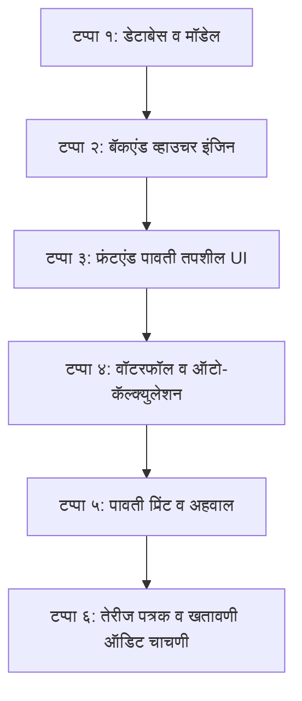

# कर्ज वसुली (Loan Collection): पावती तपशीलात 'येणे व्याज' (Interest Receivable) स्वतंत्र नोंदणी व खतावणी सीबीएस आराखडा
## Core Banking System (CBS) Loan Collection: Separate "Interest Receivable (येणे व्याज)" Receipt Apportionment & Dynamic GL Accounting Implementation Plan

---

### १. कार्यकारी सारांश व उद्दिष्ट (Executive Summary & Objective)

सहकारी पतसंस्था आणि नागरी सहकारी बँकांमध्ये (Cooperative Credit Societies & Urban Banks) कर्ज वसुली (Loan Collection) प्रक्रिया ही केवळ कॅश जमा करणे नसून ती **ताळेबंद (Balance Sheet)** आणि **नफा-तोटा पत्रक (Profit & Loss Account)** यांच्याशी थेट संबंधित असणारी दुहेरी नोंद खतावणी (Double Entry Accounting) प्रक्रिया आहे.

#### १.१ सध्याची अडचण (Current Problem Statement)
* **स्क्रीनवरील विसंगती:** कर्ज वसुली स्क्रीनवर (`LoanCollectionMaster.tsx`) उजव्या बाजूच्या हिशोब कोष्टकात (Grid) खालीलप्रमाणे स्वतंत्र रकाने दिसतात:
  1. **व्याज** (चालू कालावधीचे देय व्याज / Current Accrued Interest)
  2. **येणे व्याज** (मासिक/वार्षिक आकारणीतून खात्यावर जमा असलेले जुने येणे व्याज / `InterestBalance`)
  3. **दंड व्याज** (Penal Interest)
* **पावती तपशीलातील मर्यादा:** परंतु डाव्या बाजूच्या **"पावती तपशील (Receipt Details)"** पॅनेलमध्ये मात्र फक्त **"मेंबर व्याज (Interest)"** हा एकच रकाना उपलब्ध आहे.
* **परिणाम:** सिस्टीम ग्रिडमधील चालू व्याज आणि येणे व्याज यांची एकत्र बेरीज करून ते 'मेंबर व्याज' मध्ये भरते. यामुळे:
  - कॅशियरला किंवा ऑपरेटरला खात्यावर थकीत असणारे जुने **"येणे व्याज"** किती वसूल झाले आणि **"चालू व्याज"** किती वसूल झाले, हे स्वतंत्रपणे पाहता किंवा निवडता येत नाही.
  - बॅकएंड व्हाऊचरमध्ये संपूर्ण व्याज रक्कम एकाच **"कर्ज व्याज उत्पन्न खात्याला" (Interest Income A/c - Cr.)** जमा होते. जर येणे व्याज आधीच व्याज आकारणी बॅचमध्ये (Interest Posting Batch) उत्पन्न म्हणून बुक झाले असेल, तर वसुलीच्या वेळी पुन्हा तेच व्याज उत्पन्न खात्याला जमा झाल्याने **उत्पन्नाची दुबार नोंद (Double Income Booking)** होते आणि ताळेबंदातील **"येणे व्याज खाते (Asset)"** तसेच पडून राहते.

#### १.२ प्रस्तावित उद्दिष्ट (Core Objectives)
1. **पावती तपशीलात स्वतंत्र रकाना:** डाव्या बाजूच्या "पावती तपशील" बॉक्समध्ये **"येणे व्याज (Receivable Interest)"** आणि **"चालू व्याज (Current Interest)"** असे दोन स्वतंत्र इनपुट रकाने देणे.
2. **ग्रिड-टू-रिसिप्ट स्वयंचलित समक्रमण (Grid-to-Receipt Auto-Fill):** हिशोब कोष्टकातील 'येणे व्याज' (कॉलम १३) आणि 'चालू व्याज' (कॉलम १२) या दोन्ही रकमा पावती तपशीलातील संबंधित रकान्यांमध्ये अचूकपणे मॅप होणे.
3. **वॉटरफॉल प्राधान्यक्रम (CBS Recovery Waterfall):** वसुली करताना आधी जुने 'येणे व्याज' वसूल करणे, त्यानंतर 'चालू व्याज' आणि मग 'मुद्दल' अशी अचूक नियमानुसार विभागणी होणे.
4. **डायनॅमिक जीएल लेजर व्हाऊचर पोस्टिंग (Dynamic GL Voucher Posting):**
   - वसूल झालेले येणे व्याज ➔ **Cr. संबंधित कर्ज येणे व्याज खाते (`LoanRate.ReceivableInterestLedgerID`)**
   - वसूल झालेले चालू व्याज ➔ **Cr. संबंधित कर्ज व्याज उत्पन्न खाते (`LoanRate.InterestLedgerID`)**
5. **पारदर्शक पावती व अहवाल (Transparent Receipts & Reports):** छापील पावतीवर, व्हॉट्सॲप मेसेजवर आणि दैनंदिन वसुली नोंदवहीत (Collection Register) दोन्ही व्याजांचा स्वतंत्र ब्रेकअप दर्शवणे.

---

### २. बँकिंग व हिशोब शास्त्र विश्लेषण (Banking & Accounting Architecture)

```
┌────────────────────────────────────────────────────────────────────────────────────────────────────────┐
│                        कर्ज वसुली हिशोब शास्त्र वर्गीकरण (CBS Collection Accounting Flow)              │
└───────────────────────────────────────────────────┬────────────────────────────────────────────────────┘
                                                    │
                 ┌──────────────────────────────────┴──────────────────────────────────┐
                 ▼                                                                     ▼
┌─────────────────────────────────┐                                   ┌─────────────────────────────────┐
│ १. येणे व्याज (Interest Rec.)   │                                   │ २. चालू व्याज (Current Interest)│
├─────────────────────────────────┤                                   ├─────────────────────────────────┤
│ • पूर्वीच्या आकारणीने किंवा     │                                   │ • मागील आकारणी दिनांकापासून आज  │
│   आरंभिक शिल्लकेने खात्यावर बाकी│                                   │   दिनांकापर्यंतचे न आकारलेले व्याज│
│ • आधीच P&L ला उत्पन्न म्हणून    │                                   │ • अद्याप लेजरमध्ये आकारले गेलेले│
│   क्रेडिट झालेले असते.          │                                   │   नाही (Unposted Accrual).      │
│ ─────────────────────────────── │                                   │ ─────────────────────────────── │
│ 🏦 **खतावणी परिणाम (Cr. Effect):**│                                   │ 🏦 **खतावणी परिणाम (Cr. Effect):**│
│ ताळेबंद संपत्ती (Asset) कमी करणे:│                                   │ नफा-तोटा उत्पन्न (Income) वाढवणे:│
│ **Cr. कर्ज येणे व्याज खाते**   │                                   │ **Cr. कर्ज व्याज उत्पन्न खाते** │
│ (Receivable Interest Ledger)    │                                   │ (Interest Income Ledger)        │
└─────────────────────────────────┘                                   └─────────────────────────────────┘
```

#### २.१ हिशोब शास्त्र मॅट्रिक्स (Double Entry Accounting Matrix)

| क्र. | जमा घटक | लेजर प्रकार | डेबिट (Dr.) लेजर | क्रेडिट (Cr.) लेजर | ताळेबंद / नफा-तोटा परिणाम |
|:---:|:---|:---:|:---|:---|:---|
| **१** | रोख / बँक जमा | संपत्ती (Asset) | **Dr. कॅशियर रोख शिल्लक / बँक** | - | बँकेतील रोख शिल्लक वाढते |
| **२** | **येणे व्याज जमा** | संपत्ती घट (Asset) | - | **Cr. कर्ज येणे व्याज खाते** (`ReceivableInterestLedgerID`) | येणे व्याज येणे बाकी संपत्ती कमी होते (ताळेबंद अचूक) |
| **३** | **चालू व्याज जमा** | उत्पन्न (Income) | - | **Cr. कर्ज व्याज उत्पन्न खाते** (`InterestLedgerID`) | चालू वर्षाचे निव्वळ उत्पन्न नोंदवले जाते (P&L अचूक) |
| **४** | **दंड व्याज जमा** | उत्पन्न (Income) | - | **Cr. थकीत / दंड व्याज खाते** (`OverdueInterestLedgerID`) | दंड व्याज उत्पन्न नोंदवले जाते |
| **५** | **मुद्दल जमा** | संपत्ती घट (Asset) | - | **Cr. कर्ज मुद्दल खाते** (`LoanLedgerID`) | कर्जदाराची मुद्दल बाकी कमी होते |
| **६** | इतर वसुली फी | उत्पन्न (Income) | - | **Cr. संबंधित फी लेजर** (`Fee.LedgerID`) | इतर सेवा उत्पन्न वाढते |

> [!IMPORTANT]
> **ऑडिट सुरक्षेचा नियम:** जर 'येणे व्याज' आणि 'चालू व्याज' वेगळे केले नाही, तर संस्थेच्या तेरीज पत्रकात (Trial Balance) "येणे व्याज खाते" कधीच शून्य किंवा कमी होणार नाही आणि संस्थेचा नफा अवास्तव (Inflated Profit) दिसेल, ज्यावर ऑडिटर गंभीर आक्षेप नोंदवू शकतात.

---

### ३. डेटाबेस व सिस्टीम मॉडेल विस्तार (Database & Model Architecture)

#### ३.१ `LoanCollection.cs` मॉडेल विस्तार (`api/Bhisi.Api/Models/LoanCollection.cs`)
`LoanCollection` टेबलमध्ये 'येणे व्याज' स्वतंत्र साठवण्यासाठी नवीन कॉलम जोडणे:

```csharp
namespace Bhisi.Api.Models
{
    public class LoanCollection
    {
        // विद्यमान फील्ड्स...
        [Key]
        public int LoanCollectionID { get; set; }
        
        [Required]
        public int LoanAccountID { get; set; }

        [Required]
        [Column(TypeName = "decimal(18,2)")]
        public decimal TotalAmountReceived { get; set; }

        // --- नवीन स्वतंत्र व्याज विभागणी फील्ड्स ---
        [Required]
        [Column(TypeName = "decimal(18,2)")]
        public decimal ReceivableInterestCollected { get; set; } = 0; // जमा झालेले जुने येणे व्याज (Cr. Receivable Ledger)

        [Required]
        [Column(TypeName = "decimal(18,2)")]
        public decimal InterestCollected { get; set; } = 0; // जमा झालेले चालू कालावधीचे व्याज (Cr. Income Ledger)

        [Column(TypeName = "decimal(18,2)")]
        public decimal PenaltyInterestCollected { get; set; } = 0; // जमा जादा / दंड व्याज

        [Column(TypeName = "decimal(18,2)")]
        public decimal SurchargeCollected { get; set; } = 0; // सरचार्ज

        [Column(TypeName = "decimal(18,2)")]
        public decimal PrincipalCollected { get; set; } = 0; // जमा मुद्दल
        
        // इतर विद्यमान फील्ड्स...
    }
}
```

#### ३.२ डेटाबेस स्कीमा स्थलांतर स्क्रिप्ट (SQL Migration Script)
डेटाबेसमध्ये नवीन कॉलम सुरक्षितपणे जोडण्यासाठी:

```sql
-- १. LoanCollections टेबलमध्ये ReceivableInterestCollected कॉलम जोडणे
IF NOT EXISTS (
    SELECT 1 FROM sys.columns 
    WHERE object_id = OBJECT_ID(N'[dbo].[LoanCollections]') 
    AND name = 'ReceivableInterestCollected'
)
BEGIN
    ALTER TABLE [dbo].[LoanCollections]
    ADD [ReceivableInterestCollected] DECIMAL(18, 2) NOT NULL CONSTRAINT [DF_LoanCollections_ReceivableInterestCollected] DEFAULT (0.00);
    PRINT '✅ Column ReceivableInterestCollected added to LoanCollections successfully.';
END
GO
```

---

### ४. वसुली वॉटरफॉल प्राधान्यक्रम (Core Banking Waterfall Algorithm)

जेव्हा कर्जदार कोणतीही ठरावीक रक्कम भरतो (उदा. ₹ ५,०००), तेव्हा सिस्टीम खालील अधिकृत प्राधान्यक्रमाने पैशांची विभागणी करेल:

```
एकूण जमा रक्कम (Total Amount)
   │
   ├──▶ १. इतर वसुली फी / खर्च (Recovery Fees) वजा
   │
   ├──▶ २. दंड व्याज / जादा व्याज (Penal Interest) वजा
   │
   ├──▶ ३. थकीत येणे व्याज (Receivable Interest / InterestBalance) वजा ───▶ [Cr. येणे व्याज खाते]
   │
   ├──▶ ४. चालू कालावधीचे व्याज (Current Accrued Interest / Days Interest) वजा ───▶ [Cr. व्याज उत्पन्न खाते]
   │
   ├──▶ ५. मुद्दल हप्ता / थकीत मुद्दल (Principal Due) वजा ───▶ [Cr. कर्ज मुद्दल खाते]
   │
   └──▶ ६. शिल्लक राहिलेली रक्कम ───▶ अतिरिक्त मुद्दल परतावा किंवा सरचार्ज (Advance / Surcharge)
```

#### ४.१ वॉटरफॉल गणितीय सूत्र (Mathematical Implementation)
```typescript
let remaining = totalAmountReceived;

// १. वसुली फी
const feesPaid = Math.min(remaining, totalFeesDue);
remaining -= feesPaid;

// २. दंड व्याज
const penalPaid = Math.min(remaining, account.overdueInterestBalance || 0);
remaining -= penalPaid;

// ३. थकीत येणे व्याज (Receivable Interest)
const receivableInterestDue = account.interestBalance || 0;
const receivablePaid = Math.min(remaining, receivableInterestDue);
remaining -= receivablePaid;

// ४. चालू कालावधीचे व्याज (Current Interest)
const currentInterestDue = calculateCurrentDaysInterest(account, collectionDate);
const currentPaid = Math.min(remaining, currentInterestDue);
remaining -= currentPaid;

// ५. मुद्दल (Principal)
const principalDue = account.principalBalance || 0;
const principalPaid = Math.min(remaining, principalDue);
remaining -= principalPaid;

// ६. सरचार्ज / अतिरिक्त
const surcharge = remaining;
```

---

### ५. फ्रंटएंड युझर इंटरफेस बदल (`LoanCollectionMaster.tsx`)

#### ५.१ "पावती तपशील (Receipt Details)" पॅनेलची नवीन रचना
डाव्या बाजूच्या साइडबारमधील फॉर्ममध्ये खालीलप्रमाणे रकाने मांडले जातील:

```tsx
<div className="space-y-1.5 text-[11px]">
    {/* १. एकूण जमा रक्कम */}
    <div className="flex justify-between items-center bg-primary/10 p-1.5 rounded-sm border border-primary/30 mb-2">
        <label className="font-bold text-primary">एकूण जमा रक्कम (Total)</label>
        <input type="number" name="totalAmountReceived" ... />
    </div>

    {/* २. मुद्दल रक्कम */}
    <div className="flex justify-between items-center hover:bg-gray-50 p-1 rounded-sm">
        <label className="font-semibold text-gray-700">रक्कम (Principal)</label>
        <input type="number" name="principalCollected" ... />
    </div>

    {/* ३. येणे व्याज (नवीन स्वतंत्र रकाना) */}
    <div className="flex justify-between items-center hover:bg-emerald-50/60 p-1 rounded-sm border border-emerald-200 bg-emerald-50/30">
        <label className="font-bold text-emerald-800 flex items-center gap-1">
            <span>येणे व्याज (Receivable)</span>
            {accountDetails?.currentInterestBalance > 0 && (
                <span className="text-[9px] bg-emerald-200 text-emerald-900 px-1 rounded font-bold">बाकी</span>
            )}
        </label>
        <input type="number" name="receivableInterestCollected" value={formData.receivableInterestCollected || ''} onChange={handleSplitChange} min="0" className="w-24 border border-emerald-400 rounded-sm px-1.5 py-0.5 h-[22px] text-right font-bold text-emerald-900 bg-white" />
    </div>

    {/* ४. चालू व्याज */}
    <div className="flex justify-between items-center hover:bg-sky-50/60 p-1 rounded-sm border border-sky-200 bg-sky-50/30">
        <label className="font-bold text-sky-800 flex items-center gap-1">
            <span>चालू व्याज (Current Int)</span>
        </label>
        <input type="number" name="interestCollected" value={formData.interestCollected || ''} onChange={handleSplitChange} min="0" className="w-24 border border-sky-400 rounded-sm px-1.5 py-0.5 h-[22px] text-right font-bold text-sky-900 bg-white" />
    </div>

    {/* ५. जादा व्याज (दंड) */}
    <div className="flex justify-between items-center hover:bg-gray-50 p-1 rounded-sm">
        <label className="font-semibold text-gray-700">जादा व्याज (Penal Int)</label>
        <input type="number" name="penaltyInterestCollected" ... />
    </div>

    {/* ६. देणे सरचार्ज */}
    <div className="flex justify-between items-center hover:bg-gray-50 p-1 rounded-sm">
        <label className="font-semibold text-gray-700">देणे सरचार्ज (Surcharge)</label>
        <input type="number" name="surchargeCollected" ... />
    </div>

    {/* ७. इतर वसूल खाते */}
    ...
</div>
```

#### ५.२ हिशोब कोष्टक (Grid Table) ते पावती तपशील थेट मॅपिंग
* जेव्हा ऑपरेटर कर्ज खाते निवडेल किंवा ग्रिड रो वर क्लिक करेल:
  * **ग्रिड कॉलम १३ (येणे व्याज):** `accountDetails.currentInterestBalance` ➔ थेट `formData.receivableInterestCollected` मध्ये भरले जाईल.
  * **ग्रिड कॉलम १२ (व्याज):** चालू कालावधीचे गणना केलेले व्याज (`vyaj`) ➔ थेट `formData.interestCollected` मध्ये भरले जाईल.
  * **ग्रिड कॉलम १४ (दंड व्याज):** `formData.penaltyInterestCollected` मध्ये भरले जाईल.
  * **ग्रिड कॉलम ५ (हप्त्याची रक्कम):** `formData.principalCollected` मध्ये भरले जाईल.
  * **एकूण बेरीज:** आपोआप सर्व घटकांची बेरीज होऊन `totalAmountReceived` मध्ये लोड होईल.

#### ५.३ द्रुत कृती बटणे (Quick Fill Chips)
पावतीच्या वर कॅशियरसाठी ३ सोपी बटणे दिली जातील:
1. **[ 🔘 १ नियमित हप्ता ]:** मुद्दल हप्ता + चालू व्याज + येणे व्याज.
2. **[ 🔘 एकूण येणे व्याज भरणा ]:** मुद्दल ० + संपूर्ण येणे व्याज + चालू व्याज.
3. **[ 🔘 संपूर्ण थकबाकी वसुली ]:** थकीत मुद्दल + थकीत येणे व्याज + चालू व्याज + दंड व्याज.

---

### ६. बॅकएंड व्हाऊचर पोस्टिंग व लेजर मॅपिंग (`LoanCollectionsController.cs`)

जेव्हा पावती सेव्ह केली जाईल (`POST /api/LoanCollections`), तेव्हा खालीलप्रमाणे सीबीएस व्हाऊचर जनरेट होईल:

```csharp
// १. कर्ज योजनेचे येणे व्याज खाते (Receivable Interest Ledger) मिळवणे
int receivableLedgerId = loanRate?.ReceivableInterestLedgerID ?? 0;
int interestIncomeLedgerId = loanRate?.InterestLedgerID ?? 0;
int loanPrincipalLedgerId = loanRate?.LoanLedgerID ?? 0;

// २. व्हाउचर डिटेल्स तयार करणे
// A. कॅश / बँक खात्याला एकूण जमा रक्कम डेबिट
if (cashLedgerId > 0 && totalReceiptAmount > 0) {
    _context.VoucherDetails.Add(new VoucherDetail { 
        VoucherID = voucher.VoucherID, 
        LedgerID = cashLedgerId, 
        DrCr = "Dr", 
        Amount = totalReceiptAmount 
    });
}

// B. जर येणे व्याज वसूल झाले असेल, तर 'येणे व्याज खात्याला' क्रेडिट (Asset Reduction)
if (collection.ReceivableInterestCollected > 0) {
    int targetRecLedger = (receivableLedgerId > 0) ? receivableLedgerId : interestIncomeLedgerId;
    _context.VoucherDetails.Add(new VoucherDetail { 
        VoucherID = voucher.VoucherID, 
        LedgerID = targetRecLedger, 
        DrCr = "Cr", 
        Amount = collection.ReceivableInterestCollected,
        Narration = $"Accrued Interest Recovered (खाते: {loanAccount.LoanAccountNo})" 
    });
}

// C. जर चालू व्याज वसूल झाले असेल, तर 'व्याज उत्पन्न खात्याला' क्रेडिट (P&L Income)
if (collection.InterestCollected > 0 && interestIncomeLedgerId > 0) {
    _context.VoucherDetails.Add(new VoucherDetail { 
        VoucherID = voucher.VoucherID, 
        LedgerID = interestIncomeLedgerId, 
        DrCr = "Cr", 
        Amount = collection.InterestCollected,
        Narration = $"Current Interest Recovered (खाते: {loanAccount.LoanAccountNo})" 
    });
}

// D. मुद्दल वसूल झाली असेल, तर कर्ज मुद्दल खात्याला क्रेडिट
if (collection.PrincipalCollected > 0 && loanPrincipalLedgerId > 0) {
    _context.VoucherDetails.Add(new VoucherDetail { 
        VoucherID = voucher.VoucherID, 
        LedgerID = loanPrincipalLedgerId, 
        DrCr = "Cr", 
        Amount = collection.PrincipalCollected 
    });
}

// ३. कर्ज खात्यावरील येणे व्याज शिल्लक कमी करणे
loanAccount.InterestBalance = Math.Max(0, loanAccount.InterestBalance - collection.ReceivableInterestCollected);
loanAccount.PrincipalBalance = Math.Max(0, loanAccount.PrincipalBalance - collection.PrincipalCollected);
loanAccount.LastInstallmentPaidDate = collection.CollectionDate;
```

---

### ७. पावती प्रिंट व व्हॉट्सॲप मेसेज बदल (`LoanCollectionReceiptPrint.tsx`)

#### ७.१ छापील पावतीवरील टेबल (Print Table Breakdown)
पावतीवर ग्राहकासाठी आणि संस्थेच्या ऑडिटसाठी पारदर्शक विवरणपत्र उमटेल:

```html
-------------------------------------------------------------------------
तपशील (Particulars)                                 रक्कम (₹)
-------------------------------------------------------------------------
१. कर्ज मुद्दल जमा (Principal Recovery)             २,०८३.००
२. थकीत येणे व्याज जमा (Interest Receivable Paid)     १,५००.००
३. चालू व्याज जमा (Current Interest Paid)             १,१९३.००
४. जादा/दंड व्याज जमा (Penal Interest Paid)             ५०.००
-------------------------------------------------------------------------
एकूण जमा रक्कम (Total Amount Received):             ४,८२६.००
-------------------------------------------------------------------------
नवीन बाकी मुद्दल: ₹ ४९,९१७.०० | शिल्लक येणे व्याज: ₹ ०.००
-------------------------------------------------------------------------
```

#### ७.२ व्हॉट्सॲप पावती मेसेज (WhatsApp Share Notification)
```text
🏦 *स्मार्ट मल्टीस्टेट पतसंस्था लि.*
----------------------------------------
🧾 *कर्ज जमा पावती (Loan Receipt)*
नमस्कार *महेश प्रभाकर कदम*,
तुमची कर्ज वसुली जमा पावती यशस्वीरित्या नोंदवली गेली आहे:

📄 पावती क्रमांक: REC-26-27-00142
🗓️ दिनांक: १९/१०/२०२६
👤 कर्ज खाते क्र.: 001-012-0000010

💵 *जमा तपशील:*
• मुद्दल जमा: ₹ २,०८३.००
• थकीत येणे व्याज: ₹ १,५००.००
• चालू व्याज: ₹ १,१९३.००
• जादा व्याज: ₹ ५०.००
💰 *एकूण जमा रक्कम:* ₹ ४,८२६.००
📊 *नवीन शिल्लक कर्ज:* ₹ ४९,९१७.००

धन्यवाद! 🙏
```

---

### ८. सविस्तर अंमलबजावणी टप्पे व कार्यतालिका (Phased Implementation Plan)



| टप्पा | घटक (Component) | करावयाची कार्ये (Action Items) | अपेक्षित परिणाम |
|:---:|:---|:---|:---|
| **१** | **डेटाबेस व C# मॉडेल्स** | • `LoanCollection.cs` मध्ये `ReceivableInterestCollected` जोडणे.<br>• डेटाबेसमध्ये SQL ALTER स्क्रिप्ट चालवून कॉलम तयार करणे. | मॉडेल आणि डेटाबेस स्तर तयार होतो. |
| **२** | **बॅकएंड व्हाउचर इंजिन** | • `LoanCollectionsController.cs` मध्ये `ReceivableInterestCollected` स्वीकारणे.<br>• `ReceivableInterestLedgerID` ला स्वतंत्र क्रेडिट लाइन पोस्ट करणे.<br>• `loanAccount.InterestBalance` मधून वजावट करणे. | अचूक GL खतावणी होते आणि दुबार उत्पन्न टळते. |
| **३** | **पावती तपशील स्क्रीन UI** | • `LoanCollectionMaster.tsx` मधील डाव्या पॅनेलमध्ये 'येणे व्याज' चा स्वतंत्र हिरवा इनपुट बॉक्स जोडणे.<br>• 'मेंबर व्याज' चे नाव 'चालू व्याज' असे स्पष्ट करणे. | वापरकर्त्याला दोन्ही व्याज स्वतंत्र दिसतात. |
| **४** | **ऑटो-कॅल्क्युलेशन व वॉटरफॉल** | • `autoApportion` आणि `handleSplitChange` मध्ये ६-स्तरीय वॉटरफॉल लागू करणे.<br>• ग्रिडच्या कॉलम १३ व कॉलम १२ चे मूल्य थेट पावती तपशीलात लोड करणे. | १-क्लिकवर अचूक विभागणी होते. |
| **५** | **पावती प्रिंट व मेसेज** | • `LoanCollectionReceiptPrint.tsx` मध्ये येणे व्याज ओळ दाखवणे.<br>• व्हॉट्सॲप पावती मेसेजमध्ये दोन्ही रकमा वेगळ्या दर्शवणे. | ग्राहकाला पारदर्शक पावती मिळते. |
| **६** | **अहवाल व नोंदवही** | • `LoanCollectionRegister.tsx` मध्ये 'येणे व्याज' चा स्वतंत्र स्तंभ जोडणे.<br>• डे-बुक (Cash Book / Day Book) मध्ये योग्य लेजर दर्शवणे. | ऑडिटर अहवाल आणि डे-बुक अचूक होते. |

---

### ९. चाचणी व पडताळणी धोरण (Verification & Test Scenarios)

| चाचणी क्र. | चाचणी प्रसंग (Scenario) | इनपुट डेटा (Input) | अपेक्षित निकाल (Expected Outcome) |
|:---:|:---|:---|:---|
| **TC-1** | **फक्त येणे व्याज वसुली (Interest-Only)** | खाते क्र. १० (येणे बाकी: ₹ १,५००). एकूण भरणा: ₹ १,५०० | • येणे व्याज = ₹ १,५००<br>• चालू व्याज = ₹ ०<br>• मुद्दल = ₹ ०<br>• व्हाउचर: Cr. येणे व्याज खाते ₹ १,५००<br>• खात्यावर `InterestBalance` = ० होते. |
| **TC-2** | **येणे व्याज + चालू व्याज दोन्ही भरणे** | येणे बाकी = ₹ १,५००, चालू व्याज = ₹ १,०००. भरणा = ₹ २,५०० | • येणे व्याज = ₹ १,५०० (Cr. Receivable Ledger)<br>• चालू व्याज = ₹ १,००० (Cr. Interest Income Ledger)<br>• मुद्दल = ₹ ०<br>• एकूण व्हाऊचर = ₹ २,५००. |
| **TC-3** | **नियमित हप्ता (मुद्दल + येणे व्याज + चालू व्याज)** | मुद्दल हप्ता = ₹ २,०८३, येणे = ₹ १,०००, चालू = ₹ ५००. भरणा = ₹ ३,५८३ | • मुद्दल = ₹ २,०८३<br>• येणे व्याज = ₹ १,०००<br>• चालू व्याज = ₹ ५००<br>• खात्याची मुद्दल व व्याज दोन्ही अचूक कमी होतात. |
| **TC-4** | **कस्टम मॅन्युअल रक्कम (उदा. ₹ ५,०००)** | खात्यावर दंड = ५०, येणे = १,०००, चालू = ५००, मुद्दल बाकी = ५२,००० | वॉटरफॉल नियमानुसार आपोआप:<br>• दंड = ₹ ५०<br>• येणे व्याज = ₹ १,०००<br>• चालू व्याज = ₹ ५००<br>• मुद्दल = ₹ ३,४५०<br>• एकूण = ₹ ५,०००. |
| **TC-5** | **तेरीज पत्रक व जीएल ताळमेळ (Trial Balance Check)** | वरील सर्व पावत्या पोस्ट झाल्यानंतर जनरल लेजर तपासणे | • 'येणे व्याज खाते' मधील शिल्लक नेमकी वसूल रक्कमेने कमी होते.<br>• 'कर्ज व्याज उत्पन्न खाते' मध्ये केवळ चालू व्याज जमा दिसते.<br>• कोणतीही दुबार नोंद होत नाही. |

---

### १०. निष्कर्ष व मंजुरी (Conclusion)

पावती तपशीलात **"येणे व्याज" (Interest Receivable)** स्वतंत्र घेतल्याने:
1. **कॅशियरचा गोंधळ पूर्णपणे थांबेल** — ग्रिडमधील येणे व्याज पावती तपशीलात कुठे गेले असा प्रश्न पडणार नाही.
2. **सहकारी संस्था ऑडिट compliance १००% साध्य होईल** — येणे व्याज आणि चालू व्याज यांचे नफा-तोटा व ताळेबंद प्रतिबिंब परिपूर्ण उमटेल.
3. **डेटाबेस व लेजर अचूक राहील** — भविष्यात ऑडिट दरम्यान कोणताही ताळमेळ विस्कळीत होणार नाही.
