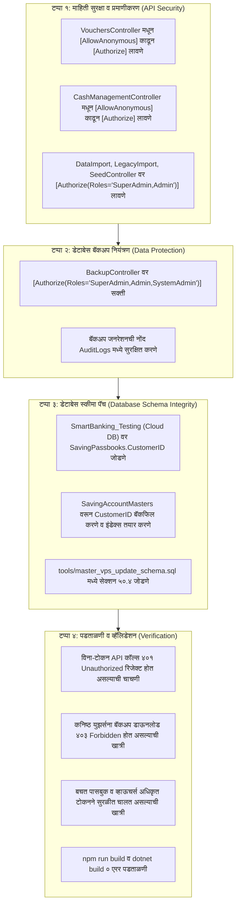

# P0 - Critical (अति-गंभीर त्रुटी) निवारण कृती आराखडा
## P0 - Critical Remediation Implementation Plan: Data Security, Financial Access & Schema Integrity

---

### १. उद्दिष्ट व कार्यक्षेत्र (Objective & Scope)

कोर बँकिंग सिस्टीम (CBS) मधील **३ अति-गंभीर (P0 - Critical)** त्रुटींचे तात्काळ व सुरक्षितपणे निवारण करणे:
1. **P0.1: विना-लॉगिन वित्तीय व्यवहार व ड्रायव्हर ॲक्सेस बंदी (Revoke Unauthenticated Access on Financial Controllers)**
2. **P0.2: अनधिकृत डेटाबेस बॅकअप डाऊनलोड बंदी व रोल-बेस्ड ॲक्सेस (Restrict Database Backup to SuperAdmin / Admin)**
3. **P0.3: `SavingPassbooks.CustomerID` डेटाबेस स्कीमा पॅच व VPS सिंक (Database Schema Crash Prevention & Sync)**

---

### २. सविस्तर कृती टप्पे (Step-by-Step Implementation Steps)



---

### ३. तपशीलवार तांत्रिक बदल (Technical Specifications by Module)

#### टप्पा १: वित्तीय कंट्रोलर्सचे प्रमाणीकरण सक्ती (Enforce Authentication on Financial Controllers)

| फाईल | सद्यस्थिती (Current State) | प्रस्तावित बदल (Target State) |
|---|---|---|
| [`api/Bhisi.Api/Controllers/VouchersController.cs`](file:///d:/Bhisi%20Software/api/Bhisi.Api/Controllers/VouchersController.cs#L17) | `[Microsoft.AspNetCore.Authorization.AllowAnonymous]` | `[Authorize]` (विना-टोकन व्हाऊचर्स पाहणे किंवा पोस्ट करणे पूर्णपणे बंद) |
| [`api/Bhisi.Api/Controllers/CashManagementController.cs`](file:///d:/Bhisi%20Software/api/Bhisi.Api/Controllers/CashManagementController.cs#L16) | `[Microsoft.AspNetCore.Authorization.AllowAnonymous]` | `[Authorize]` (कॅशियर ड्रायव्हर वाटप व कॅश शिल्लक फक्त अधिकृत लॉगिननेच शक्य) |
| [`api/Bhisi.Api/Controllers/DataImportController.cs`](file:///d:/Bhisi%20Software/api/Bhisi.Api/Controllers/DataImportController.cs#L15) | `[AllowAnonymous]` | `[Authorize(Roles = "SuperAdmin,Admin")]` |
| [`api/Bhisi.Api/Controllers/LegacyDataImportController.cs`](file:///d:/Bhisi%20Software/api/Bhisi.Api/Controllers/LegacyDataImportController.cs#L14) | `[AllowAnonymous]` | `[Authorize(Roles = "SuperAdmin,Admin")]` |
| [`api/Bhisi.Api/Controllers/SeedController.cs`](file:///d:/Bhisi%20Software/api/Bhisi.Api/Controllers/SeedController.cs#L15) | `[AllowAnonymous]` | `[Authorize(Roles = "SuperAdmin,Admin")]` |

#### टप्पा २: डेटाबेस बॅकअप सुरक्षा (Backup Controller Hardening)

- **फाईल:** [`api/Bhisi.Api/Controllers/BackupController.cs`](file:///d:/Bhisi%20Software/api/Bhisi.Api/Controllers/BackupController.cs#L12)
- **बदल:**
  ```csharp
  // Before:
  [Authorize]
  public class BackupController : ControllerBase

  // After:
  [Authorize(Roles = "SuperAdmin,Admin,SystemAdmin")]
  public class BackupController : ControllerBase
  ```
- **ऑडिट ट्रेल लॉगिंग:** बॅकअप जनरेट होताच कोणत्या युझरने (UserID, Username, IP) बॅकअप घेतला याची नोंद `AuditLogs` मध्ये स्वयंचलित करणे.

#### टप्पा ३: डेटाबेस स्कीमा पॅच (Database Schema Integrity)

1. **SQL पॅच (सक्रिय क्लाउड DB `SmartBanking_Testing` व स्थानिक DB वर):**
   ```sql
   -- SavingPassbooks: Add CustomerID
   IF EXISTS (SELECT 1 FROM sys.tables WHERE name = 'SavingPassbooks')
   BEGIN
       IF NOT EXISTS (SELECT 1 FROM sys.columns WHERE object_id = OBJECT_ID('SavingPassbooks') AND name = 'CustomerID')
       BEGIN
           ALTER TABLE [SavingPassbooks] ADD [CustomerID] INT NULL;
           
           -- Backfill CustomerID from related SavingAccountMasters where available
           UPDATE sp
           SET sp.CustomerID = sa.CustomerID
           FROM SavingPassbooks sp
           JOIN SavingAccountMasters sa ON sp.SavingAccountID = sa.SavingAccountID
           WHERE sa.CustomerID IS NOT NULL;

           PRINT 'Added CustomerID to SavingPassbooks and backfilled from SavingAccountMasters';
       END

       IF NOT EXISTS (SELECT 1 FROM sys.indexes WHERE name = 'IX_SavingPassbooks_CustomerID' AND object_id = OBJECT_ID('SavingPassbooks'))
       BEGIN
           CREATE NONCLUSTERED INDEX [IX_SavingPassbooks_CustomerID] ON [SavingPassbooks]([CustomerID]);
           PRINT 'Created Index IX_SavingPassbooks_CustomerID';
       END
   END
   ```

2. **मास्टर VPS स्कीमा सिंक:**
   - [`tools/master_vps_update_schema.sql`](file:///d:/Bhisi%20Software/tools/master_vps_update_schema.sql) मध्ये कलम ५०.४ (SavingPassbooks CustomerID Upgrade) जोडून कायमस्वरूपी सुरक्षित करणे.

---

### ४. चाचणी व गुणवत्ता पडताळणी (Quality Assurance & Test Plan)

| चाचणी क्र. | चाचणी घटक | अपेक्षित निकाल (Expected Outcome) |
|---|---|---|
| **TC-01** | विना-टोकन `GET /api/Vouchers` | `401 Unauthorized` (पूर्वी विना-टोकन २०० OK मिळत होते) |
| **TC-02** | विना-टोकन `POST /api/CashManagement/Allocations` | `401 Unauthorized` (सुरक्षित) |
| **TC-03** | सामान्य ऑपरेटर रोलने `POST /api/Backup/generate` | `403 Forbidden` (डेटा चोरी रोखली गेली) |
| **TC-04** | ॲडमिन रोलने `POST /api/Backup/generate` | `200 OK` व .bak फाईल डाऊनलोड |
| **TC-05** | `SavingPassbooks` वर EF Core क्वेरी | कोणतीही `Invalid column name 'CustomerID'` ५०० एरर न येता यशस्वी रिस्पॉन्स |
| **TC-06** | `npm run build` व API बिल्ड | ० एरर, ० वॉर्निंग्जसह यशस्वी संकलन |

---

### ५. अंमलबजावणी मंजुरी विनंती (Authorization to Proceed)

या तिन्ही P0 अति-गंभीर त्रुटींचे निवारण सुरू करण्यासाठी **`proceed`** म्हणा. मी तात्काळ वरील नियोजनानुसार बदल अंमलात आणतो.
