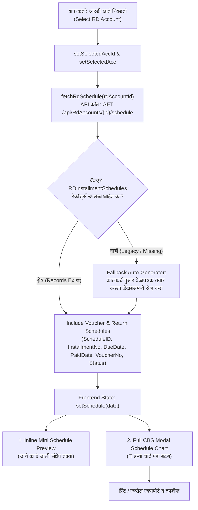

# आरडी हप्ता संकलन - हप्ता चार्ट (RD Installment Schedule Chart) अंमलबजावणी योजना

> **प्रकल्प:** स्मार्ट बँकिंग सीबीएस (SmartBanking CBS)  
> **मॉड्यूल:** मासिक आरडी हप्ता संकलन (`RdInstallmentCollection.tsx`)  
> **कार्य:** निवडलेल्या आरडी खात्याचा हप्ता चार्ट (Installment Schedule Table / Chart) दर्शवणे  
> **स्थिती:** केवळ योजना (Plan Only - No Code Written)  
> **तारीख:** 25 ऑक्टोबर 2026  

---

## १. पार्श्वभूमी आणि उद्देश (Background & Objective)

सध्या **मासिक आरडी हप्ता संकलन (`RdInstallmentCollection.tsx`)** या फॉर्ममध्ये आरडी खाते निवडल्यानंतर केवळ चालू महिन्याचा हप्ता भरण्याचा फॉर्म आणि संक्षिप्त खाते माहिती (मासिक हप्ता, एकूण भरलेले हप्ते) दिसते.

**वापरकर्त्याची मागणी:**
> *"मासिक आरडी हप्ता संकलन-->hapta chart disayala pahie plan create kar do not code"*

कॅशियर किंवा ऑपरेटरला हप्ता गोळा करताना खालील गोष्टींची तातडीने गरज भासते:
1. खातेदाराने **आतापर्यंत कोणते हप्ते भरले आहेत** (त्यांच्या पावत्या / व्हाउचर क्र. व भरणा तारखा).
2. **कोणता हप्ता सध्या थकीत (Overdue)** किंवा देय (Due) आहे.
3. पुढील **भावी हप्ते (Upcoming Installments)** आणि त्यांच्या देय तारखा काय आहेत.
4. हप्ता चार्ट जागेवरच **प्रिंट (Print)** किंवा **तपासणी (View)** करता येणे.

---

## २. आर्किटेक्चर आणि डेटा फ्लो (Architecture & Data Flow)



---

## ३. तांत्रिक बदल आणि अंमलबजावणीचे घटक (Components & Changes)

### घटक १: बॅकएंड API सुधारणा ([RdAccountsController.cs](file:///d:/Bhisi%20Software/api/Bhisi.Api/Controllers/RdAccountsController.cs))

सध्या `GET /api/RdAccounts/{id}/schedule` एंडपॉईंट अस्तित्वात आहे, परंतु त्यामध्ये `VoucherNo` समाविष्ट नाही आणि जुन्या किंवा इम्पोर्ट केलेल्या खात्यांसाठी फॉलबॅक नाही.

#### नियोजित सुधारणा:
1. **`VoucherNo` जोडणे:**
   ```csharp
   .Include(s => s.Voucher)
   ...
   VoucherNo = s.Voucher != null ? s.Voucher.VoucherNo : ""
   ```
2. **स्मार्ट फॉलबॅक जनरेटर (Auto-Resilience Generator):**
   जर एखाद्या खात्यासाठी `RDInstallmentSchedules` मध्ये शून्य नोंदी असतील (उदा. जुने/मायग्रेट केलेले खाते), तर हे एंडपॉईंट आपोआप खात्याच्या `OpeningDate`, `DurationMonths`, `InstallmentAmount`, आणि `TotalPaidInstallments` वरून वेळापत्रक तयार करून सेव्ह करेल आणि परत पाठवेल. यामुळे युझरला कधीही रिकामी स्क्रीन दिसणार नाही.

---

### घटक २: फ्रंटएंड डेटा स्ट्रक्चर व स्टेट्स ([RdInstallmentCollection.tsx](file:///d:/Bhisi%20Software/client/src/components/RdInstallmentCollection.tsx))

#### १. डेटा इंटरफेस:
```typescript
interface RdScheduleRow {
  scheduleID?: number;
  rdAccountID?: number;
  installmentNo: number;
  dueDate: string;
  graceDate?: string;
  expectedAmount: number;
  status: 'Paid' | 'Pending' | 'Overdue' | string;
  paidDate?: string | null;
  paidAmount: number;
  overdueDays: number;
  penaltyCharged: number;
  penaltyWaived?: number;
  voucherID?: number | null;
  voucherNo?: string | null;
}
```

#### २. नवीन स्टेट व्हेरिएबल्स:
- `schedule: RdScheduleRow[]` — चालू खात्याचे सर्व हप्ते
- `loadingSchedule: boolean` — वेळापत्रक लोड होत असताना स्पिनर
- `showScheduleModal: boolean` — पूर्ण स्क्रीन मोडल विंडो चालू/बंद
- `isInlineScheduleOpen: boolean` — इनलाइन संक्षिप्त तक्ता कोलॅप्सिबल ठेवणे

#### ३. API फेच फंक्शन:
```typescript
const fetchSchedule = async (accountId: number) => {
  setLoadingSchedule(true);
  try {
    const res = await axios.get(`/api/RdAccounts/${accountId}/schedule`);
    setSchedule(Array.isArray(res.data) ? res.data : []);
  } catch (err) {
    console.error('Failed to fetch RD schedule', err);
    setSchedule([]);
  } finally {
    setLoadingSchedule(false);
  }
};
```
खाते निवडल्यावर (`selectRdAccount`) आपोआप `fetchSchedule(acc.rdAccountID)` कॉल होईल.

---

### घटक ३: युझर इंटरफेस (UI) डिझाइन

युझरच्या सोयीसाठी आम्ही **द्विस्तरीय (Dual-Layered)** डिझाइन देणार आहोत (कर्ज वसुली फॉर्मप्रमाणे):

#### थर १: इनलाइन क्विक-प्रिव्ह्यू आणि बटण (Account Details Card मध्ये)
`selectedAcc` माहिती कार्डमध्ये (प्रोग्रेस बार खाली) खालील नवीन बटणे व माहिती दिसतील:

1. **`[ 📅 हप्ता चार्ट पहा (View Schedule) ]` बटण:**
   - निळ्या रंगाचे ठळक बटण.
   - सोबत हप्त्यांची संख्या दर्शवणारा बॅज (उदा. `१२ हप्ते`).
   - क्लिक केल्यास **फुल CBS मोडल चार्ट** उघडेल.
2. **`[ हप्ते यादी ▼ ]` इनलाइन टॉगल:**
   - क्लिक केल्यावर फॉर्मवरच खाली ५-६ हप्त्यांचा स्क्रोल करता येणारा मिनी-तक्ता दिसेल.
3. **क्विक स्टेटस समरी बॅजेस:**
   - 🟢 जमा: X हप्ते
   - 🟡 चालू देय: Y हप्ते
   - 🔴 थकीत: Z हप्ते

#### थर २: फुल CBS मोडल चार्ट (Full-Featured Modal Window)
`showScheduleModal` ओपन झाल्यावर एक आधुनिक आणि स्वच्छ मोडल दिसेल ज्यामध्ये:

1. **शीर्षक व खाते माहिती बार:**
   - खाते क्र., जुने आरडी क्र., खातेदाराचे नाव, योजना, मासिक हप्ता, कालावधी.
2. **४ सारांश कार्ड्स (KPI Summary Cards):**
   - 📊 **एकूण हप्ते:** एकूण मुदत व अपेक्षित एकूण मुद्दल
   - 🟢 **जमा हप्ते:** भरलेले हप्ते संख्या व एकूण जमा रक्कम
   - 🟡 **चालू देय हप्ता:** आजच्या तारखेला भरावयाचा हप्ता
   - 🔴 **थकीत हप्ते व दंड:** थकीत महिने व दंड रक्कम
3. **तपशीलवार हप्ता तक्ता (CBS Schedule Table):**
   - **हप्ता क्र. (#):** #1, #2, #3...
   - **देय दिनांक (Due Date):** DD/MM/YYYY
   - **अपेक्षित हप्ता (₹):** ₹ १,०००.००
   - **भरणा दिनांक (Paid Date):** भरलेली तारीख किंवा `-`
   - **भरलेली रक्कम (₹):** भरलेली रक्कम हिरव्या रंगात
   - **विलंब दिवस:** Overdue days
   - **दंड आकारणी (₹):** लेट फी / दंड
   - **पावती / व्हाउचर क्र.:** उदा. `VCH-2026-089`
   - **स्थिती (Status):** 
     - 🟢 `जमा (Paid)`
     - 🟡 `देय (Due / Pending)`
     - 🔴 `थकीत (Overdue)`
     - ⚪ `भावी (Upcoming)`
4. **तक्ता तळटीप (Table Footer):**
   - अपेक्षित एकूण रक्कम vs एकूण भरलेली रक्कम यांची अचूक बेरीज.
5. **अ‍ॅक्शन बटणे (Action Buttons):**
   - 🖨️ **वेळापत्रक प्रिंट करा (Print Schedule):** ग्राहकाला देण्यासाठी स्वच्छ A4 पावती प्रिंट.
   - 📥 **एक्सेल / CSV डाउनलोड (Export):** ऑफलाइन रेकॉर्डसाठी.
   - ❌ **बंद करा (Close).**

---

## ४. घटक लेआउट डिझाइन मॉकप (Visual Mockup)

```text
+-----------------------------------------------------------------------------------+
|  हप्ता जमा फॉर्म (Single Collection)                                              |
|                                                                                   |
|  आरडी खाते निवडा: [ 10025 - रमेश महादेव पाटील (मासिक RD) [🏷️ जुने आरडी: 412]  ▼ ]   |
|                                                                                   |
|  +-----------------------------------------------------------------------------+  |
|  | खातेदार: रमेश महादेव पाटील        🏷️ जुने आरडी: 412                         |  |
|  | मासिक हप्ता: ₹ 2,000.00           हप्ते प्रगती: 8 / 12 महिने                |  |
|  | [████████████████████████░░░░░░░░░░░░] 66.7%                                |  |
|  | स्थिती: सक्रिय (Active)                                                     |  |
|  |-----------------------------------------------------------------------------|  |
|  | [ 📅 हप्ता चार्ट पहा (12 हप्ते) ]   [ हप्ते यादी ▼ ]    🟢 जमा: 8  🔴 थकीत: 1 |  |
|  +-----------------------------------------------------------------------------+  |
|                                                                                   |
|  (पर्यायी Inline Preview जर उघडले तर:)                                            |
|  +-----------------------------------------------------------------------------+  |
|  | हप्ता | देय दिनांक  | अपेक्षित | भरणा दिनांक | पावती क्र.  | स्थिती            |  |
|  | #1    | 10/01/2026  | ₹ 2,000  | 10/01/2026  | VCH-1001   | 🟢 जमा (Paid)    |  |
|  | #2    | 10/02/2026  | ₹ 2,000  | 12/02/2026  | VCH-1145   | 🟢 जमा (Paid)    |  |
|  | ...   | ...         | ...      | ...         | ...        | ...              |  |
|  | #9    | 10/09/2026  | ₹ 2,000  | -           | -          | 🔴 थकीत (Overdue)|  |
|  | #10   | 10/10/2026  | ₹ 2,000  | -           | -          | 🟡 देय (Pending) |  |
|  +-----------------------------------------------------------------------------+  |
|                                                                                   |
|  हप्ता भरणा तारीख: [ 25/10/2026 🔒 लॉक ]                                          |
|  हप्ते संख्या: [ 1 ]                                                              |
|  मासिक हप्ता: ₹ 2,000 | एकूण मुद्दल: ₹ 2,000 | दंड: ₹ 40                         |
|  एकूण देय रक्कम: ₹ 2,040                                                          |
|  पेमेंट पद्धत: [ Cash ▼ ]                                                         |
|  [ 💾 हप्ता जमा करा (Collect Installment) ]                                       |
+-----------------------------------------------------------------------------------+
```

---

## ५. चाचणी व पडताळणी योजना (Testing & Verification Plan)

| क्र. | चाचणी प्रकार | अपेक्षित निकाल |
|:---:|:---|:---|
| १ | **आरडी खाते निवडणे** | खाते निवडताच `GET /api/RdAccounts/{id}/schedule` कॉल होतो आणि वेळापत्रक लोड होते. |
| २ | **हप्ता चार्ट बटण** | `[ 📅 हप्ता चार्ट पहा ]` बटणावर क्लिक केल्यावर मोडल विंडो उघडते आणि सर्व हप्त्यांची स्थिती अचूक दिसते. |
| ३ | **व्हाउचर क्रमांक** | भरलेल्या हप्त्यांसमोर त्यांचा अचूक पावती / व्हाउचर क्रमांक दिसतो. |
| ४ | **इनलाइन तक्ता टॉगल** | `[ हप्ते यादी ▼ ]` क्लिक केल्यावर फॉर्मवरच खाली ५-६ हप्त्यांचा जलद तक्ता स्क्रोलसह उघडतो. |
| ५ | **जुन्या / इम्पोर्ट खात्यांचा फॉलबॅक** | ज्या खात्यांचा शेड्युल डेटाबेसमध्ये नसेल, त्यांचा शेड्युल ऑन-द-फ्लाय जनरेट होऊन बरोबर दिसतो. |
| ६ | **प्रिंट कार्यक्षमता** | मोडलमधील प्रिंट बटणावर क्लिक केल्यास स्वच्छ A4 फॉरमॅटमध्ये हप्ता वेळापत्रक प्रिंट होते. |
| ७ | **हप्ता जमा केल्यानंतर अपडेट** | नवीन हप्ता जमा झाल्यावर वेळापत्रक पुन्हा रिफ्रेश होऊन भरलेला हप्ता लगेच हिरवा (Paid) होतो. |

---

## ६. पुढील पायरी (Next Steps)

हे केवळ **प्लॅन (Implementation Plan)** आहे; वापरकर्त्याच्या निर्देशानुसार **कोणताही कोड बदललेला नाही**.  
आपण हा प्लॅन तपासून **"proceed"** किंवा मान्यता दिल्यानंतर लगेच कोडिंग व प्रत्यक्ष अंमलबजावणी सुरू केली जाईल.
