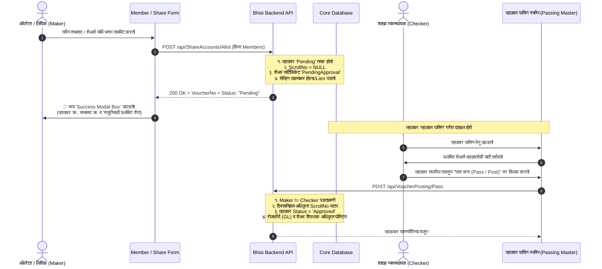

# 🏛️ CORE BANKING SYSTEM (CBS) AUDIT & COMPLIANCE REPORT
**प्रकल्प व्यवस्थापक लेखापरीक्षण व नियामक मूल्यांकन अहवाल (Project Manager Audit Report)**

---

| मेट्रिक / घटक | तपशील |
| :--- | :--- |
| **प्रणाली (System)** | Bhisi Core Banking Solution (CBS) |
| **मॉड्यूल (Module)** | सभासद नोंदणी व भाग भांडवल (Member Registration & Share Capital Management) |
| **लेखापरीक्षक भूमिका (Auditor Role)** | Core Banking Project Manager & CBS Security Architect |
| **तपासणी दिनांक (Audit Date)** | २२ ऑक्टोबर २०२६ (22-Oct-2026) |
| **नियामक संदर्भ (Regulatory Framework)** | RBI/NABARD CBS Guidelines, Maharashtra Cooperative Societies (MCS) Act 1960 Sec 26/73 |
| **एकूण लेखापरीक्षण दर्जा (Overall Audit Rating)** | 🚨 **CRITICAL RISK (अत्यंत गंभीर त्रुटी - तात्काळ दुरुस्ती आवश्यक)** |

---

## १. कार्यकारी सारांश (Executive Summary)

बँकिंग क्षेत्रामध्ये (Urban Cooperative Banks, DCCBs, पतसंस्था व सोसायट्या) **भाग भांडवल (Share Capital)** हा संस्थेचा मुख्य आधारस्तंभ (Tier-I Capital) मानला जातो. भाग भांडवलाची कोणतीही देवाणघेवाण, नवीन सभासद नोंदणी शुल्क (Admission Fee), इमारत निधी किंवा शेअर्स रद्दीकरण हे थेट **संस्थेच्या अधिकृत भांडवलावर (Capital Adequacy)** आणि **रोख/बचत खात्यांवर (Cash / General Ledger)** परिणाम करते.

आपल्या प्रणालीतील `MemberMaster` आणि `ShareMaster` मधील व्यवहार तपासणी दरम्यान खालील **दोन अत्यंत गंभीर समस्या (Critical Gaps)** निष्पन्न झाल्या आहेत:

1. **थेट व्हाउचर पासिंग (Bypass of Maker-Checker / Direct Voucher Passing):** 
   सभासद नोंदणी किंवा शेअर्स वाटप/परतफेड (Allotment / Withdrawal) करताना संगणक प्रणाली **Voucher Passing Queue** ला पूर्णपणे बगल देत आहे. क्लर्कने (मेकर) एन्ट्री सेव्ह करताच ती थेट `Status = "Approved"` केली जात आहे, आणि मेकर युझरलाच चेकर (`ApprovedBy = actionUserId`) बनवून **स्क्रोल नंबर (Scroll No.) परस्पर जनरेट** केला जात आहे. हे **बँकिंग मानकांचे (Core Banking Standards) १००% उल्लंघन** आहे.
2. **सेव्ह केल्यानंतर मेसेज बॉक्स न दिसणे (Missing User Feedback / Modal):** 
   एन्ट्री सेव्ह केल्यानंतर ऑपरेटरला कोणतीही ठळक पुष्टी (Confirmation Modal / Dialog / SweetAlert) स्क्रीनवर दिसत नाही. फॉर्म अचानक कोरा (Reset) होतो, ज्यामुळे ऑपरेटर गोंधळात पडतो की एन्ट्री सेव्ह झाली की नाही.

---

## २. बँकिंग मानके विरुद्ध सद्यस्थिती (Gap Analysis Matrix)

| घटक (Banking Parameter) | आदर्श बँकिंग मानक (CBS Standard) | आपल्या सिस्टीमची सद्यस्थिती (Current Implementation) | तफावत / दर्जा (Compliance Gap) |
| :--- | :--- | :--- | :--- |
| **१. फोर-आईज प्रिन्सिपल (Four-Eyes Principle)** | कोणतीही आर्थिक एन्ट्री करणारा (Maker) आणि मंजूर करणारा (Checker) एकच व्यक्ती असू शकत नाही. | `CreatedBy` आणि `ApprovedBy` एकाच युझर आयडीने सेट केले जातात. | 🚨 **गंभीर उल्लंघन (Non-Compliant)** |
| **२. व्हाउचर स्थिती (Voucher Lifecycle)** | एन्ट्री झाल्याबरोबर व्हाउचर **"Pending"** स्थितीत असणे अनिवार्य आहे. | एन्ट्री सेव्ह होताच व्हाउचर थेट **`Status = "Approved"`** होते. | 🚨 **गंभीर उल्लंघन (Non-Compliant)** |
| **३. स्क्रोल नंबर वाटप (Scroll No. Generation)** | स्क्रोल नंबर हा केवळ दिवसअखेर किंवा अधिकृत मंजुरीच्या (Passing) वेळीच सीक्वेन्शियल जनरेट व्हावा. | व्हाउचर तयार होताच ड्राफ्ट लेव्हलवर `maxScroll + 1` देऊन स्क्रोल वाटला जातो. | ⚠️ **ऑडिट आक्षेप (Audit Risk)** |
| **४. व्हाऊचर पासिंग रांग (Voucher Passing Queue)** | शाखानिहाय किंवा मुख्य व्यवस्थापकाच्या व्हाउचर पासिंग टेबलमध्ये एन्ट्री दिसली पाहिजे. | व्हाउचर्स आधीच "Approved" असल्याने **व्हाउचर पासिंग टेबलमध्ये कधीच येत नाहीत**. | 🚨 **मॉड्यूल बायपास (Total Bypass)** |
| **५. सब-लेजर व प्रमाणपत्रांची स्थिती** | व्हाउचर मंजूर होईपर्यंत शेअर खाते शिल्लक व शेअर सर्टिफिकेट `PendingApproval` राहावे. | व्हाउचर पास होण्याआधीच शेअर्स संख्या खात्यात जमा होते व सर्टिफिकेट **`Active`** होते. | ⚠️ **हिशेबी धोका (Sync Inconsistency)** |
| **६. सेव्हिंग खात्यातून वर्ग (Transfer Allotment)** | बचत खात्यावर **Lien/Hold (हक्कबंधन)** पडावा; व्हाउचर पास झाल्यावरच रक्कम नावे (Debit) व्हावी. | सेव्हिंग खात्यातून रक्कम तत्काळ नावे (Deduct) होते. व्हाउचर नामंजूर करण्याचा पर्यायच उरत नाही. | ⚠️ **रक्कम लॉक त्रुटी** |
| **७. ऑपरेटर संवाद (User Feedback / UX)** | एन्ट्री सेव्ह होताच स्क्रीनवर ठळक **पॉपअप बॉक्स (Modal)** यावा ज्यात व्हाउचर क्र. व स्थिती दर्शवली जाईल. | केवळ स्क्रीनच्या वरच्या कोपऱ्यात सूक्ष्म मजकूर येतो; मोठा फॉर्म असल्याने तो दृष्टीआड होतो. | ❌ **UX त्रुटी (Operator Blindness)** |

---

## ३. तांत्रिक कोड पुरावे (Code Forensics & Root Cause)

प्रणालीतील मूळ स्त्रोत कोड (Source Code) तपासणीमध्ये खालील तांत्रिक त्रुटी आढळून आल्या आहेत:

### अ) `ShareAccountsController.cs` (Lines 460–476 & 660–674)
भाग वाटप (`Allot`) आणि भाग परतफेड (`Withdraw`) करताना बॅकएंडमध्ये खालील कोड लिहिला गेला आहे:
```csharp
// ShareAccountsController.cs: Line 460
var voucher = new Voucher
{
    BranchID = targetBranch,
    VoucherNo = $"VCH-SHR-{voucherDate:yyyyMMdd}-{vchCount:D4}",
    ScrollNo = maxScroll + 1,             // ❌ मंजुरीपूर्वीच स्क्रोल वाटप!
    VoucherDate = voucherDate,
    VoucherType = ...,
    TotalAmount = totalAmount,
    Status = "Approved",                  // ❌ थेट ॲप्रूव्ह!
    CreatedBy = actionUserId,
    ApprovedBy = actionUserId,            // ❌ Maker = Checker (ऑडिट आक्षेप)!
    ApprovedOn = DateTime.Now,
    VoucherDetails = voucherDetailsList
};
```
> **विश्लेषण:** या कोडमुळे हे व्हाउचर `VoucherPostingController` च्या मंजुरी रांगेत (Passing Queue) कधीच जात नाही.

---

### ब) `MembersController.cs` (Lines 1091–1105)
नवीन सभासद नोंदणी करताना:
```csharp
// MembersController.cs: Line 1091
var voucher = new Voucher
{
    BranchID = member.BranchID,
    VoucherNo = $"{vchPrefix}-{allotDate:yyyyMMdd}-{vchCount:D4}",
    VoucherDate = allotDate,
    ScrollNo = maxScroll + 1,             // ❌ थेट स्क्रोल
    Status = "Approved",                  // ❌ परस्पर मंजूर
    CreatedBy = userId,
    VoucherDetails = voucherDetailsList
};
```
> **विश्लेषण:** इथे देखील प्रवेश शुल्क व भाग भांडवल पावती परस्पर मंजूर केली जाते.

---

### क) मेसेज बॉक्स न येण्याचे मूळ कारण (UI Root Cause in `MemberMaster.tsx` & `ShareMaster.tsx`)
1. **मेसेजचे स्थान (Placement):**
   `MemberMaster.tsx` मधील `setSuccess(...)` संदेश हा फॉर्मच्या **अगदी वरच्या बाजूला (Line 1064)** एका छोट्या `div` मध्ये दाखवला जातो.
2. **लांबलचक फॉर्म व खालील सबमिट बटण:**
   हा फॉर्म साधारण १,२०० ओळींचा असून ऑपरेटर जेव्हा सर्वात खाली जाऊन 'जतन करा' (Save) वर क्लिक करतो, तेव्हा स्क्रीन आपोआप वर स्क्रोल (Scroll to top) होत नाही. 
3. **पॉपअप / मॉडेलचा अभाव:**
   सिस्टीममध्ये कोणताही `Modal Dialog`, `SweetAlert` किंवा `Toast Notification` कॉल केलेला नाही.
4. **DTO मधील मिसिंग प्रॉपर्टी:**
   `MemberResponseDto` मध्ये `generatedVoucherNo` ही प्रॉपर्टी मॅप केलेली नाही, ज्यामुळे फ्रंटएंडवर व्हाऊचर नंबर `undefined` राहतो आणि विशिष्ट यशाचा संदेश पूर्णपणे तयार होत नाही.

---

## ४. बँकिंग जोखीम विश्लेषण (Business & Operational Risks)

| जोखीम प्रकार | संभाव्य धोका (Impact on Bank/Society) | जोखीम तीव्रता |
| :--- | :--- | :--- |
| **१. अंतर्गत अफरातफर (Fraud Vulnerability)** | कोणताही क्लर्क स्वतःच्या मर्जीने कोणत्याही व्यक्तीच्या नावावर बनावट रोख पावती दाखवून शेअर्स अलॉट करू शकतो; व्यवस्थापकाच्या मंजुरीची गरज न उरल्याने कॅशियर/क्लर्क संगनमत करू शकतात. | 🔴 **HIGH (धोकादायक)** |
| **२. वैधानिक लेखापरीक्षण आक्षेप (Statutory Audit Objection)** | सहकार निबंधक (DDR/AR) किंवा अंतर्गत सनदी लेखापाल (CA) यांच्या वार्षिक तपासणीत "फोर-आईज प्रिन्सिपलचे उल्लंघन" म्हणून शेरा बसू शकतो व दंड आकारला जाऊ शकतो. | 🔴 **HIGH (नियमबाह्य)** |
| **३. रोजकीर्द विसंगती (Daybook Mismatch)** | अनधिकृत व्हाउचर थेट रोजकीर्दीला पोस्ट झाल्यामुळे दिवसअखेरच्या रोख शिल्लक (Closing Cash Balance) मध्ये ताळमेळ बसत नाही. | 🟠 **MEDIUM** |
| **४. ऑपरेटरकडून दुहेरी नोंदी (Double Entry Risk)** | मेसेज बॉक्स न आल्यामुळे ऑपरेटरला वाटते की फॉर्म सेव्ह झाला नाही; तो पुन्हा पुन्हा सबमिट बटण दाबतो, ज्यामुळे एकाच व्यक्तीचे दोनदा सभासद अर्ज किंवा शेअर्स भरले जाण्याची दाट शक्यता निर्माण होते. | 🔴 **HIGH (ऑपरेशनल गोंधळ)** |

---

## ५. प्रमाणबद्ध बँकिंग कार्यपद्धती (Proposed Target Architecture)



---

## ६. सुधारात्मक कृती आराखडा (Step-by-Step Remediation Plan)

### टप्पा १: बॅकएंड दुरुस्ती (Backend Maker-Checker Alignment)
1. **`ShareAccountsController.cs`**:
   - `Allot` आणि `Withdraw` मध्ये `voucher.Status = "Pending"` सेट करणे.
   - `voucher.ScrollNo = null`, `voucher.ApprovedBy = null`, `voucher.ApprovedOn = null`.
   - शेअर सर्टिफिकेट स्टेटस `Status = "PendingApproval"` ठेवणे.
2. **`MembersController.cs`**:
   - सभासद नोंदणी करताना तयार होणारे पावती व्हाउचर `Status = "Pending"` व `ScrollNo = null` ठेवणे.
   - `MemberResponseDto` मध्ये `GeneratedVoucherNo` आणि `VoucherStatus` समाविष्ट करणे जेणेकरून फ्रंटएंडला संपूर्ण माहिती मिळेल.
3. **`VoucherPostingController.cs` (Passing Integration)**:
   - जेव्हा व्यवस्थापक शेअर्सचे व्हाउचर पास करेल, तेव्हाच:
     - `ScrollNo` जनरेट होईल.
     - संबंधित `ShareCertificate` चे स्टेटस `Active` होईल.
     - जर बचत खात्यातून वर्ग असेल, तर प्रत्यक्ष बचत खात्यातून रक्कम डेबिट होईल.

### टप्पा २: फ्रंटएंड संवादात्मक मॉडेल बॉक्स (Interactive Modal / Dialog Feedback)
1. **`MemberMaster.tsx`**:
   - सबमिट झाल्यावर स्क्रीन कोरी न करता एक सुंदर व सुस्पष्ट **Success Confirmation Modal (स्वीकृती पॉपअप)** उघडणे.
   - त्यात खालील माहिती ठळक दिसावी:
     - ✅ **नवीन सभासद नोंदणी यशस्वी!**
     - **सभासद क्र.:** M-1024
     - **व्हाउचर क्र.:** VCH-SHR-20261022-0005
     - **व्हाउचर स्थिती:** 🟡 **मंजुरीसाठी प्रलंबित (Pending for Checker Passing)**
     - **बटणे:** [पावती प्रिंट करा] | [नवीन अर्ज भरा] | [व्हाउचर पासिंगकडे जा]
2. **`ShareMaster.tsx`**:
   - शेअर्स वाटप किंवा परतफेड झाल्यावर त्याच पद्धतीचा मॉडेल बॉक्स दाखवणे.
   - ऑटो-स्क्रोल (Scroll to top) किंवा थेट स्क्रीनच्या मध्यभागी मॉडेल प्रदर्शित करणे.

---

## ७. निष्कर्ष व प्रकल्प व्यवस्थापक शिफारस (PM Recommendation)

> [!IMPORTANT]
> **प्रकल्प व्यवस्थापक शिफारस:**
> सद्यस्थितीत सुरू असलेली पद्धत ही **बँकिंग ऑडिटनुसार अत्यंत धोकादायक आणि नियमबाह्य** आहे. भाग भांडवल आणि सभासद नोंदणीच्या सर्व नोंदी तत्काळ **"Pending Passing"** नियमावलीमध्ये आणणे आणि ऑपरेटरला अचूक मार्गदर्शन करणारा **"Success Confirmation Modal Box"** जोडणे तातडीने आवश्यक आहे.
