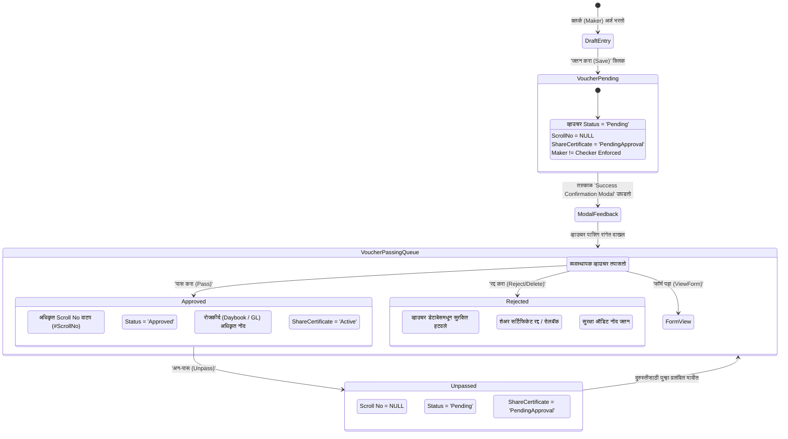

# 🏛️ कोअर बँकिंग सर्वंकष अंमलबजावणी आराखडा (Comprehensive Implementation Plan)
## सभासद व भाग भांडवल: बँकिंग मानके (Maker-Checker Passing) व संवादात्मक पुष्टीकरण मोडल (Confirmation Message Box)
### Document ID: `PLAN-CBS-SHARE-MEMBER-MAKER-CHECKER-v2.6.0`
### Target Components: 
- `api/Bhisi.Api/Controllers/MembersController.cs`
- `api/Bhisi.Api/Controllers/ShareAccountsController.cs`
- `api/Bhisi.Api/Controllers/ShareCertificatesController.cs`
- `api/Bhisi.Api/Controllers/VoucherPostingController.cs`
- `api/Bhisi.Api/Models/MemberDto.cs`
- `client/src/components/MemberMaster.tsx`
- `client/src/components/ShareMaster.tsx`
- `client/src/components/VoucherPosting.tsx`

---

## 📌 १. कार्यकारी सारांश व उद्दिष्ट (Executive Summary & Objective)

सध्या प्रणालीमध्ये **सभासद नोंदणी (`MemberMaster`)** व **भाग भांडवल वाटप/परतफेड (`ShareMaster`)** मधील नोंदी सेव्ह केल्यावर:
1. **थेट पासिंगची त्रुटी (Bypass of Maker-Checker):** व्हाउचर थेट `Status = "Approved"` होते, क्लर्क स्वतःच चेकर बनतो आणि मंजुरीपूर्वीच स्क्रोल नंबर (`ScrollNo`) वाटला जातो. परिणामी हे व्हाउचर **"व्हाउचर पासिंग, मंजुरी व व्यवस्थापन" (`VoucherPosting.tsx`)** या मुख्य नियंत्रण स्क्रीनमध्ये कधीच येत नाही. हे रिझर्व्ह बँक (RBI), नाबार्ड (NABARD) व महाराष्ट्र सहकारी संस्था कायदा (MCS Act 1960 Sec 73) चे गंभीर उल्लंघन आहे.
2. **मेसेज बॉक्स न येण्याची त्रुटी (Silent Reset / Missing Modal):** एन्ट्री सेव्ह झाल्यावर ऑपरेटरला कोणताही ठळक **मेसेज बॉक्स / पॉपअप मोडल (Confirmation Dialog)** दिसत नाही. फॉर्मच्या अगदी वरच्या भागात एक बारीक पट्टी येते, तर ऑपरेटर खाली सबमिट करत असल्याने फॉर्म अचानक कोरा (Reset) होतो. त्यामुळे नोंद झाली की नाही हे न समजल्याने ऑपरेटर गोंधळात पडतो.

### मुख्य उद्दिष्टे (Core Objectives):
1. **बँकिंग मानकांचे १००% पालन (Full CBS Compliance):** सभासद नोंदणी व भाग वाटपाच्या सर्व नोंदी सुरुवातीला **"Pending" (प्रलंबित)** स्थितीतच तयार होतील. स्क्रोल नंबर `null` राहील. केवळ अधिकृत चेकर/व्यवस्थापकाने **व्हाउचर पासिंग स्क्रीनवरून** मंजूर केल्यावरच अधिकृत स्क्रोल नंबर वाटप होईल व ते रोजकीर्दीला पोस्ट होईल.
2. **संवादात्मक पुष्टीकरण मेसेज बॉक्स (Interactive Success Confirmation Modal):** एन्ट्री सेव्ह होताच स्क्रीनच्या मध्यभागी एक आकर्षक, सुस्पष्ट **Success Confirmation Modal Dialog** उघडेल ज्यामध्ये सभासद क्र., व्हाउचर क्र., रक्कम, आणि **"🟡 व्यवस्थापक मंजुरीसाठी प्रलंबित"** असा स्पष्ट शेरा व कृती बटणे असतील.

---

## 🔍 २. सोर्स कोड ऑडिट व लाइन नंबर मॅपिंग (Source Code Audit & Line Mapping)

| घटक / फाइल (File & Component) | विद्यमान ओळ क्र. (Current Line) | सद्यस्थिती (Current Behavior) | आवश्यक बदल / सुधारणा (Proposed Fix) |
|---|---|---|---|
| `api/Bhisi.Api/Controllers/MembersController.cs` | Line 1091–1105 | `Status = "Approved"`, `ScrollNo = maxScroll + 1` | `Status = "Pending"`, `ScrollNo = null`, `ApprovedBy = null`, `ApprovedOn = null` सेट करणे. |
| `api/Bhisi.Api/Models/MemberDto.cs` | Line 6–65 | `MemberResponseDto` मध्ये व्हाउचर क्रमांक नाही. | `GeneratedVoucherNo`, `GeneratedVoucherId`, `VoucherStatus`, `TotalAmountPaid` प्रॉपर्टीज जोडणे. |
| `api/Bhisi.Api/Controllers/ShareAccountsController.cs` | Line 460–476 | भाग वाटप (`Allot`): `Status = "Approved"`, `ScrollNo = maxScroll + 1`, `ApprovedBy = actionUserId` | `Status = "Pending"`, `ScrollNo = null`, `ApprovedBy = null`. शेअर सर्टिफिकेट स्टेटस `Status = "PendingApproval"`. |
| `api/Bhisi.Api/Controllers/ShareAccountsController.cs` | Line 660–674 | भाग परतफेड (`Withdraw`): थेट `Approved` | `Status = "Pending"`, `ScrollNo = null`, `ApprovedBy = null`. |
| `api/Bhisi.Api/Controllers/ShareAccountsController.cs` | Line 2596 & 2661 | भाग हस्तांतरण (`Transfer`) व फी व्हाउचर: थेट `Approved` | `Status = "Pending"`, `ScrollNo = null`. |
| `api/Bhisi.Api/Controllers/ShareCertificatesController.cs` | Line 471 | शेअर प्रमाणपत्र रद्दीकरण (`Cancel`): थेट `Approved` | `Status = "Pending"`, `ScrollNo = null`. |
| `api/Bhisi.Api/Controllers/VoucherPostingController.cs` | Line 266–310 | पासिंग वेळी केवळ व्हाउचर स्टेटस अपडेट होते. | शेअर्स व्हाउचर मंजूर झाल्यावर संबंधित `ShareCertificate` चे स्टेटस `PendingApproval` वरून `Active` करणे. |
| `api/Bhisi.Api/Controllers/VoucherPostingController.cs` | Line 395–402 | अन-पास (Unpass) वेळी शेअर्स सर्टिफिकेट रीव्हर्ट होत नाही. | अन-पास केल्यास संबंधित सर्टिफिकेट पूर्ववत `PendingApproval` करणे. |
| `client/src/components/MemberMaster.tsx` | Line 696–732 & 1055–1070 | `setSuccess` वर एका छोट्या स्ट्रिपमध्ये दाखवला जातो. स्क्रीन स्क्रोल होत नाही. पॉपअप नाही. | भव्य `SaveSuccessModal` तयार करणे. सबमिट होताच स्क्रीन मध्यभागी पॉपअप उघडणे. |
| `client/src/components/ShareMaster.tsx` | Line 614–627 & 875–895 | `setMessage` वर दाखवले जाते. पॉपअप नाही. | भव्य `ShareSuccessModal` तयार करणे. पावती प्रिंट व पासिंग मेनूचे पर्याय देणे. |
| `client/src/components/VoucherPosting.tsx` | Line 432–452 | `VCH-SHR-` आणि `VCH-ADM-` साठी राउटिंग अस्पष्ट आहे. | फॉर्म व्ह्यूसाठी `isShareMaster` आणि `isMemberMaster` अचूक मॅप करणे. |

---

## 🏗️ ३. आदर्श बँकिंग जीवनचक्र व स्टेट मशीन (Target Banking State Machine)



---

## 💻 ४. तांत्रिक अंमलबजावणी तपशील: बॅकएंड (Backend Implementation Specs)

### ४.१. `api/Bhisi.Api/Models/MemberDto.cs` सुधारणा
`MemberResponseDto` क्लासमध्ये व्हाउचर व स्टेटस रिटर्न करण्यासाठी खालील प्रॉपर्टीज जोडणे:
```csharp
public class MemberResponseDto
{
    // Existing fields...
    
    // 🌟 CBS Maker-Checker & Voucher Passing Extensions
    public string? GeneratedVoucherNo { get; set; }
    public int? GeneratedVoucherId { get; set; }
    public string VoucherStatus { get; set; } = "Pending";
    public decimal TotalAmountPaid { get; set; } = 0;
    public int NumberOfSharesAllotted { get; set; } = 0;
    public string? CertificateNo { get; set; }
}
```

---

### ४.२. `api/Bhisi.Api/Controllers/MembersController.cs` सुधारणा (Line 1091–1140)
नवीन सभासद नोंदणी करताना व्हाउचर थेट `Approved` न करता `Pending` ठेवणे:
```csharp
// ओळ क्र. 1091 - 1105 सुधारित कोड:
var voucher = new Voucher
{
    BranchID = member.BranchID,
    VoucherNo = $"{vchPrefix}-{allotDate:yyyyMMdd}-{vchCount:D4}",
    VoucherDate = allotDate,
    ScrollNo = null,                               // 🌟 CBS Standard: स्क्रोल नंबर केवळ पासिंग वेळीच!
    VoucherType = pMode.Equals("Transfer", StringComparison.OrdinalIgnoreCase) ? "Journal" : "Receipt",
    TotalAmount = totalAmount,
    Narration = vchNarration,
    Status = "Pending",                            // 🌟 CBS Standard: मेकर-चेकरसाठी प्रलंबित!
    CreatedBy = userId,
    ApprovedBy = null,                             // 🌟 मेकर स्वतः चेकर असू शकत नाही!
    ApprovedOn = null,
    VoucherDetails = voucherDetailsList
};
_context.Vouchers.Add(voucher);
await _context.SaveChangesAsync();

if (shareTxn != null)
{
    shareTxn.VoucherId = voucher.VoucherID;
}
generatedVoucherNo = voucher.VoucherNo;

// DTO निर्मितीमध्ये व्हाउचर माहिती जोडणे:
var responseDto = MemberResponseDto.FromMember(member);
responseDto.GeneratedVoucherNo = voucher.VoucherNo;
responseDto.GeneratedVoucherId = voucher.VoucherID;
responseDto.VoucherStatus = voucher.Status;
responseDto.TotalAmountPaid = totalAmount;
responseDto.NumberOfSharesAllotted = numShares;
responseDto.CertificateNo = shareCert?.CertificateNo;

return CreatedAtAction("GetMember", new { id = member.MemberID }, responseDto);
```

---

### ४.३. `api/Bhisi.Api/Controllers/ShareAccountsController.cs` सुधारणा
#### अ) भाग भांडवल वाटप (`Allot` - Lines 460–476):
```csharp
var voucher = new Voucher
{
    BranchID = targetBranch,
    VoucherNo = $"VCH-SHR-{voucherDate:yyyyMMdd}-{vchCount:D4}",
    ScrollNo = null,                               // 🌟 No premature scroll
    VoucherDate = voucherDate,
    VoucherType = (request.PaymentMode == "Transfer" || request.PaymentMode == "LedgerTransfer") ? "Journal" : "Receipt",
    TotalAmount = totalAmount,
    Narration = $"Share Allotment ({request.PaymentMode}) for {(member.Customer != null ? $"{member.Customer.FirstName} {member.Customer.LastName}".Trim() : "")}. Cert: {certNo}. {request.Narration}",
    Status = "Pending",                            // 🌟 CBS Standard: Pending Passing
    CreatedBy = actionUserId,
    ApprovedBy = null,
    ApprovedOn = null,
    VoucherDetails = voucherDetailsList
};
_context.Vouchers.Add(voucher);
await _context.SaveChangesAsync();

// शेअर प्रमाणपत्र सद्यस्थिती 'PendingApproval' ठेवणे:
if (shareCert != null)
{
    shareCert.Status = "PendingApproval";          // 🌟 चेकरने पास केल्यावरच Active होईल!
}
```

#### ब) भाग भांडवल परतफेड (`Withdraw` - Lines 660–674):
```csharp
var voucher = new Voucher
{
    BranchID = targetBranch,
    VoucherNo = $"VCH-SHR-WD-{voucherDate:yyyyMMdd}-{vchCount:D4}",
    ScrollNo = null,                               // 🌟 No premature scroll
    VoucherDate = voucherDate,
    VoucherType = (request.PaymentMode == "Transfer" || request.PaymentMode == "LedgerTransfer") ? "Journal" : "Payment",
    TotalAmount = totalAmount,
    Narration = $"Share Withdrawal ({request.PaymentMode}) for {(member.Customer != null ? $"{member.Customer.FirstName} {member.Customer.LastName}".Trim() : "")}. {request.Narration}",
    Status = "Pending",                            // 🌟 CBS Standard: Pending Passing
    CreatedBy = actionUserId,
    ApprovedBy = null,
    ApprovedOn = null,
    VoucherDetails = voucherDetailsList
};
```

#### क) भाग हस्तांतरण (`Transfer` - Lines 2596 & 2661) आणि प्रमाणपत्र रद्दीकरण (`Cancel`):
त्याचप्रमाणे मुख्य व्हाउचर व फी व्हाउचर दोन्ही `Status = "Pending"` आणि `ScrollNo = null` करणे.

---

### ४.४. `api/Bhisi.Api/Controllers/VoucherPostingController.cs` सुधारणा
व्हाउचर पास (`Post`), अन-पास (`Unpass`) किंवा रद्द (`BulkReject`) करताना संबंधित शेअर प्रमाणपत्रांची स्थिती अद्ययावत करणे:

```csharp
// १. पासिंग वेळी (Line 295 च्या खाली जोडणे):
// जर हे शेअर वाटपाचे व्हाउचर असेल, तर संबंधित ShareCertificate 'Active' करणे
var shareTxns = await _context.ShareTransactions
    .Where(st => st.VoucherId == voucher.VoucherID)
    .ToListAsync();

foreach (var st in shareTxns)
{
    var cert = await _context.ShareCertificates
        .FirstOrDefaultAsync(c => c.ShareAccountId == st.ShareAccountId && c.Status == "PendingApproval");
    if (cert != null)
    {
        cert.Status = "Active";
    }
}

// २. अन-पास (Unpass) वेळी (Line 401 च्या खाली जोडणे):
foreach (var st in shareTxns)
{
    var cert = await _context.ShareCertificates
        .FirstOrDefaultAsync(c => c.ShareAccountId == st.ShareAccountId && c.Status == "Active");
    if (cert != null)
    {
        cert.Status = "PendingApproval";
    }
}
```

---

## 🎨 ५. तांत्रिक अंमलबजावणी तपशील: फ्रंटएंड (Frontend UI/UX Specs)

### ५.१. `client/src/components/MemberMaster.tsx` मधील संवादात्मक मेसेज बॉक्स

#### अ) स्टेट व्याख्या (State Definition):
```tsx
interface MemberSuccessModalData {
  open: boolean;
  memberId: number;
  memberCode: string;
  memberName: string;
  cifNo: string;
  voucherNo: string;
  voucherId?: number;
  totalAmount: number;
  numberOfShares: number;
  fromShareNo?: number;
  toShareNo?: number;
  certificateNo?: string;
  paymentMode: string;
  voucherStatus: string;
}

const [successModalData, setSuccessModalData] = useState<MemberSuccessModalData | null>(null);
```

#### ब) फॉर्म सबमिट यश हँडलर (Form Submit Success Handler):
```tsx
if (response.ok) {
  const savedMember = await response.json();
  const vchNo = savedMember.generatedVoucherNo || savedMember.voucherNo || 'VCH-PENDING';
  const vchId = savedMember.generatedVoucherId || savedMember.voucherId;
  const targetMemberCode = savedMember.memberCode || formData.memberCode;

  // 🌟 ऑपरेटरसाठी भव्य आणि आकर्षक संवादात्मक मेसेज बॉक्स उघडणे!
  setSuccessModalData({
    open: true,
    memberId: savedMember.memberID || editingId,
    memberCode: targetMemberCode,
    memberName: `${formData.firstName} ${formData.lastName}`.trim(),
    cifNo: selectedCustomer?.cifNo || formData.cifNo || '',
    voucherNo: vchNo,
    voucherId: vchId,
    totalAmount: totalPayable,
    numberOfShares: Number(shareConfig.numberOfShares) || 0,
    fromShareNo: autoFromShareNo,
    toShareNo: autoToShareNo,
    certificateNo: autoCertificateNo,
    paymentMode: shareConfig.paymentMode || 'Cash',
    voucherStatus: savedMember.voucherStatus || 'Pending'
  });

  resetForm();
  fetchMembers();
}
```

#### क) मेसेज बॉक्स मोडल संरचना (Modal Dialog UI Design):
```tsx
{/* 🌟 CBS संवादात्मक पुष्टीकरण मेसेज बॉक्स (Interactive Confirmation Modal) */}
{successModalData && successModalData.open && (
  <div className="fixed inset-0 z-50 bg-slate-950/70 backdrop-blur-xs flex items-center justify-center p-3 sm:p-4 overflow-y-auto animate-in fade-in duration-200">
    <div className="bg-white rounded-lg max-w-lg w-full overflow-hidden shadow-2xl border border-slate-200 animate-in zoom-in-95 duration-200">
      
      {/* Modal Header */}
      <div className="bg-gradient-to-r from-emerald-600 via-teal-700 to-emerald-800 text-white p-4 flex items-center justify-between">
        <div className="flex items-center gap-3">
          <div className="p-2 bg-white/20 rounded-full backdrop-blur-xs">
            <CheckCircle className="w-6 h-6 text-white" />
          </div>
          <div>
            <h3 className="text-base font-black tracking-wide">सभासद नोंदणी अर्ज यशस्वी!</h3>
            <p className="text-xs text-emerald-100 font-medium">नोंदणी व भाग वाटप सिस्टीममध्ये जतन झाले आहे</p>
          </div>
        </div>
        <button 
          onClick={() => setSuccessModalData(null)}
          className="text-white/80 hover:text-white p-1 rounded hover:bg-white/10 transition-colors cursor-pointer"
        >
          <X className="w-5 h-5" />
        </button>
      </div>

      {/* Modal Body: Transaction & Audit Snapshot */}
      <div className="p-4 sm:p-5 space-y-4">
        
        {/* Status Callout Banner */}
        <div className="bg-amber-50 border-2 border-amber-300 rounded-md p-3 flex items-start gap-2.5">
          <AlertCircle className="w-5 h-5 text-amber-600 shrink-0 mt-0.5" />
          <div className="text-xs text-amber-900 leading-relaxed">
            <div className="font-bold flex items-center gap-1.5">
              <span>व्हाउचर स्थिती:</span>
              <span className="px-2 py-0.5 bg-amber-200 text-amber-900 rounded font-black text-[11px] uppercase tracking-wider">
                🟡 व्यवस्थापक मंजुरीसाठी प्रलंबित (Pending Passing)
              </span>
            </div>
            <div className="mt-1 text-[11px] text-amber-800">
              कोअर बँकिंग मानकांनुसार हे व्हाउचर जोपर्यंत शाखा व्यवस्थापक मंजूर (Pass) करत नाहीत, तोपर्यंत ते अंतिम रोजकीर्दीला पोस्ट होणार नाही.
            </div>
          </div>
        </div>

        {/* Key Transaction Data Grid */}
        <div className="bg-slate-50 border border-slate-200 rounded-md divide-y divide-slate-200 text-xs">
          <div className="flex justify-between items-center p-2.5">
            <span className="text-slate-500 font-bold">सभासद क्रमांक (Member Code):</span>
            <span className="font-black text-slate-900 text-sm font-mono bg-blue-50 px-2 py-0.5 rounded border border-blue-200">
              {successModalData.memberCode}
            </span>
          </div>

          <div className="flex justify-between items-center p-2.5">
            <span className="text-slate-500 font-bold">सभासदाचे नाव (Member Name):</span>
            <span className="font-bold text-slate-800">{successModalData.memberName}</span>
          </div>

          <div className="flex justify-between items-center p-2.5">
            <span className="text-slate-500 font-bold">व्हाउचर क्रमांक (Voucher No):</span>
            <span className="font-bold text-emerald-800 font-mono">{successModalData.voucherNo}</span>
          </div>

          <div className="flex justify-between items-center p-2.5">
            <span className="text-slate-500 font-bold">वाटप शेअर्स (Shares Allotted):</span>
            <span className="font-bold text-slate-800">
              {successModalData.numberOfShares} शेअर्स (दाखला: {successModalData.certificateNo})
            </span>
          </div>

          <div className="flex justify-between items-center p-2.5 bg-emerald-50/60">
            <span className="text-emerald-900 font-black">एकूण भरलेली रक्कम (Total Paid):</span>
            <span className="font-black text-emerald-900 text-sm">
              ₹{successModalData.totalAmount.toLocaleString('en-IN', { minimumFractionDigits: 2 })}
              <span className="text-[10px] font-bold text-emerald-700 ml-1">({successModalData.paymentMode})</span>
            </span>
          </div>
        </div>

      </div>

      {/* Modal Actions */}
      <div className="bg-slate-100 p-3.5 border-t border-slate-200 flex flex-wrap items-center justify-between gap-2">
        <button
          onClick={() => {
            setSuccessModalData(null);
          }}
          className="px-3.5 py-1.5 bg-white border border-slate-300 hover:bg-slate-50 text-slate-700 text-xs font-bold rounded shadow-2xs flex items-center gap-1.5 transition-colors cursor-pointer"
        >
          <Printer className="w-4 h-4 text-slate-600" />
          <span>पावती प्रिंट करा</span>
        </button>

        <div className="flex items-center gap-2">
          <button
            onClick={() => {
              setSuccessModalData(null);
              window.location.href = `/?tab=voucher-posting&filterDate=${new Date().toISOString().split('T')[0]}`;
            }}
            className="px-3 py-1.5 bg-amber-600 hover:bg-amber-700 text-white text-xs font-bold rounded shadow-2xs flex items-center gap-1 transition-colors cursor-pointer"
          >
            <span>व्हाउचर पासिंगकडे जा</span>
            <ArrowRight className="w-3.5 h-3.5" />
          </button>

          <button
            onClick={() => setSuccessModalData(null)}
            className="px-4 py-1.5 bg-emerald-700 hover:bg-emerald-800 text-white text-xs font-bold rounded shadow-2xs transition-colors cursor-pointer"
          >
            नवीन नोंदणी करा
          </button>
        </div>
      </div>

    </div>
  </div>
)}
```

---

### ५.२. `client/src/components/ShareMaster.tsx` मधील संवादात्मक मेसेज बॉक्स
भाग वाटप (`Allot`), परतफेड (`Withdraw`) किंवा हस्तांतरण (`Transfer`) यशस्वी झाल्यावर अशाच प्रकारचा आकर्षक मोडल बॉक्स प्रदर्शित करणे, ज्यामध्ये:
- व्हाउचर क्रमांक
- सदस्य नाव व CIF क्रमांक
- शेअर्स संख्या व प्रमाणपत्र क्रमांक
- **"🟡 व्यवस्थापक मंजुरीसाठी प्रलंबित"** स्टेटस
- थेट **[व्हाउचर पासिंगकडे जा]** व **[पावती प्रिंट करा]** चे पर्याय

---

### ५.३. `client/src/components/VoucherPosting.tsx` मधील फॉर्म व्ह्यू डिस्पेचर अपडेट
`handleOpenFormView` मध्ये सभासद नोंदणी व भाग वाटप व्हाउचर्ससाठी अचूक मार्ग निश्चित करणे:
```tsx
const isShareAllotmentOrMember = 
  vNo.startsWith('VCH-SHR-') ||
  vNo.startsWith('VCH-ADM-') ||
  vNo.startsWith('REC-SH-') ||
  narr.includes('भाग वाटप') ||
  narr.includes('सभासद नोंदणी');

if (isShareAllotmentOrMember) {
  if (onNavigate) {
    onNavigate('share-master', { voucherId: v.voucherID, passingMode: 'true' });
  } else {
    window.location.href = `/?tab=share-master&voucherId=${v.voucherID}&passingMode=true`;
  }
}
```

---

## 🧪 ६. चाचणी व पडताळणी कार्यपद्धती (Verification & Testing Plan)

### चाचणी प्रकरण १: नवीन सभासद नोंदणी व पुष्टीकरण पॉपअप चाचणी
1. `MemberMaster` स्क्रीन उघडून नवीन सभासद नोंदणी व १० शेअर्सची निवड करा.
2. पेमेंट मोड 'रोख' (Cash) निवडून 'जतन करा' (Save) वर क्लिक करा.
3. **अपेक्षित निकाल:**
   - स्क्रीनवर त्वरित **Success Confirmation Modal** पॉपअप होईल.
   - त्यात सदस्य कोड (उदा. `M-1025`), व्हाउचर क्र. (उदा. `VCH-SHR-20261022-0001`), रक्कम ₹१,१५० दिसेल.
   - स्टेटस **"व्यवस्थापक मंजुरीसाठी प्रलंबित"** दिसेल.
   - डेटाबेसमध्ये व्हाउचर स्टेटस `Pending` असेल व `ScrollNo` **null** असेल.

### चाचणी प्रकरण २: मेकर-चेकर निर्बंध चाचणी (Maker-Checker Restriction)
1. ज्या ऑपरेटरने (क्लर्क) नोंद केली, त्याच युझर आयडीने व्हाउचर पासिंग स्क्रीन उघडा.
2. स्वतः तयार केलेले व्हाउचर पास करण्याचा प्रयत्न करा.
3. **अपेक्षित निकाल:**
   - सिस्टीम एरर देईल: *"सुरक्षा ऑडिट त्रुटी: व्हाउचर स्वतः तयार करणाऱ्या युझरला मंजूर करण्याची परवानगी नाही (Maker-Checker Restriction)."*

### चाचणी प्रकरण ३: चेकर/व्यवस्थापक अधिकृत मंजुरी (Passing & Posting)
1. मॅनेजर/चेकर युझर आयडीने लॉग इन करून व्हाउचर पासिंग स्क्रीन उघडा.
2. संबंधित शेअर्स व्हाउचर निवडून `[पास करा (Pass)]` वर क्लिक करा.
3. **अपेक्षित निकाल:**
   - व्हाउचरला दिवसानिहाय अनुक्रमांक असलेला `Scroll No.` वाटप होईल.
   - व्हाउचर स्टेटस `Status = "Approved"` होईल.
   - संबंधित `ShareCertificate` चे स्टेटस `PendingApproval` वरून `Active` होईल.
   - रोजकीर्द (Daybook / General Ledger) मध्ये अधिकृत जमा-नावे खतावणी पूर्ण होईल.

### चाचणी प्रकरण ४: अन-पास (Unpass) व दुरुस्ती चाचणी
1. व्यवस्थापकाने मंजूर व्हाउचरवर `[अन-पास (Unpass)]` क्लिक करून कारण प्रविष्ट करावे.
2. **अपेक्षित निकाल:**
   - व्हाउचरचा स्क्रोल नंबर रीसेट होईल (`ScrollNo = null`).
   - व्हाउचर पुन्हा `Pending` टॅबमध्ये येईल.
   - शेअर प्रमाणपत्र पूर्ववत `PendingApproval` होईल.

---

## 🛡️ ७. रोलबॅक व सुरक्षा उपाययोजना (Rollback & Safety Safeguards)
1. **मागील डेटा सुरक्षितता (Backward Compatibility):** सिस्टीममधील पूर्वीचे जुने मंजूर व्हाउचर्स (`Status = "Approved"`) अबाधित राहतील; केवळ नव्या नोंदींना ही मेकर-चेकर नियमावली लागू होईल.
2. **आरंभिक शिल्लक लॉक (Opening Balance Guard):** स्थलांतरित केलेले किंवा आरंभिक शिल्लक व्हाउचर्स अन-पास किंवा बदलता येणार नाहीत.
3. **ऑडिट लॉगिंग (Full Audit Trail):** प्रत्येक मेकर नोंद, चेकर मंजुरी, अन-पास व डिलीटची वेळ, युझर आयडी व आयपी ॲड्रेससह `AuditLogs` मध्ये कायमस्वरूपी नोंद राहील.

---

## 📅 ८. अंमलबजावणी क्रम (Implementation Sequence)

```
[पायरी १] api/Bhisi.Api/Models/MemberDto.cs मध्ये DTO विस्तार करणे
    │
[पायरी २] api/Bhisi.Api/Controllers/MembersController.cs मध्ये Pending व्हाउचर लागू करणे
    │
[पायरी ३] api/Bhisi.Api/Controllers/ShareAccountsController.cs मध्ये Allot/Withdraw Pending करणे
    │
[पायरी ४] api/Bhisi.Api/Controllers/VoucherPostingController.cs मध्ये Share Certificate Sync जोडणे
    │
[पायरी ५] client/src/components/MemberMaster.tsx मध्ये Success Confirmation Modal जोडणे
    │
[पायरी ६] client/src/components/ShareMaster.tsx मध्ये Confirmation Modal जोडणे
    │
[पायरी ७] client/src/components/VoucherPosting.tsx मध्ये Dispatcher Route अपडेट करणे
    │
[पायरी ८] एंड-टू-एंड चाचणी (Maker नोंद -> Popup -> Checker Passing -> Scroll No Generation)
```
