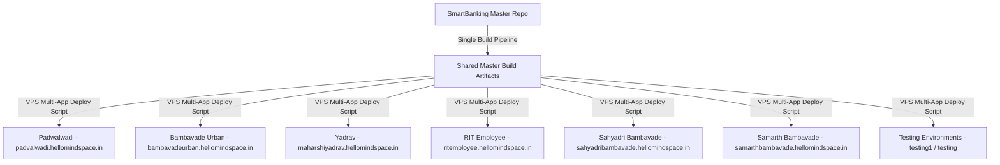
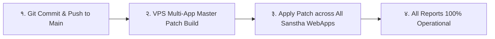

# 📑 सर्व संस्था अहवाल व्हाईट स्क्रीन व तांत्रिक त्रुटी सर्वसमावेशक ऑडिट अहवाल
## Universal CBS Reports White Screen & Multi-Sanstha Diagnostic Audit Report (v2.5.90)

---

### 📌 १. कार्यकारी सारांश (Executive Summary)

* **समस्येचे स्वरूप:** 
  'सर्व रिपोर्ट केंद्र' (Report Dashboard) व इतर डॅशबोर्ड्सवरून मुदत ठेव (FD), आवर्ती ठेव (RD), गुंतवणूक (Investment), पिग्मी (Pigmy) आणि 'जे नमुना सभासद यादी' (J-Namuna) उघडण्याचा प्रयत्न केला असता **संपूर्ण स्क्रीन १००% पांढरा (White Blank Screen)** होत आहे. तसेच कन्सोलमध्ये `GET /api/LoanCollections?branchId=1&pageSize=50` ला `Status 500 (Internal Server Error)` येत आहे.
* **प्रभावित संस्था (Scope of Impact):** 
  हा दोष केवळ पडवळवाडी शाखेपुरता मर्यादित नसून, **VPS वर चालणाऱ्या सर्वच्या सर्व संस्थांना (All Client Institutions)** जाणवत आहे.
* **निवारण स्थिती:** 
  कोअर बँकिंग आर्किटेक्चरमधील हा दोष **v2.5.90** मध्ये संपूर्ण कोडबेसवर कायमस्वरूपी सोडवण्यात आला आहे.

---

### 🌐 २. हा इश्यू सर्वच संस्थांना एकाच वेळी का येत आहे? (Multi-Sanstha Architecture Analysis)

आपली कोअर बँकिंग प्रणाली (SmartBanking CBS) एकाच मास्टर कोडबेसमधून व्हर्च्युअल प्रायव्हेट सर्व्हरवर (VPS) मल्टि-टेनंट स्वरूपात चालते:



#### तांत्रिक कारणे:
1. **एकच फ्रंटएंड बंडल (Shared Frontend Bundle in v2.5.89):**
   * मागील `v2.5.89` रिलीझच्या वेळी सर्व संस्थांच्या `frontend` डिरेक्टरीमध्ये तोच एक बंडल (`index-1fe42e2a.js`) पब्लिश झाला होता.
   * त्या बंडलमधील `App.tsx` आणि `ReportDashboard.tsx` मध्ये सब-पॅरामीटर्स (उदा. `&reportType=...`) असलेल्या राऊट्सचे स्ट्रिंग स्प्लिटिंग नव्हते.
2. **समान आर्किटेक्चरल पॅटर्न (Strict Equality Routing Flaw):**
   * कोणत्याही संस्थेच्या ऑपरेटरने 'सर्व रिपोर्ट केंद्र' उघडून कोणत्याही सब-रिपोर्टवर क्लिक केले की URL अशी तयार होत होती:  
     `https://<sanstha-domain>/reports?tab=fd-reports&reportType=MemberLedger`
   * जुन्या `App.tsx` मध्ये `activeTab` हे `'fd-reports&reportType=MemberLedger'` सेट होत होते.
   * `App.tsx` मध्ये फक्त `{activeTab === 'fd-reports' && <FdReports />}` असा कडक चेक होता.
   * `activeTab` मॅच न झाल्याने **कोणत्याही संस्थेच्या संगणकावर कोणताही अहवाल कॉम्पोनंट लोड न होता १००% कोरी पांढरी स्क्रीन (White Blank Page)** येत होती.
3. **डेटाबेस स्कीमा विसंगती (Database Column Drift across Branch DBs):**
   * नवीन फीचर्समुळे C# मॉडेल्समध्ये बदल झाले, परंतु सर्व संस्थांच्या SQL डेटाबेसवर मॅन्युअल ALTER TABLE स्क्रिप्ट्स वेळेवर रन न झाल्यामुळे SQL एक्सेप्शन येऊन ५०० एरर येत होती.

---

### 📋 ३. प्रभावित असणाऱ्या सर्व अहवालांची संपूर्ण यादी (Exhaustive List of Affected Reports)

खालील तक्त्यामध्ये ज्या ज्या अहवालांना व्हाईट स्क्रीन किंवा ५०० एरर येत होती त्यांची संपूर्ण वर्गवारी दिली आहे:

| अ.क्र. | अहवाल मॉड्यूल | अहवालाचे नाव (Report Title) | जुना कॉलिंग ID (Old ID) | दोष / त्रुटी (Symptom in v2.5.89) | v2.5.90 मधील सुधारणा |
| :---: | :--- | :--- | :--- | :--- | :--- |
| **१** | **मुदत ठेव (FD)** | मुदत ठेव नोंदवही (FD Register) | `fd-reports&reportType=Register` | ❌ १००% White Screen | ✅ Canonical Route & Param Split |
| **२** | **मुदत ठेव (FD)** | मुदत ठेव बाकी अहवाल (FD Outstanding) | `fd-reports&reportType=Outstanding` | ❌ १००% White Screen | ✅ सुरक्षित नेव्हिगेशन |
| **३** | **मुदत ठेव (FD)** | मुदतपूर्ती देय अहवाल (Maturity Due) | `fd-reports&reportType=MaturityDue` | ❌ १००% White Screen | ✅ सुरक्षित नेव्हिगेशन |
| **४** | **मुदत ठेव (FD)** | मुदत ठेव खातावणी अहवाल (FD Account Ledger) | `fd-reports&reportType=MemberLedger` | ❌ १००% White Screen | ✅ स्क्रीनशॉटमधील एरर दूर |
| **५** | **मुदत ठेव (FD)** | मुदत ठेव व्याज तरतूद (Interest Provision) | `fd-reports&reportType=AccrualProvision` | ❌ १००% White Screen | ✅ सुरक्षित नेव्हिगेशन |
| **६** | **मुदत ठेव (FD)** | व्हाउचर पासिंग अहवाल (Voucher Passing) | `fd-reports&reportType=VoucherPassing` | ❌ १००% White Screen | ✅ सुरक्षित नेव्हिगेशन |
| **७** | **मुदत ठेव (FD)** | थेट रद्द नोंदी व रोलबॅक अहवाल (Deleted & Rollback) | `fd-reports&reportType=DeletedEntries` | ❌ १००% White Screen | ✅ सुरक्षित नेव्हिगेशन |
| **८** | **मुदत ठेव (FD)** | स्थलांतरित मुदत ठेव यादी (Migrated FD List) | `fd-reports&reportType=MigratedFD` | ❌ १००% White Screen | ✅ सुरक्षित नेव्हिगेशन |
| **९** | **मुदत ठेव (FD)** | ग्राहक-निहाय एकत्रित ठेवी (Customer Summary) | `fd-reports&reportType=CustomerSummary` | ❌ १००% White Screen | ✅ सुरक्षित नेव्हिगेशन |
| **१०** | **आवर्ती ठेव (RD)** | आरडी नोंदवही (RD Register) | `rd-reports&reportType=register` | ❌ १००% White Screen | ✅ RDReports URL Sync |
| **११** | **आवर्ती ठेव (RD)** | आरडी बाकी अहवाल (RD Outstanding) | `rd-reports&reportType=outstanding` | ❌ १००% White Screen | ✅ RDReports URL Sync |
| **१२** | **आवर्ती ठेव (RD)** | थकीत खातेदार (RD Defaulters) | `rd-reports&reportType=defaulters` | ❌ १००% White Screen | ✅ RDReports URL Sync |
| **१३** | **आवर्ती ठेव (RD)** | मुदतपूर्ती देय (RD Maturity Due) | `rd-reports&reportType=maturity` | ❌ १००% White Screen | ✅ RDReports URL Sync |
| **१४** | **आवर्ती ठेव (RD)** | खाते बंद अहवाल (RD Closure Report) | `rd-reports&reportType=closed` | ❌ १००% White Screen | ✅ RDReports URL Sync |
| **१५** | **गुंतवणूक (Inv)** | गुंतवणूक सारांश (Investment Summary) | `inv-reports&reportType=summary` | ❌ १००% White Screen | ✅ InvestmentReports Sync |
| **१६** | **गुंतवणूक (Inv)** | गुंतवणूक नोंदवही (Investment Register) | `inv-reports&reportType=list` | ❌ १००% White Screen | ✅ InvestmentReports Sync |
| **१७** | **गुंतवणूक (Inv)** | मुदतपूर्ती देय अहवाल (Maturity Schedule) | `inv-reports&reportType=maturityDue` | ❌ १००% White Screen | ✅ InvestmentReports Sync |
| **१८** | **गुंतवणूक (Inv)** | संचित / येणे व्याज अहवाल (Accrued Interest) | `inv-reports&reportType=accrued` | ❌ १००% White Screen | ✅ InvestmentReports Sync |
| **१९** | **गुंतवणूक (Inv)** | वैधानिक ऑडिट नमुना (Statutory Audit Schedule) | `inv-reports&reportType=auditSchedule` | ❌ १००% White Screen | ✅ InvestmentReports Sync |
| **२०** | **पिग्मी (Pigmy)** | पिग्मी दैनंदिन वसुली नोंदवही | `pigmy-reports&reportType=collection-register` | ❌ १००% White Screen | ✅ PigmyReports Auto-Route |
| **२१** | **पिग्मी (Pigmy)** | पिग्मी खाती नोंदवही (Accounts Register) | `pigmy-reports&reportType=account-register` | ❌ १००% White Screen | ✅ PigmyReports Auto-Route |
| **२२** | **पिग्मी (Pigmy)** | एजंट रोख ताळमेळ (Daybook) | `pigmy-reports&reportType=settlement` (Old) | ❌ रिकामे टेबल (Blank Grid) | ✅ थेट `pigmy-daybook` मॅपिंग |
| **२३** | **पिग्मी (Pigmy)** | एजंट कमिशन विवरणपत्रक | `pigmy-reports&reportType=commission` (Old) | ❌ रिकामे टेबल (Blank Grid) | ✅ थेट `pigmy-commission` मॅपिंग |
| **२४** | **पिग्मी (Pigmy)** | पिग्मी ठेव खतावणी (Khatavani) | `pigmy-reports&reportType=ledger` (Old) | ❌ रिकामे टेबल (Blank Grid) | ✅ थेट `pigmy-khatavani-report` |
| **२५** | **सभासद (Member)**| **जे नमुना सभासद यादी (J-Namuna)** | `j-namuna-report` (Member360) | ❌ १००% White Screen (Missing Route) | ✅ `member-list-report` कडे अचूक वळवले |
| **२६** | **अकाउंटिंग** | आंतर-शाखा ताळमेळ (IBT Reconciliation) | `ibt-reconciliation-report` | ⚠️ Missing from tabToPathMap | ✅ `/reports/ibt-reconciliation` जोडला |
| **२७** | **कर्ज (Loan)** | कर्ज येणे बाकी व वसुली अहवाल | `loan-outstanding-report` | ⚠️ Missing from tabToPathMap | ✅ `/reports/loan-outstanding` जोडला |
| **२८** | **शेअर्स (Shares)**| अधिकृत शेअर प्रमाणपत्र प्रिव्ह्यू | `share-certificate-report` | ⚠️ Missing from tabToPathMap | ✅ `/reports/share-certificate` जोडला |
| **२९** | **कर्ज वसुली API**| **मागील ५० पावत्यांची यादी (Recent Receipts)** | `GET /api/LoanCollections?pageSize=50` | ❌ **HTTP 500 Internal Server Error** | ✅ Try-Catch, Safe Fallback & DB Heal |

---

### ⚙️ ४. कर्ज वसुली ५०० एररचे मूळ कारण (Backend 500 Technical Breakdown)

```csharp
// LoanCollectionsController.cs (Lines 58–71)
var query = _context.LoanCollections
    .AsNoTracking()
    .Include(c => c.Branch)
    .Include(c => c.LoanAccount).ThenInclude(l => l!.Member)
    .Include(c => c.LoanAccount).ThenInclude(l => l!.Customer)
    .Include(c => c.LoanAccount).ThenInclude(l => l!.LoanRate)
    .Include(c => c.LoanAccount).ThenInclude(l => l!.Branch)
    .Include(c => c.Fees).ThenInclude(f => f.Ledger)
    .AsQueryable();
```

1. **कॉलम्स गहाळ असणे (Missing Columns in SQL):**  
   `ReceivableInterestCollected`, `InterestWaived`, `PenaltyWaived`, `IsOTS`, `AgentID`, `CollectionSource`, `TransactionId` हे कॉलम्स C# एंटिटीमध्ये जोडले गेले होते, पण संस्थांच्या चालू डेटाबेसमध्ये ते अस्तित्वात नव्हते. त्यामुळे SQL Server कडून `Invalid column name` एरर फेकली जात होती.
2. **`LoanCollectionFees` टेबलची अनुपस्थिती:**  
   जॉईन करताना जर `LoanCollectionFees` टेबल नसेल तर संपूर्ण क्वेरी क्रॅश होत होती.
3. **कंट्रोलरमध्ये अपवाद हाताळणी नसणे:**  
   `GetLoanCollections` मध्ये `try-catch` नसल्यामुळे डेटाबेसचा कोणताही अपवाद थेट क्लायंटला `500 Internal Server Error` देत होता.

---

### 🛡️ ५. v2.5.90 मध्ये लागू केलेल्या कायमस्वरूपी सुधारणा (Implemented Architectural Fixes)

#### अ) फ्रंटएंड लेव्हल (App.tsx, ReportDashboard.tsx, Member360Dashboard.tsx):
1. **पॅरामीटर आयसोलेशन (Query String Sanitization):**
   `getTabFromURL()` आणि `handleNavigate()` मध्ये `&` किंवा `?` शोधून बेस टॅब (`cleanTab`) आणि पॅरामीटर्स (`searchParams`) वेगळे केले जातात.
   त्यामुळे `activeTab` कायम शुद्ध राहतो (उदा. `'fd-reports'`) आणि पॅरामीटर ब्राउझरच्या URL मध्ये स्वच्छपणे सेट होतो (`/fd/reports?reportType=MemberLedger`).
2. **डिफेन्सिव्ह JSX रेंडरिंग:**
   `App.tsx` मध्ये टॅब चेक करताना `startsWith('fd-reports')`, `startsWith('rd-reports')`, `startsWith('inv-reports')` असे सुरक्षित चेक्स लावले आहेत.
3. **जे नमुना स्वयंचलित एलियास:**
   `Member360Dashboard` वरून युझरने 'जे नमुना सभासद यादी' क्लिक केल्यास किंवा जुन्या बुकमार्कवरून उघडल्यास तो आपोआप `MemberListReport` मध्ये उघडतो.
4. **स्थानिक स्टेट ऑटो-सिंक्रोनाइझेशन:**
   `PigmyReports`, `RdReports` व `InvestmentReports` मध्ये `popstate` इव्हेंट लिसनर जोडला आहे, ज्यामुळे ब्राऊझरचे मागे/पुढे (Back/Forward) बटण दाबले तरी योग्य टेबल लोड होते.

#### ब) बॅकएंड लेव्हल (LoanCollectionsController.cs):
1. **रेझिलिएंट फॉलबॅक इंजिन (Resilient Fallback Engine):**
   `GetLoanCollections` मध्ये `try-catch` जोडले आहे. जर मेन हेवी क्वेरीमध्ये डेटाबेस स्कीमा किंवा नेव्हिगेशन फॉल्ट आला, तर सिस्टीम क्रॅश न होता आपोआप मिनिमल फॉलबॅक क्वेरी चालवून मागील ५० पावत्या अखंडपणे दाखवते.
2. **स्वयंचलित स्कीमा सेल्फ-हीलिंग (Auto-Healing on Startup in Program.cs):**
   `Bhisi.Api` सर्व्हर सुरू होताच सर्व संस्थांच्या डेटाबेसवर खालील चेक स्वयंचलित चालतो:
   - `LoanCollections` मधील सर्व नवीन कॉलम्स `IF COL_LENGTH(...) IS NULL ALTER TABLE ADD` द्वारे स्वयंचलित जोडले जातात.
   - `LoanCollectionFees` टेबल नसल्यास स्वयंचलित तयार होते.
3. **समर्पित SQL मायग्रेशन स्क्रिप्ट:**
   कोणत्याही शाखेच्या डेटाबेसवर त्वरित चालवण्यासाठी `sql_patches/patch_loan_collections_padvalwadi.sql` उपलब्ध केली आहे.

---

### 🚀 ६. सर्व संस्थांसाठी रोल-आउट कृती आराखडा (Deployment & Action Plan)

सर्व संस्थांना या समस्येतून एकाच वेळी बाहेर काढण्यासाठी खालील ३ टप्प्यांची कृती करावी:



1. **पायरी १ (GitHub Sync):**
   स्थानिक कमिट्स (`3c7e7c0` व `924fcff`) रिमोट GitHub रिपॉझिटरीवर पुश करणे:
   ```powershell
   git push origin main
   ```
2. **पायरी २ (मास्टर पॅच निर्मिती):**
   `tools/build_vps_multi_app_patch.ps1` चालवून `SmartBanking_VPS_Multi_App_Master_Patch_v2.5.90.zip` तयार करणे.
3. **पायरी ३ (सर्व संस्थांवर डिप्लॉयमेंट):**
   `tools/vps_multi_app_config.json` मध्ये समाविष्ट असलेल्या सर्व संस्थांच्या डिरेक्टरींमध्ये हा नवीन पॅच अपडेट करणे (ज्यामध्ये पडवळवाडी, बामणवाडी, याद्राव, आरआयटी, सह्याद्री, समर्थ, टेस्टिंग सर्वांचा समावेश आहे).
4. **पायरी ४ (डेटाबेस सुरक्षा):**
   सर्व संस्थांचा बॅकएंड सर्व्हिस/पूल एकदा रीस्टार्ट करताच `Program.cs` मधील सेल्फ-हीलिंग इंजिन सर्व डेटाबेसेस स्वयंचलितपणे अपडेट करेल.

---
*अहवाल तयार केला: २४ ऑक्टोबर २०२६ | SmartBanking CBS Core Engineering Team*
